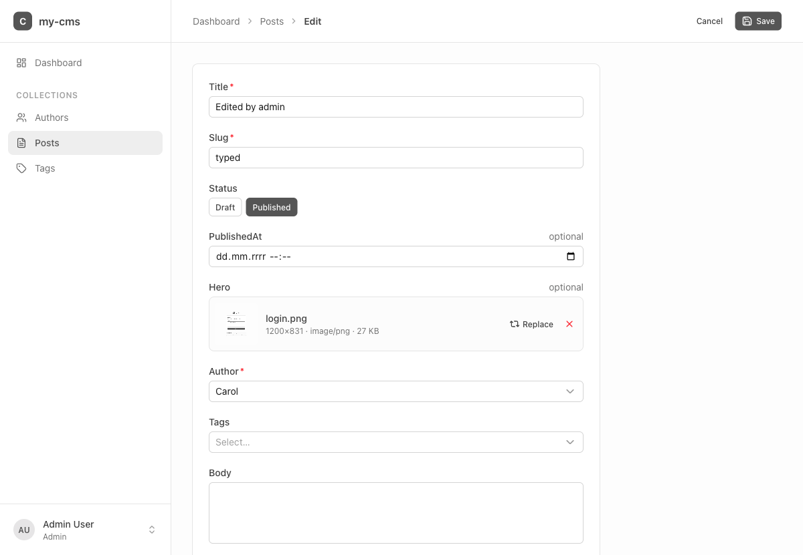
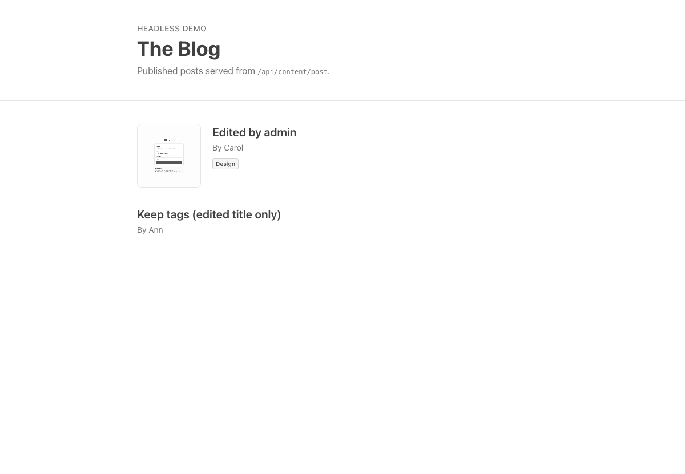
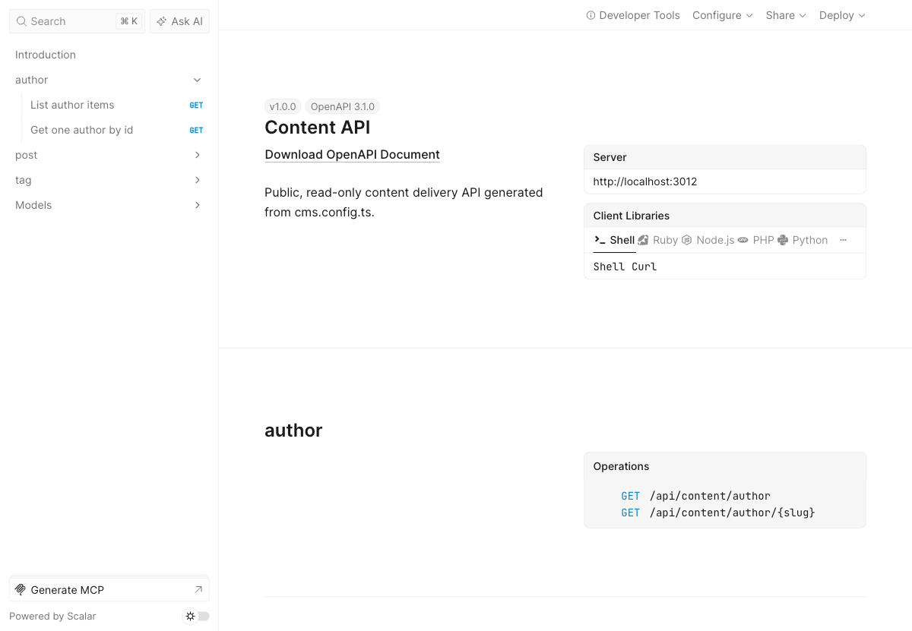

# my-cms

A **code-first, distributable CMS for Nuxt 4**, shipped as a single Nuxt **Layer + Module**
(`@my-cms/core`). You define content entities once in TypeScript; the package derives the
database schema, validation, a typed CRUD API, and an auto-generated admin dashboard. Your
clients edit **data** through the dashboard — never the UI or the structure.

> Philosophy: structure is a developer concern, owned in git (like Payload/Sanity). There is
> **no runtime schema editor** — that's the differentiator, not a limitation.

## Status — MVP vertical slice (working, verified end-to-end)

One entity definition flows all the way through, proven against a real Postgres:

```
cms.config.ts  ──▶  db/schema.ts  ──▶  drizzle-kit SQL  ──▶  Postgres
   (defineEntity)      (emitted)         (migration)
        │
        └─▶ #cms graph ──▶ generic Nitro CRUD ──▶ auto /admin (list + form)
```

Verified: enum (`pgEnum`), unique constraints, nullable/non-null FKs with correct `ON DELETE`,
m2m junction tables, m2o label population, m2m junction diff-writes, richtext (jsonb), Zod 422
validation, and correct PATCH semantics (omitted fields preserved, defaults don't fire on update).

Plus: real auth (nuxt-auth-utils), route-protected dashboard, role + **row-level** access
enforcement, a polished sidebar shell, list search/sort/pagination, dark mode,
**media upload** (pluggable `StorageDriver`: local + S3/R2) with image previews, a
**TipTap** rich-text editor, a **host-overridable field/view registry**, and a public
**headless content API** for your frontends.


## Architecture

| Piece | What it does |
|---|---|
| `f.*` field factories | each returns a `FieldDescriptor` carrying a **column IR**, a Zod validator, a default, and a UI renderer name |
| `defineEntity(name, def)` | builds the live Drizzle `pgTable` (the type-inference anchor) + Zod create/update schemas |
| `buildRegistry(config)` | two-phase: resolves relation thunks, creates m2m junctions, builds the serializable UI graph |
| `emitSchema(config)` | serializes the **same IR** to `db/schema.ts` source → **one IR, two sinks, zero drift** |
| `cms` CLI | `generate` (emit schema + `drizzle-kit generate`) / `up` (`drizzle-kit migrate`) |
| Nuxt module | aliases `#cms/config`, wires runtimeConfig; the layer ships `/admin` + `Cms*` + server API |
| generic CRUD | one handler set dispatching by entity; relations, m2m diff-writes, populated labels |

### The single source of truth (`playground/cms.config.ts`)

```ts
export const Post = defineEntity('post', {
  label: 'Posts', titleField: 'title',
  admin: { list: { columns: ['title', 'status', 'author', 'publishedAt'] } },
  fields: {
    title:  f.text({ required: true }),
    slug:   f.slug({ from: 'title', unique: true }),
    status: f.select({ options: ['draft', 'published'] as const, default: 'draft' }),
    hero:   f.media({ accept: 'image/*' }).optional(),
    author: f.relation({ to: () => Author, kind: 'many-to-one', required: true }),
    tags:   f.relation({ to: () => Tag, kind: 'many-to-many' }),
    body:   f.richtext(),
  },
})
```

Entities are **precisely typed with no annotations** — the data shapes are inferred:

```ts
import type { Row, Insert } from "@my-cms/core"

type PostRow = Row<typeof Post>
//   { id: string; title: string; status: 'draft' | 'published';
//     publishedAt: Date | null; heroId: string | null; authorId: string;
//     body: RichTextDoc; createdAt: Date; updatedAt: Date }

type NewPost = Insert<typeof Post>
//   author + title + slug + body required; status/tags/publishedAt/hero optional
```

## Repository layout

```
packages/cms/          @my-cms/core — the Layer + Module
  src/                 field engine, defineEntity, registry, emitters (schema / openapi / sdk)
  cli/                 cms generate|up|client|openapi (wraps drizzle-kit + codegen)
  module.ts            build-time wiring (#cms/config alias, runtimeConfig)
  nuxt.config.ts       layer root
  server/              generic CRUD + content API + drizzle DataSource (useCms)
  app/                 /admin pages + CmsField renderer
packages/client/       @my-cms/client — tiny strictly-typed content-API client (publishable)
playground/            demo host app: `extends: ['../packages/cms']`
  cms.config.ts        Post + Author + Tag (the source of truth)
  app/lib/             generated cms-content.ts (typed client bindings)
  server/db/           generated schema.ts + migrations
```

## Run it

```bash
pnpm install

# 1. start Postgres (any Postgres works; this is the local demo DB on :5434)
docker run -d --name my-cms-pg -e POSTGRES_USER=cms -e POSTGRES_PASSWORD=cms \
  -e POSTGRES_DB=cms -p 5434:5432 postgres:16-alpine

# 2. emit schema.ts from cms.config.ts and generate the SQL migration
pnpm db:generate

# 3. apply the migration
pnpm db:migrate

# 4. run the playground → http://localhost:3000/admin
pnpm play
```

`DATABASE_URL` is read from `playground/.env`. Edit `playground/cms.config.ts`, re-run
`pnpm db:generate` (review the SQL!) and `pnpm db:migrate`, and the dashboard updates itself.

## Decisions locked in this MVP

- **Stack:** Nuxt 4, Tailwind 4, Nuxt UI v4, Zod 4, Drizzle (Postgres dialect).
- **Dual-runtime:** runs on a Node server **or** Cloudflare Workers — see below. The Postgres
  dialect is identical for both; runtime-specific code is isolated to the DB + storage seams. D1/SQLite deferred.
- `select` → native `pgEnum`; rich text → `jsonb` (TipTap doc); ids → `uuid`; media → `cms_media` FK.

## Theming (host-owned)

The CMS components use semantic Nuxt UI classes (`bg-primary`, `text-muted`, …), so the
host re-skins the whole admin from its own `app.config.ts` + `main.css` — no package edits.
The playground ships a monochrome theme: `primary` is a custom `ink` ramp anchored at `#555`
(defined via `@theme` in `main.css`), `neutral` is a true-neutral gray.

## Extensibility — the field & view registry

Every field renders through a tiny dispatcher (`CmsField` for the edit form,
`CmsCell` for list cells) that resolves a component **by name** with this precedence:

```
app.config  cms.fields[type].edit   (host override, by field type)
  → field.ui.edit                   (built-in default, from the descriptor)
    → CmsFieldText                   (fallback)
```

So a host adds or replaces a renderer **without touching the package** — ship a
component and register its name:

```ts
// app.config.ts
export default defineAppConfig({
  cms: { fields: { select: { edit: 'MySegmentedSelect' }, color: { edit: 'ColorPicker', cell: 'ColorSwatch' } } },
})
```

```vue
<!-- components/global/MySegmentedSelect.vue  (props: { field }, v-model) -->
```

> Custom renderers must be **globally registered** (put them in `components/global/`
> or use the `.global.vue` suffix) — the registry resolves them at runtime, and
> `resolveComponent` only sees globals. The playground does exactly this in
> `app/components/global/PgStatusSelect.vue`, rendering the post status as a
> segmented control instead of the default dropdown.



Built-in renderers live in `packages/cms/app/components` (`CmsField*` / `CmsCell*`),
one small component per type — each independently overridable.

## Media upload

`f.media({ accept })` is now a working pipeline, not just an FK column:

```
file → POST /api/cms/_media → StorageDriver.put → cms_media row → FK on the entity
                                     │
                       GET /api/cms/_media/raw/** (public, served by LocalDriver)
```

- **`StorageDriver`** seam (`server/utils/cmsStorage.ts`): `LocalDriver` writes to disk and
  serves through a Nitro route; `S3Driver` targets any S3-compatible store (AWS S3,
  Cloudflare R2, MinIO). Selected via `cms.storage.driver`; size cap via `cms.storage.maxSizeMb`.
- Upload widget with thumbnail preview, replace/remove, and list-cell thumbnails.
- **Image dimensions** captured on upload (`width`/`height` via `image-size`) and used
  for intrinsic sizing + lazy loading in the admin.
- **Lifecycle / GC:** blobs are reference-counted across every media field — replacing or
  clearing a media field, or deleting its owning row, removes the now-orphan row **and** blob.
  `DELETE /api/cms/_media/:id` removes a specific media (409 if still referenced).
- **Limits:** per-file `cms.storage.maxSizeMb`, per-user `maxBytesPerUser` quota (0 = off),
  and `uploadRatePerMin` rate-limit (default 60; in-memory, single-instance).
- **Hardened:** strict server-side MIME allowlist (no SVG/HTML → no stored-XSS),
  `nosniff` + `Content-Security-Policy: sandbox` on served blobs, path-traversal guards,
  and a `Content-Length` ceiling on `/api/cms/**` before any body is buffered.

### S3 / Cloudflare R2

The S3 driver signs requests with SigV4 via [`aws4fetch`](https://github.com/mhart/aws4fetch)
(`fetch` + Web Crypto), so it runs unchanged on Node **and** Cloudflare Workers. Objects are
served straight from a public bucket / CDN URL (`publicBaseUrl`), never proxied through the app.

Configure with env vars (secrets stay server-side — never commit them):

```bash
NUXT_CMS_STORAGE_DRIVER=r2                 # or 's3'
NUXT_CMS_STORAGE_S3_ENDPOINT=https://<account>.r2.cloudflarestorage.com
NUXT_CMS_STORAGE_S3_REGION=auto            # 'auto' for R2; e.g. 'us-east-1' for AWS
NUXT_CMS_STORAGE_S3_BUCKET=my-bucket
NUXT_CMS_STORAGE_S3_ACCESS_KEY_ID=...
NUXT_CMS_STORAGE_S3_SECRET_ACCESS_KEY=...
NUXT_CMS_STORAGE_S3_PUBLIC_BASE_URL=https://cdn.example.com   # public bucket / custom domain
```

Verified end-to-end against MinIO (an S3-compatible store you can run locally):

```bash
docker network create cms-net
docker run -d --name my-cms-minio --network cms-net -p 9000:9000 -p 9001:9001 \
  -e MINIO_ROOT_USER=minio -e MINIO_ROOT_PASSWORD=minio12345 \
  minio/minio server /data --console-address ":9001"
# create a public-read bucket
docker run --rm --network cms-net --entrypoint /bin/sh minio/mc -c \
  'mc alias set m http://my-cms-minio:9000 minio minio12345 && \
   mc mb -p m/cms-media && mc anonymous set download m/cms-media'
# then run the playground with NUXT_CMS_STORAGE_DRIVER=s3, ENDPOINT=http://localhost:9000, etc.
```

### Rendering media on your frontend

`@nuxt/image` is a **host/frontend** concern, not baked into the layer (it would force the
dependency + a provider config on every host, and the right provider differs by storage
backend). Each `cms_media` row exposes everything an image component needs — `url`, `width`,
`height`, `mime`, `alt` — so on your site you wire it to your chosen provider:

```vue
<NuxtImg :src="post.hero.url" :width="post.hero.width" :height="post.hero.height"
         :alt="post.hero.alt" sizes="sm:100vw md:50vw" />
```

Point `@nuxt/image` at an `ipx`/CDN provider for the `local` driver, or your R2/S3 public
domain for the cloud driver.

## Headless content API

A separate, **public, read-only** delivery API for your frontends — distinct from the
auth-gated admin API. Entities opt in from `cms.config.ts`:

```ts
export const Post = defineEntity('post', {
  /* …fields… */
  content: {
    public: true,
    published: (t) => eq(t.status, 'published'), // only these are served
    slug: 'slug',                                //  → GET /api/content/post/:slug
    populate: ['hero', 'author', 'tags'],        // resolved into the response
  },
})
export const Author = defineEntity('author', {
  /* … */ content: { public: true, hidden: ['email'] }, // never expose email
})
```

```
GET /api/content/:entity         # published list — ?page= ?limit= ?sort= ?dir= ?q= ?<field>=
GET /api/content/:entity/:slug   # single published item by slug (or id)
```

Responses resolve relations + media into nested objects, drop raw FK ids, and omit
`hidden` fields — on the item **and** on populated relations (a non-public relation target
collapses to `{ id, title }`). Drafts are never served (list excludes them; single → 404).
Responses are CDN-cacheable (`Cache-Control`), or lock the whole API behind a token with
`cms.content.token` / `NUXT_CMS_CONTENT_TOKEN`.

Render stored rich text on the frontend with the shipped `<CmsContent :doc="post.body" />`
(safe — builds VNodes from the structured doc, no `v-html`). The playground's `/blog` and
`/blog/[slug]` pages are a complete consumer demo.




## Typed clients & OpenAPI

Two ways for a **separate** frontend (any framework, its own repo — no shared monorepo)
to consume the content API with full types. Both are generated from `cms.config.ts` via a
single IR (`content-shape.ts`) that mirrors the runtime projection exactly, so the types
**cannot drift** from what the API actually returns. Hidden fields (e.g. `author.email`)
never appear; nullability, enums and populated-relation shapes are all precise.

**OpenAPI 3.1 — any language.** A spec with a concrete path per public collection:

```
GET /api/openapi.json    # the document
GET /api/openapi         # interactive reference (Scalar)
```
```bash
npx openapi-typescript https://cms.example.com/api/openapi.json -o cms.d.ts
```

**Typed TS SDK — `@my-cms/client`.** A ~2 kB, dependency-free, strictly-typed client.
Generate the bindings, install the runtime, go:

```bash
pnpm cms:client                                              # writes app/lib/cms-content.ts
# …or from anywhere with API access:
curl https://cms.example.com/api/content-types.ts -o src/cms-content.ts
npm i @my-cms/client
```
```ts
import { createClient } from './cms-content'
const cms = createClient({ baseUrl: 'https://cms.example.com', token: process.env.CMS_TOKEN })

const { items } = await cms.post.list({ filter: { status: 'published' }, sort: 'publishedAt', dir: 'desc' })
//      ^? Post[] — items[0].author.name, .hero?.url, .tags[0].slug are all typed
const post = await cms.post.get('hello-world') // Post, or throws CmsError on 404
```

Per-collection sort keys, filters and enum values are type-checked; an invalid sort key or
filter value is a compile error. Set `cms.content.publicUrl` to stamp the spec's `servers`
URL (it stays relative otherwise — the request Host is never reflected). The playground's
`/blog/typed` page is a working consumer.



## Dual runtime — Node or Cloudflare Workers

The same code runs on a Node server or on Cloudflare Workers; the two runtime-specific
seams are selected by config:

- **Database** — `cms.db.driver` picks the driver at **build time**, so only its deps land
  in the bundle:
  - `'node'` (default) → node-postgres (`pg`).
  - `'edge'` → Neon serverless over WebSocket — supports the interactive transactions the
    CRUD layer uses (unlike neon-http). Point it at Neon, or Postgres behind Cloudflare Hyperdrive.
- **Storage** — use the `s3` / `r2` `StorageDriver` (the `local` filesystem driver has no place
  on Workers; its `node:fs` is lazy-loaded so it never breaks an edge bundle).

```bash
# build for Workers with the edge DB driver (env override of cms.db.driver)
CMS_DB_DRIVER=edge NITRO_PRESET=cloudflare_module pnpm --filter playground build
npx wrangler deploy .output/server/index.mjs --assets .output/public
```

Set runtime secrets as Worker vars: `NUXT_CMS_DATABASE_URL` (Neon/Hyperdrive),
`NUXT_SESSION_PASSWORD`, `NUXT_CMS_STORAGE_DRIVER=r2` + the `NUXT_CMS_STORAGE_S3_*` R2 creds.

> **Verified:** the playground builds cleanly for `cloudflare_module` with the edge driver
> (`pg` excluded from the bundle, Neon included). A *live* deploy needs your own Cloudflare
> account + a Neon/Hyperdrive DB. Note: the in-memory upload rate-limiter doesn't coordinate
> across isolates — back it with KV / a Durable Object for multi-isolate production.

## Not yet built (next slices, in rough order)

- **Draft preview** (tokened access to unpublished content) and on-publish **webhooks** / ISR revalidation
- **Streaming multipart parser** (bound chunked uploads that omit `Content-Length`) and a
  shared-store rate-limiter/quota for multi-instance / Workers deploys (today: in-memory)
- A media **library browser** (reuse an existing upload instead of re-uploading)
- **Per-field permissions** (`fieldMode`) + a roles-management UI. (Auth is real — nuxt-auth-utils; entity- and row-level `access` is enforced server-side. The package reads `event.context.cmsUser`, which the host sets — see `playground/server/middleware/cms-session.ts`.)
- **`blocks`** page-builder field (the `f.json` hook already reserves the path)
- Golden-file tests for descriptor→DDL; precise `table` *value*-typing in `eq()` (columns are typed `PgColumn` today — key autocomplete works, value side is loose)
- A *live* Cloudflare deploy recipe (wrangler config + Hyperdrive binding); publish pipeline
  (changesets); package-name layer resolution
