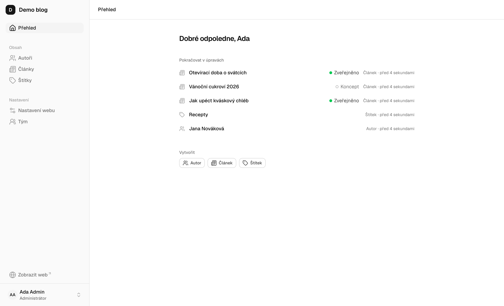
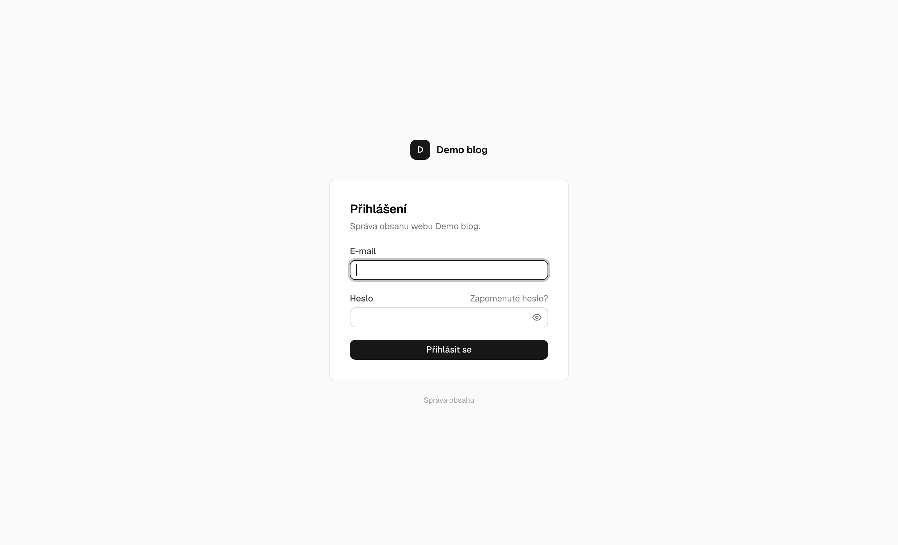
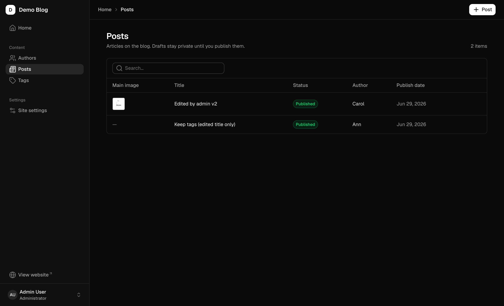
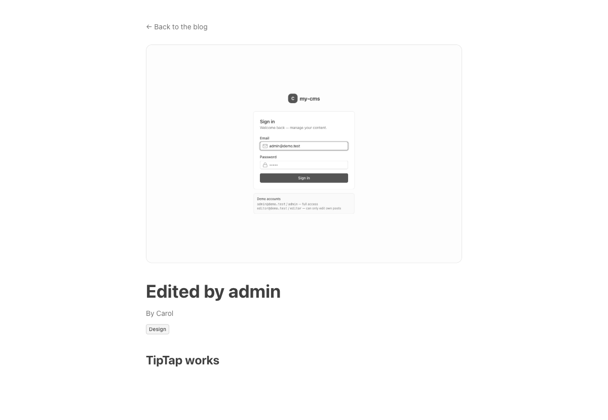

<p></p>

*A tiny CMS that lives inside your Nuxt app.*

A **code-first, distributable CMS for Nuxt 4**, shipped as a single Nuxt **Layer + Module**
(`tinyzoo`, with the typed content client `@tinyzoo/client`). You define content entities once in TypeScript; the package derives the
database schema, validation, a typed CRUD API, and an auto-generated admin dashboard. Your
clients edit **data** through the dashboard — never the UI or the structure.

The name is always **tinyzoo** — one word, lowercase. Brand guide, logo and the animal
characters: [`docs/brand/`](docs/brand/brand-guide.md). Inside the code the CMS keeps its
`cms` namespace (`cms.config.ts`, `NUXT_CMS_*`, `cms_*` tables, `Cms*` components).

> Philosophy: structure is a developer concern, owned in git (like Payload/Sanity). There is
> **no runtime schema editor** — that's the differentiator, not a limitation.

## Status — MVP vertical slice (working, verified end-to-end)

One entity definition flows all the way through, proven against a real Postgres:

```
cms.config.ts  ──▶  db/schema.ts  ──▶  drizzle-kit SQL  ──▶  Postgres
   (defineEntity)      (emitted)         (migration)
        │
        └─▶ #cms graph ──▶ generic Nitro CRUD ──▶ auto /admin (list + form)
```

Verified: enum (`pgEnum`), unique constraints, nullable/non-null FKs with correct `ON DELETE`,
m2m junction tables, m2o label population, m2m junction diff-writes, richtext (jsonb), Zod 422
validation, and correct PATCH semantics (omitted fields preserved, defaults don't fire on update).

Plus: built-in accounts (first-run setup, invitations, password reset, admin/editor/author
roles, audit log), entity- and **row-level** access enforcement, a polished sidebar shell, list search/sort/pagination, dark mode,
**media upload** (pluggable `StorageDriver`: local + S3/R2) with image previews, a
**TipTap** rich-text editor, a **host-overridable field/view registry**, and a public
**headless content API** for your frontends.







## Architecture

| Piece | What it does |
|---|---|
| `f.*` field factories | each returns a `FieldDescriptor` carrying a **column IR**, a Zod validator, a default, and a UI renderer name |
| `defineEntity(name, def)` | builds the live Drizzle `pgTable` (the type-inference anchor; SQL name `snake_case(name)`) + Zod create/update schemas |
| `buildRegistry(config)` | two-phase: resolves relation thunks, creates m2m junctions, builds the serializable UI graph |
| `emitSchema(config)` | serializes the **same IR** to `db/schema.ts` source → **one IR, two sinks, zero drift** |
| `tinyzoo` CLI | `generate` (emit schema + `drizzle-kit generate`, stops on migrations that lose data) / `up` (migrations + upgrade steps) / `status` / `upgrade` — see [docs/upgrading.md](docs/upgrading.md) |
| Nuxt module | aliases `#cms/config`, wires runtimeConfig; the layer ships `/admin` + `Cms*` + server API |
| generic CRUD | one handler set dispatching by entity; relations, m2m diff-writes, populated labels |

### The single source of truth (`playground/cms.config.ts`)

```ts
export const Post = defineEntity('post', {
  label: 'Posts', titleField: 'title',
  admin: { list: { columns: ['title', 'status', 'author', 'publishedAt'] } },
  fields: {
    title:  f.text({ required: true }),
    slug:   f.slug({ from: 'title', unique: true }),
    status: f.select({ options: ['draft', 'published'] as const, default: 'draft' }),
    hero:   f.media({ accept: 'image/*' }).optional(),
    author: f.relation({ to: () => Author, kind: 'many-to-one', required: true }),
    tags:   f.relation({ to: () => Tag, kind: 'many-to-many' }),
    body:   f.richtext(),
  },
})
```

Entities are **precisely typed with no annotations** — the data shapes are inferred:

```ts
import type { Row, Insert } from "tinyzoo"

type PostRow = Row<typeof Post>
//   { id: string; title: string; status: 'draft' | 'published';
//     publishedAt: Date | null; heroId: string | null; authorId: string;
//     body: RichTextDoc; createdAt: Date; updatedAt: Date }

type NewPost = Insert<typeof Post>
//   author + title + slug + body required; status/tags/publishedAt/hero optional
```

## Repository layout

```
packages/cms/          tinyzoo — the Layer + Module
  src/                 field engine, defineEntity, registry, emitters (schema / openapi / sdk)
  cli/                 tinyzoo generate|up|status|upgrade|client|openapi|content:migrate (wraps drizzle-kit + codegen)
  module.ts            build-time wiring (#cms/config alias, runtimeConfig)
  nuxt.config.ts       layer root
  server/              generic CRUD + content API + drizzle DataSource (useCms)
  app/                 /admin pages + CmsField renderer
packages/client/       @tinyzoo/client — tiny strictly-typed content-API client (publishable)
playground/            demo host app: `extends: ['../packages/cms']`
  cms.config.ts        Post + Author + Tag (the source of truth)
  app/lib/             generated cms-content.ts (typed client bindings)
  server/db/           generated schema.ts + migrations
compose.yaml           local dev deps: Postgres, + MinIO behind the `s3` profile
```

## Run it

```bash
pnpm install

# 1. start Postgres (any Postgres works; compose.yaml is the local demo DB on :5434)
docker compose up -d

# 2. emit schema.ts from cms.config.ts and generate the SQL migration
pnpm db:generate

# 3. apply the migration
pnpm db:migrate

# 4. run the playground → http://localhost:3000/admin
pnpm play
```

On a fresh database, `/admin` asks you to create the first administrator; invite
everyone else from **Settings → Team**.

`docker compose down` stops it; the data lives in a named volume and survives (use
`down -v` to wipe it). If `:5434` is taken, `CMS_PG_PORT=5455 docker compose up -d` —
then match `DATABASE_URL` in `playground/.env`.

`DATABASE_URL` is read from `playground/.env`. Edit `playground/cms.config.ts`, re-run
`pnpm db:generate` (review the SQL!) and `pnpm db:migrate`, and the dashboard updates itself.
`pnpm db:generate` stops before a migration that drops data (a removed or renamed field);
moving a site to a newer tinyzoo is described in [docs/upgrading.md](docs/upgrading.md).

## Accounts, roles & sign-in

The CMS owns its users (`cms_users`). A fresh install shows **first-run setup** at
`/admin`, which creates the first administrator; everyone else is **invited** from
Settings → Team (email with a one-time link, plus a copyable link if the email gets
lost). People reset forgotten passwords themselves; links expire (invites 7 days,
resets 1 hour) and only a hash of each is stored. In production setup always asks for
a **setup code** — your `NUXT_CMS_AUTH_SETUP_TOKEN`, or one the server prints in its
log (`Setup code: XXXX-XXXX-XXXX-XXXX`) when none is set — so a fresh deploy cannot be
claimed by whoever opens the page first.

| Role | Can |
|---|---|
| Administrator | everything, plus people (invite, change role, disable, remove) |
| Editor | create, edit, publish and delete all content; edit site settings |
| Author | create drafts; edit and delete only what they created; never publish, never touch settings |

An entity's own `access` rules still apply on top (AND-ed). Every request re-reads
the account, so disabling someone, changing their role or changing a password takes
effect immediately, not when a cookie expires. Sign-in is rate-limited, failures look
identical whether or not the address exists, and writes, sign-ins and people changes go
to an audit log (`cms_audit`). Every content row records `createdBy` / `updatedBy`.

Configuration (all overridable by env):

```ts
cms: {
  publicUrl: 'https://cms.example.com',   // NUXT_CMS_PUBLIC_URL — required in production: links in emails use it, never the Host header
  mail: {
    transport: 'smtp',                    // NUXT_CMS_MAIL_TRANSPORT: log (default) | file | smtp (Node only)
    from: 'Pekárna Novák <web@pekarna-novak.cz>',
    smtp: { host: 'smtp.example.com', port: 587, user: '…', pass: '…' }, // NUXT_CMS_MAIL_SMTP_*
  },
  auth: {
    mode: 'builtin',                      // 'external': your app signs people in and sets event.context.cmsUser
    trustedProxies: 1,                    // proxies appending to X-Forwarded-For (rate limits read the client IP behind them)
    ipHeader: '',                         // or a trusted edge header, e.g. 'cf-connecting-ip'
  },
}
```

Sessions last 14 days from sign-in (`runtimeConfig.session.maxAge`). State-changing
requests to `/api/cms/**` must send JSON (multipart only for media uploads) and, when
the browser reports it, come from the same origin — so a form on another page of the
site or a sibling subdomain cannot act as a signed-in editor (CSRF). Rate limits are
in memory per instance today; a shared store for several replicas is planned (Phase 5).

Locally, `docker compose --profile mail up -d` starts Mailpit; set
`NUXT_CMS_MAIL_TRANSPORT=smtp NUXT_CMS_MAIL_SMTP_HOST=localhost NUXT_CMS_MAIL_SMTP_PORT=1025`
and read the emails at http://localhost:8025. Without it, emails are printed to the
server log.


## Pages, blocks & languages

**Blocks** — an ordered list of typed sections editors arrange into a page:

```ts
const hero = defineBlock({
  label: { en: 'Hero', cs: 'Úvod' }, icon: 'i-lucide-panel-top',
  fields: { heading: f.text({ required: true }), image: f.media({ accept: 'image/*' }) },
})
sections: f.blocks({ hero, text, gallery })
```

Each block is validated against its own type; rich text inside is sanitised; media
inside is resolved by the content API and protected by media cleanup. The typed
client gets an exact union per block type. Block fields: text, slug, number,
boolean, datetime, select, rich text, media.

**Changing a block later: `version` and `upgrade`** — stored blocks (and `f.list`
items) outlive the code that wrote them. A renamed field, a removed one or a new
required one would otherwise drop data on the next save or make old entries
unsaveable. When a block's stored shape changes, raise its `version` and say how
to get from the old one to the new:

```ts
const hero = defineBlock({
  label: { en: 'Hero' },
  version: 2,                                   // was 1: `heading` became `title`
  upgrade: ({ heading, ...rest }, from) => ({ ...rest, title: heading }),
  fields: { title: f.text({ required: true }), image: f.media() },
})
// the same on a list: f.list({ version: 2, upgrade, fields: { … } })
```

- `upgrade(data, fromVersion)` turns a block stored at `fromVersion` into
  `fromVersion + 1` and is called once per step (1 → 2, then 2 → 3), so every old
  version only needs its own step. `data` is a copy with `id`, `type` and the
  stored fields; keep `upgrade` pure (it runs on every read of an old block).
- Stored blocks carry `v` (left out at version 1, so existing data needs no
  rewrite). Old ones are brought up to date **wherever they are read**: the content
  API, the admin's form, search, history and restore, translations. Writes always
  store the current version, so nothing has to be run on deploy. A missing `v` on a
  write means "the current version" (what the content API returns has none).
- A forgotten rename is loud, not silent: a block that went through `upgrade` is
  checked strictly against the current fields on save (an unrecognised key is a
  validation error), and in development a stored block with keys the definition
  does not know logs a warning naming the block and the keys.
- An `upgrade` that throws never takes a page down: it is logged once (entity,
  record, block id), the website gets the block as stored, and the admin shows it as
  "could not be brought up to date" with a Remove button.
- **A block whose type was removed from the config** is kept, not fatal: the save
  still goes through and the block stays in the data, the admin shows "This block no
  longer exists (type)" with a Remove button, and the content API and the search
  leave it out. Media inside it is not deleted while it stays.
- `tinyzoo content:migrate [--dry-run] [--batch <n>]` rewrites the stored copies
  (entries, translations and saved versions in `cms_revisions`) to the current
  versions, in batches inside transactions, and reports per entity and field what
  changed and what it could not upgrade (those blocks stay as stored; the command
  exits 1). `--dry-run` only reports. It uses `DATABASE_URL`, does not touch
  `updatedAt`, and can be run again at any time.
- Rich text has the same hook at document level: `richTextUpgrades` (in `tinyzoo`)
  is a list of idempotent steps applied to stored TipTap documents on read and by
  `content:migrate`; empty today, so a future TipTap node rename is one entry.

**Languages** — declare them once, mark what is translatable:

```ts
export const locales = defineLocales({ default: 'cs', locales: ['cs', 'en'] })
title: f.text({ required: true }).localized()
```

Text, URL addresses, rich text and blocks can be `.localized()`. The entry's row
holds the default language; translations live in `<entity>_locales` (the entity name in
snake_case, like every table: `siteSettings` → `site_settings_locales`; typed columns,
URL addresses unique per language) and fall back per field to the default. The
admin edits a translation with the language switcher (default text shown as
reference). The content API takes `?locale=en`, finds items by translated URL
addresses, searches in the language, translates related items, and adds `locale` +
`locales` to each item. Publishing applies to all languages.

**Site presets:**

```ts
export const Page = definePages({ blocks: { hero, text, cta }, localized: true }) // title, address, status, blocks, SEO, preview
export const Navigation = defineNavigation({ localized: true })                  // main + footer menus as lists of links
export const Redirect = defineRedirects()                                         // old address → new, applied to every page request
```

Collections with `content.path` (e.g. `'/blog/:slug'`) appear in **`/sitemap.xml`**
(published only, with `hreflang` alternates; `defineLocales({ prefix })` controls
`/en/…` prefixes) and in `GET /api/content/_sitemap`. A host can replace the XML
route with its own `server/routes/sitemap.xml`.

When the address itself is translated, give one template per language — for
`content.path`, `publish.preview` and `definePages({ path })` alike:

```ts
content: { public: true, slug: 'slug', path: { cs: '/aktuality/:slug', en: '/news/:slug' } }
// → /aktuality/zavod-tabor and /en/news/tabor-race (sitemap, webhooks, preview)
```

A language left out of the map has no page for that collection.

## Admin look & language

The admin has its own design system, scoped so it never touches the host website's
theme: tinyzoo's look — a white workspace, charcoal actions, cream for the brand's
moments (with one of the animals), Manrope titles and Inter text, and a "charcoal
night" dark mode. It works on phones. It speaks Czech and English (cookie → browser
language → default). Brand it per client in `app.config.ts`:

```ts
cms: { admin: {
  name: { cs: 'Pekárna Novák', en: 'Novák Bakery' },
  siteUrl: 'https://pekarna-novak.cz',
  accent: 'mono',              // mono (default) | indigo | blue | violet | emerald
  locales: ['cs', 'en'], defaultLocale: 'cs',
  timeZone: 'Europe/Prague',   // dates are shown and edited in this zone
} }
```

Labels in `cms.config.ts` take one string or one per admin language
(`label: { en: 'Posts', cs: 'Články' }`), and entities can set `icon`,
`labelSingular` and `description`.

Each editor and list is arranged for its content, without configuration: news (a
rich-text body with a page) opens as a calm **writing** column, events and settings as
a **form**, pages built from blocks beside their **live preview**; lists are tables
(with drafts "in progress" on top), picture grids (albums, logos) or **Upcoming / Past**
(events). Override where the guess is wrong:

```ts
defineEntity('event', { /* … */ admin: { editor: 'form', list: { columns: ['title', 'startsAt'], layout: 'table' } } })
defineSingleton('home', { /* … */ admin: { preview: '/' } }) // edit the home page beside the live page
```

The preview beside the form follows the typing: the editor's unsaved values go to the
server, and the preview page refetches its content, with those values laid over the
entry for that editor's own `?preview` requests only (never cached, never public, gone
when they close the editor). A site that loads its content through the content API with
`?preview` (as the starter does) needs no code for it. A site rendering from somewhere
else can listen for `{ type: 'cms:preview', entity, id, locale, data }` messages.

Forms read as a few titled sections. Name them as plain questions, and give fields
the icons and options that make them quick to fill in. Empty optional fields wait
behind "+ Add …"; long forms get a section menu beside them:

```ts
defineEntity('event', {
  /* … */
  admin: { sections: [
    { label: { cs: 'Kdy?', en: 'When?' }, icon: 'i-lucide-calendar', fields: ['startsAt', 'endsAt'] },
    { label: { cs: 'Kde?', en: 'Where?' }, icon: 'i-lucide-map-pin', fields: ['place'] },
    { label: { cs: 'Kontakty', en: 'Contacts' }, fields: ['email', 'phone'], columns: 2 },
  ] },
  fields: {
    kind: f.select({ options: ['race', 'club'] as const, icons: { race: 'i-lucide-trophy', club: 'i-lucide-users' } }),
    startsAt: f.datetime({ allDay: true }),          // an "All day" switch; stored at 0:00
    place: f.text().optional().icon('i-lucide-map-pin'),
    organised: f.boolean().label('We organise it').help('It gets a label in the calendar.'), // the help is the switch's sentence
    /* … */
  },
})
```

Without `admin.sections`, a form of six fields or more is grouped by kind (dates,
pictures, links, related entries); `admin.tabs` read as sections in the form and
preview editors.

Tokens, rules and building blocks:
[`docs/ui-foundation.md`](docs/ui-foundation.md); live tour at `/admin/styleguide`.

## Tests, typecheck & CI

```bash
pnpm test          # unit + API suites (needs the compose Postgres running)
pnpm test:unit     # pure core: descriptors, codegen drift, sanitiser, client — no DB, < 1 s
pnpm test:api      # the built playground over real HTTP against real Postgres
pnpm typecheck     # core/client/tests (tsc) + the playground and layer (nuxt typecheck)
pnpm build         # production build (Pushbase, Docker, any VM)
pnpm check         # all of the above, what CI runs
```

The API suites run against **their own database**, `<dev db>_test` (e.g. `cms_test`; any name with a `test` word in it, such as `cms_test_ops`, is accepted),
which the global setup creates, wipes and migrates from the playground's migrations
on every run — never the development database. Set `TEST_DATABASE_URL` to point
elsewhere. The setup then production-builds the playground into
`node_modules/.cache/cms-test` (your own `.nuxt`/`.output` and dev server are left
alone), starts it on a free port with a throwaway upload directory, and the specs
talk to it over HTTP. The setup creates one account per role the way a real install
does (first-run setup for the admin, invitations for the editor and author) and
shares their sessions with the specs; emails land in a temp folder the specs read. Files run one at a time and truncate the
tables they use. While iterating on specs, `CMS_TEST_REUSE_BUILD=1 pnpm test:api`
skips the ~15 s rebuild (only when the server code did not change);
`CMS_TEST_SERVER_LOGS=1` prints the server's output at the end.

Codegen drift is a test: the committed `playground/server/db/schema.ts` and
`playground/app/lib/cms-content.ts` must equal what the generators emit, and the
served `/api/content-types.ts` must equal the committed file.

CI (`.github/workflows/ci.yml`) runs typecheck, the tests against a Postgres service,
and both production builds on Node 22 — the runtime Pushbase deploys on.

**Releases.** `tinyzoo` and `@tinyzoo/client` share one version. Every change to a
package adds a changeset (`pnpm changeset`; a change a site must act on has an
`### Upgrade` section with the steps), and a changed contract snapshot
(`test/contracts/`, `pnpm contracts:update`) means the public content API changed.
Merging to `main` makes `.github/workflows/release.yml` open a "Version packages"
pull request; merging that publishes both packages to npm with provenance. Details,
the version policy and how deprecations work (`cmsDeprecated()`): [CONTRIBUTING.md](CONTRIBUTING.md).

## Decisions locked in this MVP

- **Stack:** Nuxt 4, Tailwind 4, Nuxt UI v4, Zod 4, Drizzle (Postgres dialect).
- **Runtime:** a Node server (Node 22+) — Pushbase, Docker or any VM. Cloudflare Workers
  support was dropped in Phase 5b; see docs/production-plan.md.
- `select` → native `pgEnum`; rich text → `jsonb` (TipTap doc); ids → `uuid`; media → `cms_media` FK.

## Theming (host-owned)

The CMS components use semantic Nuxt UI classes (`bg-primary`, `text-muted`, …), so the
host re-skins the whole admin from its own `app.config.ts` + `main.css` — no package edits.
The playground ships a monochrome theme: `primary` is a custom `ink` ramp anchored at `#555`
(defined via `@theme` in `main.css`), `neutral` is a true-neutral gray.

## Extensibility — the field & view registry

Every field renders through a tiny dispatcher (`CmsField` for the edit form,
`CmsCell` for list cells) that resolves a component **by name** with this precedence:

```
app.config  cms.fields[type].edit   (host override, by field type)
  → field.ui.edit                   (built-in default, from the descriptor)
    → CmsFieldText                   (fallback)
```

So a host adds or replaces a renderer **without touching the package** — ship a
component and register its name:

```ts
// app.config.ts
export default defineAppConfig({
  cms: { fields: { select: { edit: 'MySegmentedSelect' }, color: { edit: 'ColorPicker', cell: 'ColorSwatch' } } },
})
```

```vue
<!-- components/global/MySegmentedSelect.vue  (props: { field }, v-model) -->
```

> Custom renderers must be **globally registered** (put them in `components/global/`
> or use the `.global.vue` suffix) — the registry resolves them at runtime, and
> `resolveComponent` only sees globals. The playground does exactly this in
> `app/components/global/PgStatusSelect.vue`, rendering the post status as a
> segmented control instead of the default dropdown.


Built-in renderers live in `packages/cms/app/components` (`CmsField*` / `CmsCell*`),
one small component per type — each independently overridable.

## Authoring experience

The admin is built for non-technical clients, not just developers:

- **Rich text** — the TipTap editor does **links** and **inline images** (pick from
  the media library or upload inline). Stored content is sanitized on write *and* at
  render (CmsContent), so a `javascript:`/`data:` href or src can never reach a visitor.
- **Media library** — browse, search and **reuse** existing uploads instead of
  re-uploading; set **alt text** per image (accessibility + SEO). Blobs are
  reference-counted across media fields **and images embedded in rich text**, so an
  asset is GC'd only when truly orphaned (and never while still referenced).
- **Slugs auto-generate** from their source field (`f.slug({ from: 'title' })`) until
  you edit them, and never clobber an existing slug.
- **Friendly fields** — labels are humanized from the key, overridable with
  `.label('Publish date')`, with help text via `.help('…')`.
- **Safety rails** — destructive deletes ask for confirmation, and leaving a form with
  unsaved changes warns you (in-app navigation and tab close).

```ts
publishedAt: f.datetime().optional().label('Publish date'),
slug: f.slug({ from: 'title', unique: true }).help('Auto-generated — edit to override.'),
```

## Globals, SEO & publishing

**Globals (singletons)** — single-row records like Site Settings or a Homepage, edited
as one form under a "Globals" section in the admin (no list, no create/delete):

```ts
export const SiteSettings = defineSingleton('siteSettings', {
  label: 'Site settings', titleField: 'siteName',
  fields: { siteName: f.text({ required: true }), tagline: f.text().optional(), logo: f.media().optional(), ...seo() },
  content: { public: true },          // delivered at GET /api/content/_global/siteSettings
})
```

**SEO preset** — `seo()` is a reusable fields fragment (metaTitle / metaDescription /
ogImage) you spread into any entity or global: `fields: { ...seo(), title: … }`.

**Publish workflow** — declare `publish` and the editor gets Publish/Unpublish buttons,
a status badge, and a Preview button:

```ts
publish: {
  field: 'status', publishedValue: 'published', draftValue: 'draft',
  dateField: 'publishedAt',   // stamped on publish
  preview: '/blog/:slug',     // opened with ?preview
},
```

**Draft preview** — the content API serves a draft only to an authenticated editor (or a
caller with the content token) when the request carries `?preview`; everyone else gets a
404, and previews are sent `no-store`. The frontend forwards the editor's cookie with
`useRequestFetch()` and shows a "Draft preview" banner.

## Media upload

`f.media({ accept })` is now a working pipeline, not just an FK column:

```
file → POST /api/cms/_media → StorageDriver.put → cms_media row → FK on the entity
                                     │
                       GET /api/cms/_media/raw/** (public, served by LocalDriver)
```

- **`StorageDriver`** seam (`server/utils/cmsStorage.ts`): `LocalDriver` writes to disk and
  serves through a Nitro route; `S3Driver` targets any S3-compatible store (AWS S3,
  Cloudflare R2, MinIO). Selected via `cms.storage.driver`; size cap via `cms.storage.maxSizeMb`.
- Upload widget with thumbnail preview, replace/remove, and list-cell thumbnails.
- **Image dimensions** captured on upload (`width`/`height` via `image-size`) and used
  for intrinsic sizing + lazy loading in the admin.
- **Lifecycle / GC:** blobs are reference-counted across every media field — replacing or
  clearing a media field, or deleting its owning row, removes the now-orphan row **and** blob.
  Files uploaded or edited **in the library** (its page or picker; `cms_media.in_library`)
  are never removed automatically, only by deleting them there.
  `DELETE /api/cms/_media/:id` removes a specific media (409 if still referenced).
- **Limits:** per-file `cms.storage.maxSizeMb`, per-user `maxBytesPerUser` quota (0 = off),
  and `uploadRatePerMin` rate-limit (default 60; in-memory, single-instance).
- **Hardened:** strict server-side MIME allowlist (no SVG/HTML → no stored-XSS),
  `nosniff` + `Content-Security-Policy: sandbox` on served blobs, path-traversal guards,
  and a `Content-Length` ceiling on `/api/cms/**` before any body is buffered.

### S3 / Cloudflare R2

The S3 driver signs requests with SigV4 via [`aws4fetch`](https://github.com/mhart/aws4fetch)
(`fetch` + Web Crypto). Objects are
served straight from a public bucket / CDN URL (`publicBaseUrl`), never proxied through the app.

Configure with env vars (secrets stay server-side — never commit them):

```bash
NUXT_CMS_STORAGE_DRIVER=r2                 # or 's3'
NUXT_CMS_STORAGE_S3_ENDPOINT=https://<account>.r2.cloudflarestorage.com
NUXT_CMS_STORAGE_S3_REGION=auto            # 'auto' for R2; e.g. 'us-east-1' for AWS
NUXT_CMS_STORAGE_S3_BUCKET=my-bucket
NUXT_CMS_STORAGE_S3_ACCESS_KEY_ID=...
NUXT_CMS_STORAGE_S3_SECRET_ACCESS_KEY=...
NUXT_CMS_STORAGE_S3_PUBLIC_BASE_URL=https://cdn.example.com   # public bucket / custom domain
```

Verified end-to-end against MinIO (an S3-compatible store you can run locally). It ships in
`compose.yaml` behind the `s3` profile, together with a one-shot job that creates a
public-read `cms-media` bucket:

```bash
docker compose --profile s3 up -d     # MinIO on :9100, console on :9101
```

Then run the playground against it (console login: `minio` / `minio12345`):

```bash
NUXT_CMS_STORAGE_DRIVER=s3 \
NUXT_CMS_STORAGE_S3_ENDPOINT=http://localhost:9100 \
NUXT_CMS_STORAGE_S3_REGION=us-east-1 \
NUXT_CMS_STORAGE_S3_BUCKET=cms-media \
NUXT_CMS_STORAGE_S3_ACCESS_KEY_ID=minio \
NUXT_CMS_STORAGE_S3_SECRET_ACCESS_KEY=minio12345 \
NUXT_CMS_STORAGE_S3_PUBLIC_BASE_URL=http://localhost:9100/cms-media \
pnpm play
```

> Host ports are `9100`/`9101` rather than MinIO's usual `9000`/`9001`, which collide with
> common local tooling; override with `CMS_MINIO_PORT` / `CMS_MINIO_CONSOLE_PORT`.

### Rendering media on your frontend

`@nuxt/image` is a **host/frontend** concern, not baked into the layer (it would force the
dependency + a provider config on every host, and the right provider differs by storage
backend). Each `cms_media` row exposes everything an image component needs — `url`, `width`,
`height`, `mime`, `alt` — so on your site you wire it to your chosen provider:

```vue
<NuxtImg :src="post.hero.url" :width="post.hero.width" :height="post.hero.height"
         :alt="post.hero.alt" sizes="sm:100vw md:50vw" />
```

Point `@nuxt/image` at an `ipx`/CDN provider for the `local` driver, or your R2/S3 public
domain for the cloud driver.

## Headless content API

A separate, **public, read-only** delivery API for your frontends — distinct from the
auth-gated admin API. Entities opt in from `cms.config.ts`:

```ts
export const Post = defineEntity('post', {
  /* …fields… */
  content: {
    public: true,
    published: (t) => eq(t.status, 'published'), // only these are served
    slug: 'slug',                                //  → GET /api/content/post/:slug
    populate: ['hero', 'author', 'tags'],        // resolved into the response
  },
})
export const Author = defineEntity('author', {
  /* … */ content: { public: true, hidden: ['email'] }, // never expose email
})
```

```
GET /api/content/:entity         # published list — ?page= ?limit= ?sort= ?dir= ?q= ?<field>=
GET /api/content/:entity/:slug   # single published item by slug (or id)
GET /api/content/_search?q=      # the website search — ?locale= ?limit= ?entity=page,news
```

**Search.** `/api/content/_search` searches every public collection with a `path`:
published entries only, in the requested language (entries translated into it), never
`hidden` fields. It reads what a visitor reads — titles, text, rich text and the text
inside blocks and lists, not addresses, choices or block types — ignores accents and
case, needs every word and **forgives typos**: one in a word of 4–7 letters, two from
8, swapped letters counting as one, the first letter kept ("bazne" and "baezn" find
"bazénu", "sousterdeni" finds "soustředění"); other endings of a word match too
("zima" finds "zimní"). Title matches rank first; each result has its address, a
snippet and the [start, end) ranges of the words found. Leave a collection out with
`content: { search: false }`, or narrow it with `search: { fields: ['title', 'body'] }`.
The admin has its own search (⌘K) over everything the signed-in person may read,
drafts, hidden fields and every language included.

How it works: Postgres only, with the **pg_trgm** extension (in every standard
Postgres image, CloudNativePG's included; the migration enables it, which the
database owner may do). The `cms_search` table holds each entry's text per language,
updated on every save and rebuilt on start whenever the search configuration changes
(or by hand: `cms:search-reindex` task). Trigram indexes find the candidates; the
server then checks each word by edit distance, ranks and cuts the snippet. Upgrading
an existing site: `pnpm db:generate` writes the migration for the table (starting with
`CREATE EXTENSION IF NOT EXISTS pg_trgm`), then `pnpm db:migrate`; the index fills
itself on the next start.

Responses resolve relations + media into nested objects, drop raw FK ids, and omit
`hidden` fields — on the item **and** on populated relations (a non-public relation target
collapses to `{ id, title }`). Drafts are never served (list excludes them; single → 404).
Responses are CDN-cacheable (`Cache-Control`: a CDN may keep them 5 minutes; browsers
check back every time and get a quick `304` via `ETag` while nothing changed, so a
published change shows at once), or lock the whole API behind a token with
`cms.content.token` / `NUXT_CMS_CONTENT_TOKEN`.

Render stored rich text on the frontend with the shipped `<CmsContent :doc="post.body" />`
(safe — builds VNodes from the structured doc, no `v-html`). The playground's `/blog` and
`/blog/[slug]` pages are a complete consumer demo.




## Typed clients & OpenAPI

Two ways for a **separate** frontend (any framework, its own repo — no shared monorepo)
to consume the content API with full types. Both are generated from `cms.config.ts` via a
single IR (`content-shape.ts`) that mirrors the runtime projection exactly, so the types
**cannot drift** from what the API actually returns. Hidden fields (e.g. `author.email`)
never appear; nullability, enums and populated-relation shapes are all precise.

**OpenAPI 3.1 — any language.** A spec with a concrete path per public collection:

```
GET /api/openapi.json    # the document
GET /api/openapi         # interactive reference (Scalar)
```
```bash
npx openapi-typescript https://cms.example.com/api/openapi.json -o cms.d.ts
```

**Typed TS SDK — `@tinyzoo/client`.** A ~2 kB, dependency-free, strictly-typed client.
Generate the bindings, install the runtime, go:

```bash
pnpm cms:client                                              # writes app/lib/cms-content.ts
# …or from anywhere with API access:
curl https://cms.example.com/api/content-types.ts -o src/cms-content.ts
npm i @tinyzoo/client
```
```ts
import { createClient } from './cms-content'
const cms = createClient({ baseUrl: 'https://cms.example.com', token: process.env.CMS_TOKEN })

const { items } = await cms.post.list({ filter: { status: 'published' }, sort: 'publishedAt', dir: 'desc' })
//      ^? Post[] — items[0].author.name, .hero?.url, .tags[0].slug are all typed
const post = await cms.post.get('hello-world') // Post, or throws CmsError on 404
const settings = await cms.global('siteSettings', { locale: 'en' }) // SiteSettings | null
```

Filters match text, choice and relation fields exactly, yes/no fields with `true`/`false`,
and date fields by range — `'publishedAt.from'` / `'publishedAt.to'` (an ISO date or time;
a bare date is a whole day in UTC, a time without an offset is UTC), e.g. upcoming events:
`cms.event.list({ filter: { 'startsAt.from': new Date() }, sort: 'startsAt', dir: 'asc' })`.

Per-collection sort keys, filters and enum values are type-checked; an invalid sort key or
filter value is a compile error. Set `cms.content.publicUrl` to stamp the spec's `servers`
URL (it stays relative otherwise — the request Host is never reflected). The playground's
`/blog/typed` page is a working consumer.


## Start a new website

```bash
pnpm dlx tinyzoo init my-site      # (in this repo: pnpm exec tsx packages/cms/cli/index.ts init my-site)
cd my-site && pnpm install && cp .env.example .env
docker compose up -d && pnpm db:migrate && pnpm dev   # → /admin
SEED_EMAIL=you@example.com SEED_PASSWORD='a long password' pnpm seed   # optional: demo content ([Seeding](#seeding-content-a-site-starts-with))
```

The starter (`packages/cms/starter`, a workspace app typechecked with the rest) is a
small-business site with the CMS inside: pages from blocks (opening, text, picture,
call to action, contact form), news, menus with dropdowns, redirects, site settings
with opening hours, a contact form, Czech + English. Each block is drawn by
`app/components/global/Block<Type>.vue`; one catch-all page serves pages, the news
list and news items in both languages.

## Seeding: content a site starts with

`seed/index.ts` holds the content a new site starts with (demo pages, the first menus, its
settings), written in code, and `tinyzoo seed` puts it into a running site. The starter has
one (a small bakery in Czech and English, with pictures): after `pnpm dev` is running,

```bash
SEED_EMAIL=you@example.com SEED_PASSWORD='a long password' pnpm seed
```

On a site with no administrator yet it creates the first one with these details (a deployed
site asks for its setup code first: `SEED_SETUP_CODE`, or `--setup-code`; the server's log
prints it). Otherwise it signs in as that administrator.

```ts
// seed/index.ts
import { defineSeed } from 'tinyzoo'
import { Author, Navigation, Page, Post, SiteSettings } from '../cms.config'

export default defineSeed(async (s) => {
  const hero = await s.upload('seed/media/hero.jpg', { alt: 'The shop front', altLocales: { en: 'The shop front' } })

  const jana = await s.create(Author, { name: 'Jana', email: 'jana@example.com' }, { by: 'email' })
  const home = await s.upsert(Page, {
    title: 'Úvod', slug: 'home', status: 'published',
    sections: [{ type: 'hero', heading: 'Vítejte', text: '…', image: hero, buttonLabel: '', buttonUrl: '/' }],
  }, { translations: { en: { title: 'Home', sections: [/* … */] } } })
  await s.create(Post, { title: 'První', slug: 'prvni', author: jana.id, body: s.rich.doc(s.rich.p('Text.')) })

  await s.global(Navigation, { main: [s.link('Úvod', home), s.link('Blog', '/blog')], footer: [] })
  await s.global(SiteSettings, { siteName: 'Můj web', logo: hero })
})
```

| In the seed | What it does |
|---|---|
| `s.create(Entity, data, { by?, translations? })` | makes the entry when nothing has its key yet; otherwise leaves it **exactly as it is** (editors' changes stay) |
| `s.upsert(Entity, data, { by?, translations? })` | makes it, or brings an existing one up to the seed (only the fields you give) |
| `s.translate(entry, 'en', data)` | one language of an entry or global (only the `.localized()` fields); follows `create` / `upsert` |
| `s.global(Entity, data, { translations?, ifMissing? })` | saves a global (settings, menus) whole; `ifMissing` leaves a saved one alone |
| `s.upload(file, { alt, altLocales, focal, folder, name })` | a file from disk into the media library; returns its id |
| `s.link(label, '/address' \| entry, { locale?, newTab?, sub? })` | a menu link; for an entry, its address on the website is worked out |
| `s.rich.doc / p / h2 / ul / quote / bold / link / image` | rich-text builders |

- **Typed from `cms.config.ts`** when you pass the entity (`s.create(Post, …)`): a wrong field,
  a missing required one or a wrong choice is a type error. A name (`s.create('post', …)`) works
  too, without the types.
- **Running it twice changes nothing.** An entry is recognised by its **key**: `by`, which
  defaults to the entity's address field (`content.slug`, else its only `f.slug()`); an entity
  without one needs `by: 'email'` (or several fields). A file is recognised by its name, folder
  and size. Before an update the stored values are read and compared with the seed's, and only a
  real difference is written, so a second run makes no save, no new saved version and no
  upload. Blocks and list items need no `id` and no `type` when there is one: the runner makes
  stable ids, so the same seed gives the same ones every time. Write dates as fixed values
  (`'2026-03-01T09:00:00Z'`), not "now".
- **Fields you leave out are left alone** by `s.upsert` (it cannot clear a field: give `null`).
  A global is saved whole, so give every required field.
- Relations take the id a call returned (`author: jana.id`); a seed that goes through
  `s.upsert` can be changed and run again to update a live site's pages.

```bash
tinyzoo seed                      # seed/index.ts, http://localhost:3000, $SEED_EMAIL / $SEED_PASSWORD
tinyzoo seed other.ts --url https://demo.example.com --email you@example.com
tinyzoo seed --dry-run            # sign in, read, say what would be created, changed, uploaded; write nothing
tinyzoo seed --reset              # first remove what this seed owns (found by key and file name), then seed again
tinyzoo seed --verbose            # also list what was already up to date
```

`--reset` removes only the entries the seed declares (and its files, unless something still
uses them, such as a global's logo: it stays and is found again), never other content; it asks
first (`--yes` skips the question, and is needed without a terminal). Globals are not
removed: the seed overwrites them. The password is only ever read from `SEED_PASSWORD`.

**Why over HTTP.** The seed goes through the admin's own API, with an administrator's
session, so every write meets the rules an editor's save does: validation, translations,
the media pipeline (sizes, the library), the search index, saved versions, webhooks and
access. A seeded site cannot differ from one an editor filled in, and it works against a
deployed site, where the database is not reachable from your laptop. The cost: the site has
to be running, and sign-in limits apply (ten tries per address per fifteen minutes; uploads
wait when the minute's limit of 60 is reached).

## Content between environments

`tinyzoo export` and `tinyzoo import` move a site's content from one environment to
another (production → staging, a laptop → a new server) as one file, and are the
way out when a migration goes wrong. Run them from the website's folder (where
`cms.config.ts` is). The database and the media storage (the local `.cms-uploads`
folder, or the S3 / R2 bucket) are found the way the running site finds them: the
environment (`DATABASE_URL`, `NUXT_CMS_STORAGE_*`), then the website's `.env`, then the
`cms:` options of `nuxt.config`.

```bash
tinyzoo export site.tar.gz                      # everything below
tinyzoo export site.tar.gz --only post,author   # just those entries (and the media they use)
tinyzoo export site.tar.gz --no-media           # media rows without the files (the target already has its own copy of them)

# on the other site, whose database is migrated and empty:
tinyzoo import site.tar.gz
tinyzoo import site.tar.gz --replace            # delete the content the archive covers first (asks, and says what; --yes skips the question)
tinyzoo import site.tar.gz --merge              # add and update entries by id, delete nothing
tinyzoo import site.tar.gz --dry-run            # check and report, write nothing
```

**What is in it.** Every collection's entries with their translations and
many-to-many links, the globals (settings, menus, home page), and the media library
with its files. Ids are kept, so links between entries and pictures in pages survive.
Left out on purpose, because people and their history belong to an environment (a
copy of production must not carry its accounts, invitation links or audit trail into
staging): accounts and tokens, sessions, the audit log, live-editing state, and the
search index (rebuilt from the content on import). Who created or last changed an
entry is dropped too (it points at accounts). Saved versions come with
`--with-revisions`; form submissions, which are personal data, with
`--with-submissions` — also when you name a form in `--only`, which is refused
without the flag. The file is created readable by its owner only (it holds your
content, and with the options above personal data).

**Media and buckets.** Every environment has its **own** bucket (or, with the local
driver, its own folder). Do not point staging at production's bucket to skip copying
the files: media files are shared by address, so deleting a picture in staging's admin
would delete production's. `--no-media` is only for a target that already has the
files (a copy of the bucket made by the storage provider, say). The archive records a
fingerprint (never the name) of the storage it was exported from, and `import` prints
a warning when the target writes to that very storage — the same folder on the same
machine, or the same endpoint and bucket.

**Export** reads everything in one `REPEATABLE READ` transaction, so the file is a
consistent snapshot while editors keep saving. Tables are read in pages and written
straight to disk, and media files one at a time: memory does not grow with the site.

**Import** refuses unless the target holds no content (`--replace` deletes what the
archive covers first, in the same transaction; `--merge` upserts by id and sets each
many-to-many field to the archive's list). `--replace` says before it asks what it
deletes. Of the media library, a full archive replaces **all** of it (the archive
brings the whole library back); an `--only` archive deletes just the media rows it lists
that nothing else uses (links, pictures in rich text and in blocks are checked, as the
server's own clean-up does) and updates the ones other content still uses in place:
a site logo or the pictures of pages that are not in the archive are never touched. It
checks the archive first:

- the archive format must be one this tinyzoo reads (a newer one asks you to upgrade);
- if the content model differs from the one the archive was exported from (the
  *fingerprint*: entity and field names, types, choices and block definitions), it
  lists every difference — entities and fields missing on either side, changed types,
  other choices, added or removed blocks, blocks (or list items) at a newer `version`
  than this site's definition — and stops. `--allow-mismatch` imports what
  fits and reports what it skipped. Another *default language* cannot be mapped and
  always stops. Blocks stored at an older version are brought up to date on import; a
  block stored at a *newer* one than this site knows is refused, because the site could
  neither read nor save it (update the site first);
- media files are checked against their hashes, and uploaded to the target's storage;
  the media rows get that storage's public addresses, and pictures embedded in rich
  text are pointed at them;
- the archive is read with a cap on what it may unpack to (20 GiB; set
  `TINYZOO_MAX_ARCHIVE_BYTES` to change it), only plain files are written, and a path
  that leaves the folder is refused.

Rows are inserted in dependency order (media, then entries so that a post comes after
its author, then translations, links and saved versions). A link that cannot be
satisfied in any order — a page's parent, two entries pointing at each other — is
left empty first and filled in afterwards; a *required* link in a cycle cannot be
imported. All database changes are one transaction: a failure leaves the database as
it was (media files uploaded before it stay in storage, unreferenced). With
`--replace`, the media files of the old content also stay in storage: they may be
shared with another environment. Afterwards the search index is rebuilt; if that
fails the site rebuilds it on its next start, or run `nitro task run cms:search-reindex`.
The website's caches (CDN, pre-rendered pages) are not purged.

**The archive** is one `.tar.gz` (format 1), all JSON so it can be read without
tinyzoo:

```
manifest.json              format, tinyzoo version, exportedAt, fingerprint, the content
                           model (entities, fields, types, blocks), languages, what is
                           inside (rows per entity), what was left out
content/<entity>.jsonl     one entry per line
globals/<name>.json        the one row of a global
media.jsonl                the media library's rows
media/<storage key>        the files
revisions.jsonl            only with --with-revisions
```

An entry is keyed by field names, not columns:

```json
{ "id": "…", "createdAt": "…", "updatedAt": "…",
  "fields": { "title": "První", "author": "<id>", "hero": "<media id>", "body": { "type": "doc" } },
  "translations": [{ "id": "…", "locale": "en", "createdAt": "…", "updatedAt": "…", "fields": { "title": "First" } }],
  "relations": { "tags": ["<id>", "<id>"] } }
```

This is not `tinyzoo backup` (a raw database dump of everything, accounts included,
for the same version): the archive is for content, across versions of the site that
still agree on the content model. Block and list JSON is written as it was exported;
import brings older ones up to date (see above).

## More field types

```ts
team: f.list({ fields: { name: f.text({ required: true }), role: f.text() }, max: 30 }),
// → [{ id, type: 'item', name, role }] — add, drag to reorder, duplicate, remove (with undo)
rules: f.file(),                    // a document to download (PDF by default): name, size, open
brandColor: f.color().optional(),   // #rrggbb, colour picker + hex
```

`f.list` items take the same field types as blocks and can be `.localized()`. Menus
(`defineNavigation`) are lists of links; a link marked "under the link above" goes into
the dropdown of the one before it — `cmsMenuTree(nav.main)` from `@tinyzoo/client`
nests them, `<CmsNav>` draws them.

## Website forms

```ts
export const ContactForm = defineForm('contactForm', {
  label: { en: 'Contact form', cs: 'Kontaktní formulář' },
  fields: {
    name: f.text({ required: true }).label({ en: 'Name', cs: 'Jméno' }),
    email: f.text({ required: true, format: 'email' }).label({ en: 'Email', cs: 'E-mail' }),
    message: f.text({ required: true, multiline: true, max: 5000 }).label({ en: 'Message', cs: 'Zpráva' }),
  },
})
export const FormSettings = defineFormSettings() // editors set who gets the emails
```

On a page: `<CmsForm name="contactForm" />` (plain HTML, zero-specificity default
styles, errors per field in the visitor's language). Or post JSON to
`POST /api/content/_form/contactForm`; `GET` on the same address describes the form.
Each submission becomes an entry (state New / Read / Done) and the people in Forms
settings get an email (fallback: `notify.to` in code, then `NUXT_CMS_FORMS_NOTIFY_TO`).
Spam protection: a hidden field, a minimum fill-in time, a rate limit per visitor,
same-site Origin, and Cloudflare Turnstile when `NUXT_CMS_FORMS_TURNSTILE_SECRET` and
`NUXT_PUBLIC_CMS_TURNSTILE_SITE_KEY` are set. Every list can be exported as CSV
(`/api/cms/:entity/_export`, the Export button).

## Operations and privacy

- **Backups:** `tinyzoo backup [file]` writes one tar with a `pg_dump` and the media the
  database refers to (local folder or S3); `tinyzoo restore <file>` replaces the whole
  database with it — schemas dropped and recreated, then restored in one transaction, so
  an older backup over a newer database ends up exactly as the backup was — asking first
  and refusing a database that has any tables unless `--force`.
- **Error reporting:** server errors, failed scheduled tasks and webhooks that gave up
  run the `cms:error` Nitro hook; send them to Sentry or anything else from a server
  plugin of the site. No vendor in the package.
- **Privacy (GDPR):** `defineForm(name, { retentionDays })` and `cms.retention.auditDays`
  (default 365) are enforced by a daily task; Settings → Privacy (administrators) finds
  everything stored about an email address, exports it as JSON, or erases it (messages
  deleted, account anonymised, log entries stripped of personal fields).

Details, the privacy-policy checklist and the restore drill:
[`docs/deploying.md`](docs/deploying.md).

## Frontend kit (for the website's pages)

| | |
|---|---|
| `<CmsBlocks :blocks="page.sections" />` | each block drawn by the site's `Block<Type>` component |
| `<CmsImage :media="post.hero" />` | alt text, real size, lazy loading, the editor's focal point |
| `<CmsContent :doc="post.body" />` | rich text, sanitised |
| `<CmsNav :links="nav.main" />` | a menu with dropdowns, as nested lists |
| `<CmsForm name="contactForm" />` | a website form |
| `useCmsSeo(() => item)` | title, description, sharing image from the `seo()` fields |
| `useCmsSearch(() => route.query.q, { locale })` | the website search: results with address and snippet |
| `<CmsHighlight :text="r.excerpt" :ranges="r.highlights" />` | text with the searched words in `<mark>` |

## Not yet built (next slices, in rough order)

- **Plugin API** (forms is a first-party preset today) and **`f.group`** (an object of fields).
- **Links that follow their target** (today a picked page is stored as its address).

- **Streaming multipart parser** (bound chunked uploads that omit `Content-Length`)
- **Per-field permissions** (`fieldMode`) and custom roles beyond admin / editor / author.
- Precise `table` *value*-typing in `eq()` (columns are typed `PgColumn` today — key autocomplete works, value side is loose)
