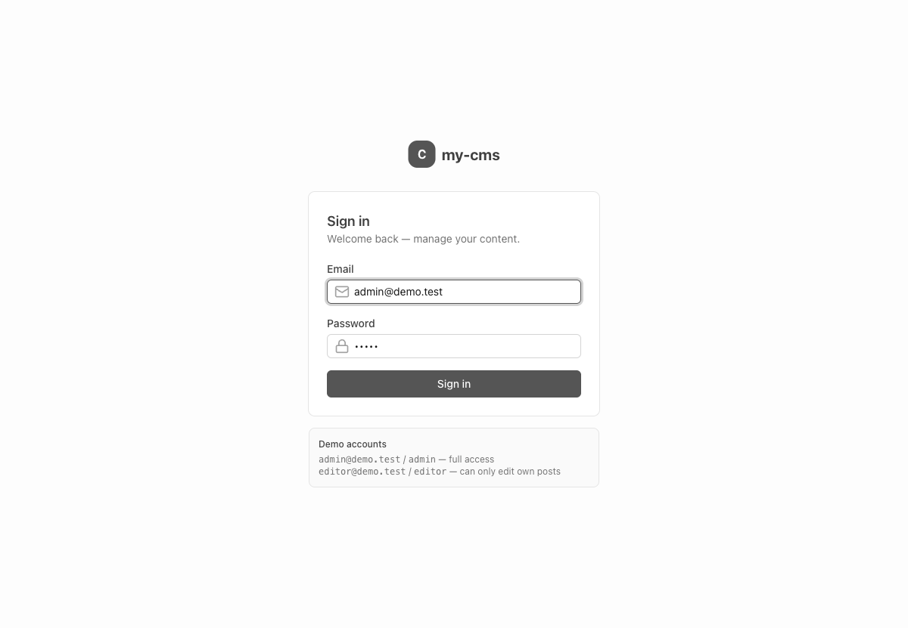
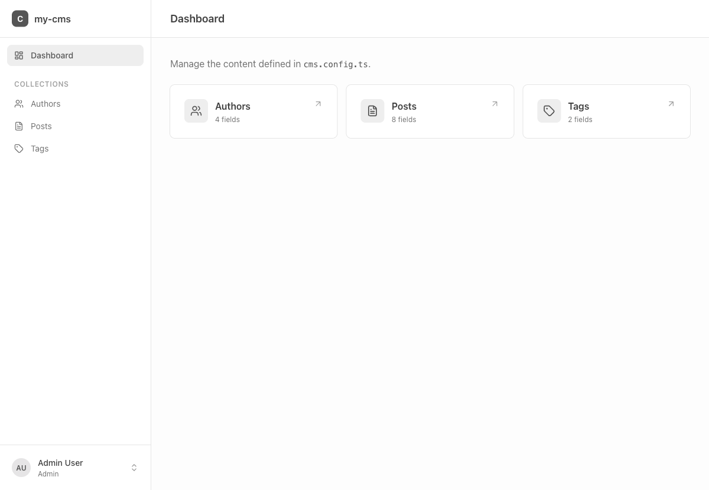
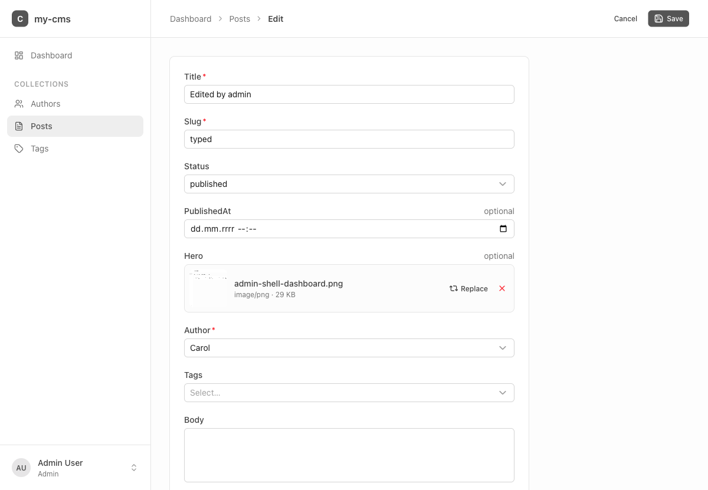
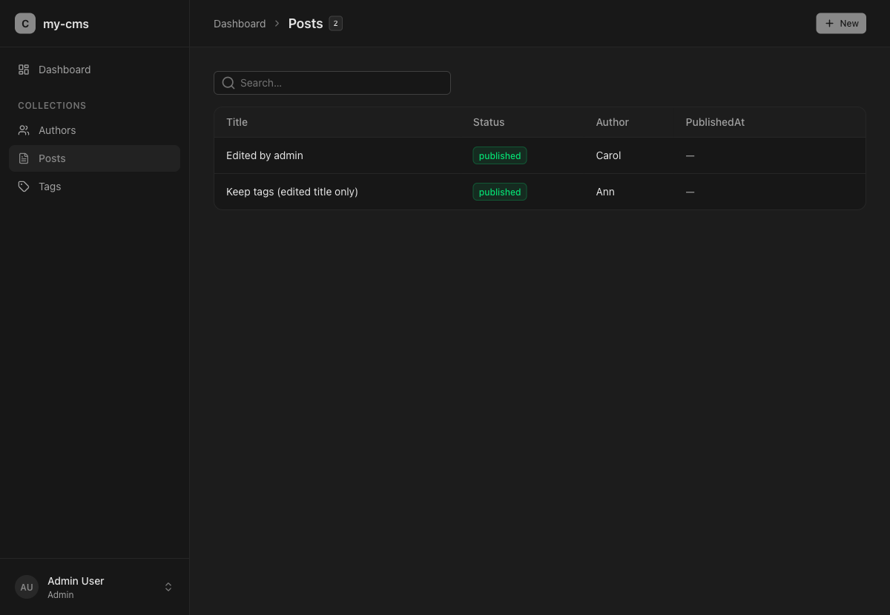

# my-cms

A **code-first, distributable CMS for Nuxt 4**, shipped as a single Nuxt **Layer + Module**
(`@my-cms/core`). You define content entities once in TypeScript; the package derives the
database schema, validation, a typed CRUD API, and an auto-generated admin dashboard. Your
clients edit **data** through the dashboard — never the UI or the structure.

> Philosophy: structure is a developer concern, owned in git (like Payload/Sanity). There is
> **no runtime schema editor** — that's the differentiator, not a limitation.

## Status — MVP vertical slice (working, verified end-to-end)

One entity definition flows all the way through, proven against a real Postgres:

```
cms.config.ts  ──▶  db/schema.ts  ──▶  drizzle-kit SQL  ──▶  Postgres
   (defineEntity)      (emitted)         (migration)
        │
        └─▶ #cms graph ──▶ generic Nitro CRUD ──▶ auto /admin (list + form)
```

Verified: enum (`pgEnum`), unique constraints, nullable/non-null FKs with correct `ON DELETE`,
m2m junction tables, m2o label population, m2m junction diff-writes, richtext (jsonb), Zod 422
validation, and correct PATCH semantics (omitted fields preserved, defaults don't fire on update).

Plus: real auth (nuxt-auth-utils), route-protected dashboard, role + **row-level** access
enforcement, a polished sidebar shell, list search/sort/pagination, dark mode, and
**media upload** (pluggable `StorageDriver`, local filesystem driver) with image previews.






## Architecture

| Piece | What it does |
|---|---|
| `f.*` field factories | each returns a `FieldDescriptor` carrying a **column IR**, a Zod validator, a default, and a UI renderer name |
| `defineEntity(name, def)` | builds the live Drizzle `pgTable` (the type-inference anchor) + Zod create/update schemas |
| `buildRegistry(config)` | two-phase: resolves relation thunks, creates m2m junctions, builds the serializable UI graph |
| `emitSchema(config)` | serializes the **same IR** to `db/schema.ts` source → **one IR, two sinks, zero drift** |
| `cms` CLI | `generate` (emit schema + `drizzle-kit generate`) / `up` (`drizzle-kit migrate`) |
| Nuxt module | aliases `#cms/config`, wires runtimeConfig; the layer ships `/admin` + `Cms*` + server API |
| generic CRUD | one handler set dispatching by entity; relations, m2m diff-writes, populated labels |

### The single source of truth (`playground/cms.config.ts`)

```ts
export const Post = defineEntity('post', {
  label: 'Posts', titleField: 'title',
  admin: { list: { columns: ['title', 'status', 'author', 'publishedAt'] } },
  fields: {
    title:  f.text({ required: true }),
    slug:   f.slug({ from: 'title', unique: true }),
    status: f.select({ options: ['draft', 'published'] as const, default: 'draft' }),
    hero:   f.media({ accept: 'image/*' }).optional(),
    author: f.relation({ to: () => Author, kind: 'many-to-one', required: true }),
    tags:   f.relation({ to: () => Tag, kind: 'many-to-many' }),
    body:   f.richtext(),
  },
})
```

Entities are **precisely typed with no annotations** — the data shapes are inferred:

```ts
import type { Row, Insert } from "@my-cms/core"

type PostRow = Row<typeof Post>
//   { id: string; title: string; status: 'draft' | 'published';
//     publishedAt: Date | null; heroId: string | null; authorId: string;
//     body: RichTextDoc; createdAt: Date; updatedAt: Date }

type NewPost = Insert<typeof Post>
//   author + title + slug + body required; status/tags/publishedAt/hero optional
```

## Repository layout

```
packages/cms/          @my-cms/core — the Layer + Module
  src/                 field engine, defineEntity, registry, emitter
  cli/                 cms migrate (wraps drizzle-kit)
  module.ts            build-time wiring (#cms/config alias, runtimeConfig)
  nuxt.config.ts       layer root
  server/              generic CRUD + drizzle DataSource (useCms)
  app/                 /admin pages + CmsField renderer
playground/            demo host app: `extends: ['../packages/cms']`
  cms.config.ts        Post + Author + Tag (the source of truth)
  server/db/           generated schema.ts + migrations
```

## Run it

```bash
pnpm install

# 1. start Postgres (any Postgres works; this is the local demo DB on :5434)
docker run -d --name my-cms-pg -e POSTGRES_USER=cms -e POSTGRES_PASSWORD=cms \
  -e POSTGRES_DB=cms -p 5434:5432 postgres:16-alpine

# 2. emit schema.ts from cms.config.ts and generate the SQL migration
pnpm db:generate

# 3. apply the migration
pnpm db:migrate

# 4. run the playground → http://localhost:3000/admin
pnpm play
```

`DATABASE_URL` is read from `playground/.env`. Edit `playground/cms.config.ts`, re-run
`pnpm db:generate` (review the SQL!) and `pnpm db:migrate`, and the dashboard updates itself.

## Decisions locked in this MVP

- **Stack:** Nuxt 4, Tailwind 4, Nuxt UI v4, Zod 4, Drizzle (Postgres dialect).
- **Dual-runtime ready:** runtime-specific code is isolated behind the `useCms` DataSource seam;
  Postgres dialect stays identical for a future Cloudflare Workers target (Neon/Hyperdrive). D1/SQLite deferred.
- `select` → native `pgEnum`; rich text → `jsonb` (TipTap doc); ids → `uuid`; media → `cms_media` FK.

## Theming (host-owned)

The CMS components use semantic Nuxt UI classes (`bg-primary`, `text-muted`, …), so the
host re-skins the whole admin from its own `app.config.ts` + `main.css` — no package edits.
The playground ships a monochrome theme: `primary` is a custom `ink` ramp anchored at `#555`
(defined via `@theme` in `main.css`), `neutral` is a true-neutral gray.

## Media upload

`f.media({ accept })` is now a working pipeline, not just an FK column:

```
file → POST /api/cms/_media → StorageDriver.put → cms_media row → FK on the entity
                                     │
                       GET /api/cms/_media/raw/** (public, served by LocalDriver)
```

- **`StorageDriver`** seam (`server/utils/cmsStorage.ts`): `LocalDriver` writes to disk and
  serves through a Nitro route; `s3`/`r2` share the interface and are reserved (fail loudly).
  Selected via `cms.storage.driver`; size cap via `cms.storage.maxSizeMb` (default 10).
- Upload widget with thumbnail preview, replace/remove, and list-cell thumbnails.
- Path-traversal-guarded serving; media behave like public CDN assets.

## Not yet built (next slices, in rough order)

- **S3/R2 storage driver** (the `StorageDriver` seam + `cms.storage.driver` switch are ready)
  and `@nuxt/image` presets; orphan-blob GC when media is deleted/unlinked
- **Per-field permissions** (`fieldMode`) + a roles-management UI. (Auth is real — nuxt-auth-utils; entity- and row-level `access` is enforced server-side. The package reads `event.context.cmsUser`, which the host sets — see `playground/server/middleware/cms-session.ts`.)
- **Field-type & view registries** (replace the `CmsField` switch with `app.config` overrides)
- **TipTap rich-text editor** (currently a textarea proxy)
- **`blocks`** page-builder field (the `f.json` hook already reserves the path)
- Golden-file tests for descriptor→DDL; precise `table` *value*-typing in `eq()` (columns are typed `PgColumn` today — key autocomplete works, value side is loose)
- Cloudflare Workers adapter; publish pipeline (changesets); package-name layer resolution
