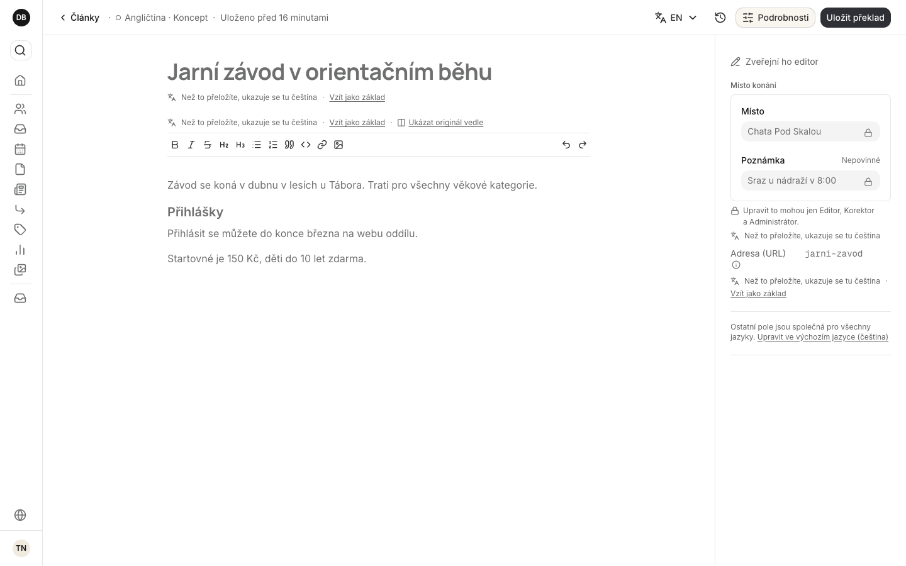
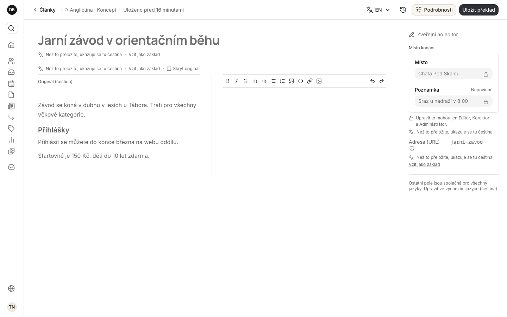
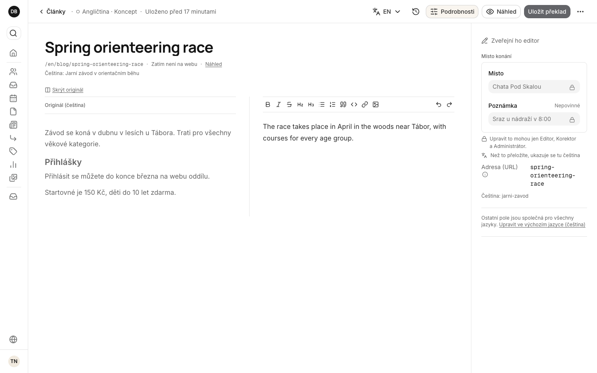
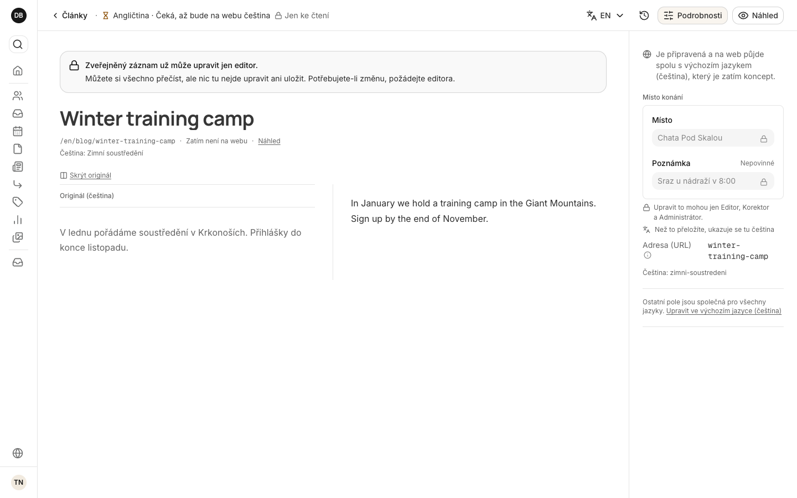
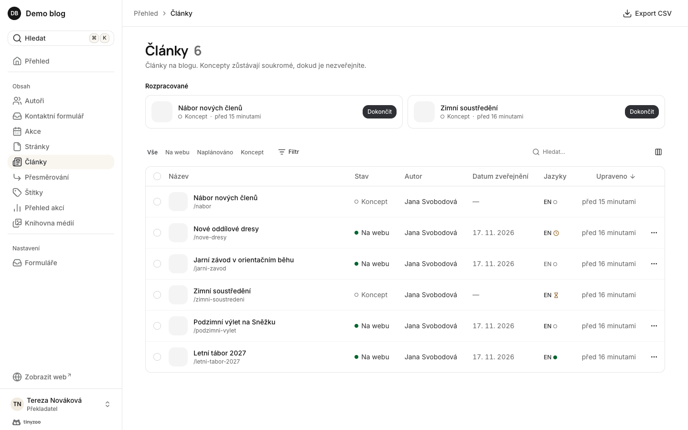
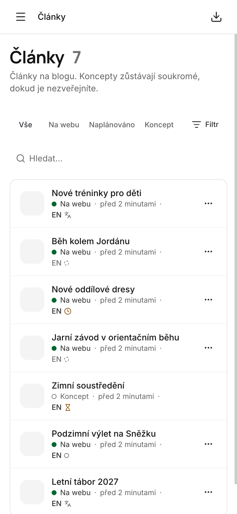
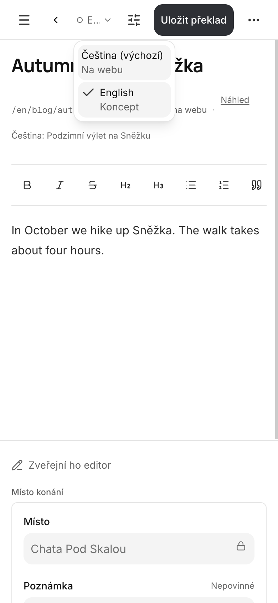

# Překlady

Jak přidat anglickou (nebo jinou) verzi stránky či aktuality, jak překládat s originálem před očima a kdy se překlad objeví na webu.

Web může mít víc jazyků. Jeden z nich je **výchozí**, obvykle čeština. Do ostatních se překládá. Nemusíte přeložit všechno: kde překlad chybí, návštěvník uvidí text ve výchozím jazyce.

## Jak přeložit stránku nebo aktualitu

1. Otevřete položku, kterou chcete přeložit. Musí být nejdřív **uložená**: u úplně nové položky tlačítko pro jazyk v horní liště není (a u ještě neuložených nastavení se v nabídce jazyků píše **Nejdřív uložte, pak přeložte**).
2. V horní liště vpravo je tlačítko s ikonou jazyků a zkratkou jazyka, ve kterém právě jste (třeba **CS**). Klikněte na něj a vyberte jazyk, do kterého překládáte. U každého jazyka vidíte, jak na tom je: **(výchozí)**, **Přeloženo**, **Nepřeloženo**, nebo jeho stav, třeba **Na webu** či **Koncept**. Jazyk jde přepnout i v panelu **Podrobnosti**, kde je stejný seznam. (Na telefonu je to jinak, viz [Na telefonu](#na-telefonu).)
3. Nahoře u názvu se teď píše, ve kterém jazyce jste a v jakém je stavu, třeba **Angličtina · Koncept**.
4. Přepište texty do nového jazyka (jak vám s tím pomůže originál, je [hned níže](#překládání-s-originálem-před-očima)).
5. Klikněte na **Uložit překlad**.

Zpátky do výchozího jazyka se vrátíte stejně: tlačítkem s jazykem v horní liště a výběrem jazyka označeného **(výchozí)**.

## Překládání s originálem před očima

Když otevřete jazyk, který ještě není přeložený, nejsou pole prázdná. **V každém nepřeloženém poli je šedě český text.** Je to přesně to, co by návštěvník v tom jazyce na místě viděl, než to přeložíte. U pole je napsáno **Než to přeložíte, ukazuje se tu čeština**.

- **Vzít jako základ** vloží český text do pole. Hodí se, když chcete text jen trochu upravit, nebo když v něm jsou jména a čísla, která zůstanou stejná. Pak ho přepíšete.
- Když pole přeložíte, šedý text zmizí. Pod polem zůstane pro kontrolu, jak zní česky, třeba **Čeština: Jarní závod v orientačním běhu**.
- U delšího textu (text článku nebo stránky) je navíc **Ukázat originál vedle**. Vlevo se objeví **Originál (čeština)** a vpravo píšete překlad. Odstavec po odstavci tak vidíte, co ještě zbývá. **Skrýt originál** ho zase schová. Tahle volba je jen na širší obrazovce, na telefonu ne.

> **Tip:** Originál vedle sebe se hodí i na kontrolu hotového překladu. Nic tím neměníte, jen se díváte.

## Co uvidí návštěvník v nepřeloženém poli

Český text. Nic se nerozbije, jen v anglické verzi webu bude na tom místě česky. Šedý text v poli vám to ukazuje předem.

Správa to připomene i před zveřejněním: u pole, které jste nepřeložili, uvidíte třeba **Prázdné: Text** a pod tím **Než to přeložíte, návštěvníci tu uvidí původní text (čeština).** s tlačítkem **Přeložit**. Je to jen upozornění. Zveřejnit můžete i tak.

## Co se překládá a co ne

Překládají se **texty**: název, adresa stránky, text, bloky, popisy pro vyhledávače. Obrázky, čísla, data a přepínače jsou pro všechny jazyky stejné. V panelu **Podrobnosti** proto uvidíte **Ostatní pole jsou společná pro všechny jazyky.** a odkaz **Upravit ve výchozím jazyce (čeština)**, který vás vrátí do výchozí verze, kde se tato pole mění.

Některá pole může mít web zamčená jen pro určité role. Mají šedé pozadí a zámek a pod nimi je, kdo je smí měnit, třeba **Upravit to mohou jen Editor, Korektor a Administrátor.** Víc v kapitole [Role a oprávnění](role-a-opravneni.md).

## Kdy je překlad na webu

To záleží na tom, jak má váš web nastavený daný druh obsahu. Poznáte to v panelu **Podrobnosti** u překladu.

**Zveřejnění společné pro všechny jazyky.** Když je u překladu napsáno **Zveřejnění platí pro všechny jazyky.**, má položka jen jeden stav. Když ji zveřejníte, jsou na webu všechny její jazykové verze najednou. Uložený překlad zveřejněné položky je na webu hned.

**Každý jazyk zvlášť.** Na webech, kde to vývojář zapnul (třeba u článků), má každý jazyk svůj vlastní stav: **Koncept**, **Naplánováno** nebo **Na webu**. Překlad tak můžete v klidu dopsat a zveřejnit, až bude hotový. Podrobnosti jsou v další části.

## Každý jazyk zvlášť

### Stav jazyka

Stav vidíte na čtyřech místech: nahoře u názvu (**Angličtina · Koncept**), v nabídce jazyků, v panelu **Podrobnosti** a v seznamu položek.

- **Koncept**: tenhle jazyk na webu není. Návštěvník v něm stránku nenajde, nevyskočí mu v seznamu, v mapě webu ani ve vyhledávání. Rozepsaný překlad si prohlédnete v **Náhledu**.
- **Naplánováno**: jazyk půjde na web v den a čas, který jste vybrali.
- **Na webu**: návštěvníci ho vidí.
- **Řídí se výchozím jazykem**: jazyk zatím nemá vlastní stav. Jde na web a z webu spolu s češtinou. Takhle začíná každý jazyk, dokud ho někdo nezveřejní nebo nestáhne zvlášť. Proto se na webu nic nezmění, když vývojář tuhle volbu zapne.

Otevřete jazyk a použijte **Zveřejnit…**, **Aktualizovat** nebo **Naplánovat**. V nabídce **Další akce** (tři tečky) je **Stáhnout z webu** a **Znovu se řídit výchozím jazykem**. Všechno to platí jen pro jazyk, který máte otevřený. Ostatní jazyky se nezmění.

### Čeština rozhoduje

**Překlad jde na web jen spolu s českou verzí.** Když je čeština koncept, není na webu ani zveřejněný překlad. Je připravený a čeká. U jazyka se pak píše **Čeká, až bude na webu čeština** a v seznamu má přesýpací hodiny. Jakmile češtinu zveřejníte, jde na web i on, sám od sebe.

Proč? V překladu se nepřeložená pole ukazují česky. Kdyby šel překlad na web dřív, uviděli by návštěvníci i nehotový český text.

- Když češtinu stáhnete z webu, odejdou s ní všechny jazyky. Jejich vlastní stav se ale nezapomene: po novém zveřejnění češtiny jsou zpátky tak, jak byly.
- Jeden jazyk můžete stáhnout nebo naplánovat zvlášť, i když je čeština na webu.
- Když naplánujete jazyk i češtinu, jde jazyk na web, až přijdou obě data (platí to pozdější).

### Zveřejnění překladu

**Zveřejnit…** u překladu otevře kontrolu **Zveřejnit překlad: angličtina** s větou **Ostatní jazyky zůstanou, jak jsou.** Jako u celé položky vás upozorní na nepřeložená pole a ukáže **Adresu na webu**. Když je čeština zatím koncept, je nahoře **Čeština je zatím koncept** a u volby **Hned teď** se píše **Na web to půjde, jakmile tam bude i čeština.** Víc o zveřejňování je v kapitole [Zveřejnění, naplánování, náhled](zverejneni-a-nahled.md#zveřejnění-překladu).

### Kdo smí zveřejnit jazyk

Kdo nesmí zveřejňovat (třeba **Autor** nebo **Překladatel**), překlad píše a ukládá, ale nezveřejní ho. Místo tlačítka **Zveřejnit…** vidí **Zveřejní ho editor**. Takový člověk také:

- nemůže zveřejnit, stáhnout ani naplánovat žádný jazyk;
- nemůže měnit jazyk, který je na webu, ani jazyk, který se řídí češtinou, když je čeština na webu. Takový jazyk se mu otevře **Jen ke čtení**;
- nemůže odebrat překlad, který má vlastní stav.

Jazyk, který na webu není, psát smí. Jak to v praxi chodí:

- **Nový článek** se nejlépe překládá dřív, než se zveřejní. Čeština je koncept, takže je koncept i angličtina a překladatel do ní může psát. Editor pak zveřejní češtinu a angličtina jde na web s ní.
- **Článek, který už je na webu**, editor nejdřív u angličtiny stáhne z webu (**Další akce → Stáhnout z webu**, v otevřené anglické verzi). Angličtina je pak koncept, překladatel ji dopíše a editor ji zveřejní.

### Jazyky v seznamu

V seznamu položek je sloupec **Jazyky**. Když se zveřejňuje každý jazyk zvlášť, je u každého jazyka kromě výchozího jeho zkratka a značka:

| Značka | Co znamená |
|---|---|
| plné zelené kolečko | **Na webu** |
| prázdné kolečko | **Koncept** |
| hodiny | **Naplánováno** |
| přesýpací hodiny | **Čeká, až bude na webu čeština**: překlad je zveřejněný, ale čeština zatím ne |

Zkratka je světlejší, když jazyk ještě není přeložený (ukazuje se v něm čeština). Když na značku najedete myší, napíše se to slovy, třeba „Angličtina: Na webu · řídí se výchozím jazykem“.

U obsahu, kde se zveřejňuje všechno společně, je ve sloupci **Jazyky** buď **Všechny jazyky**, nebo **Chybí EN** (podle toho, co chybí). Hodí se to, abyste rychle našli věci, které ještě nejsou přeložené.

## Na telefonu

V seznamu na telefonu jsou jazyky u každé položky pod jejím stavem, se stejnými značkami jako na počítači.

V otevřené položce je na telefonu jazyk a jeho stav vlevo nahoře, hned vedle šipky zpět (třeba **EN · Koncept**, na úzkém displeji jen kolečko a začátek zkratky). **Klepněte na něj a otevře se nabídka jazyků** se stavem každého z nich. Stejnou nabídku najdete i v **Další akce** (tři tečky) pod **Jazyk**.

Tlačítko pro uložení překladu se na telefonu jmenuje jen **Uložit**, aby se do lišty vešel i jazyk. Dokud máte neuložené změny, je místo jazyka napsáno **Neuloženo**. Po uložení je jazyk zase zpátky.

## Adresa v jiném jazyce

Adresa stránky se může překládat taky. Stránka **O nás** může být na webu na `/o-nas` a její anglická verze na `/en/about`. Když anglickou adresu nevyplníte, použije se ta česká.

Pod nadpisem překladu je adresa a vedle ní, jestli je na webu. Když na webu ještě není, píše se tam **Zatím není na webu** a odkaz **Náhled** místo odkazu na web.

## Odebrání překladu

Překlad, který už nechcete, odeberete tlačítkem **Odebrat překlad** (v nabídce **Další akce**, když máte otevřený jazyk, který není výchozí). Správa se zeptá **Odebrat překlad: angličtina?**. Návštěvníci pak v tom jazyce uvidí zase výchozí jazyk. **Nejde to vrátit.**

> **Tip:** Chcete-li překlad jen vyzkoušet, nejdřív ho uložte a otevřete **Náhled**. Uvidíte stránku tak, jak ji uvidí návštěvník v tom jazyce.

## Viz také

- [Stránky a bloky](stranky-a-bloky.md)
- [Zveřejnění, naplánování, náhled](zverejneni-a-nahled.md)
- [Role a oprávnění](role-a-opravneni.md): zamčená pole a kdo smí zveřejňovat
- [Co dělat, když něco nefunguje](kdyz-neco-nefunguje.md): „Anglická verze chybí“
