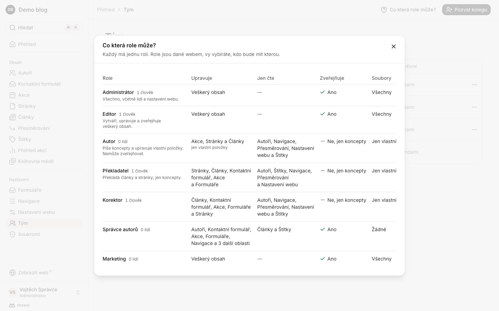
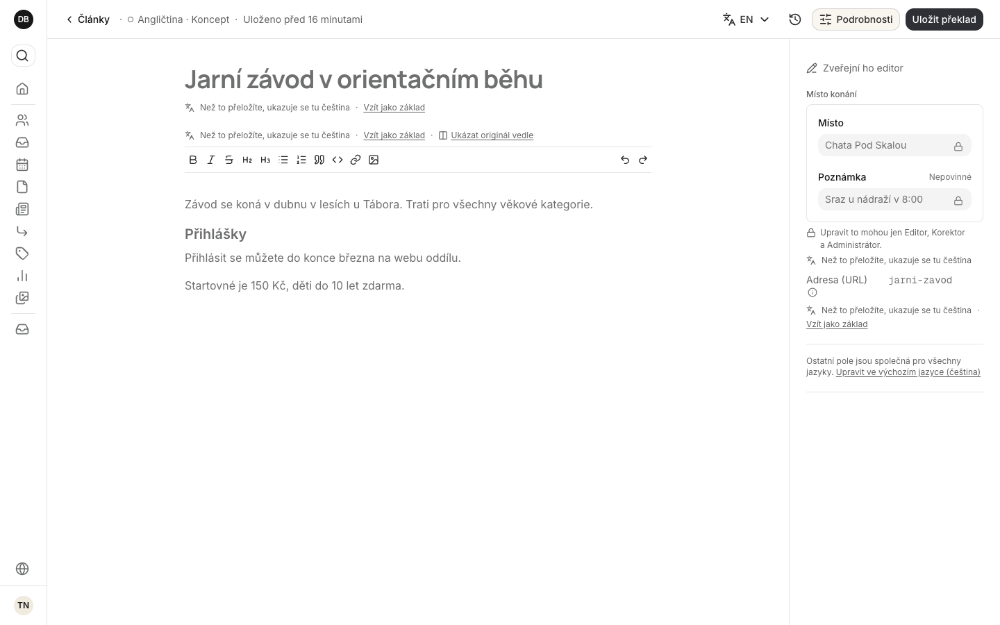
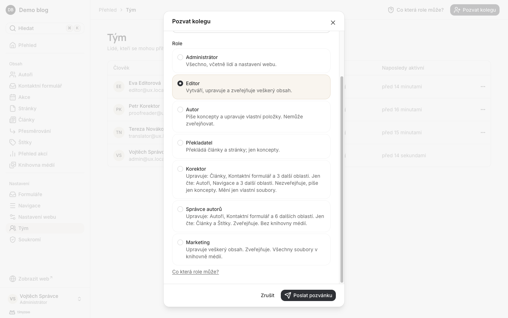
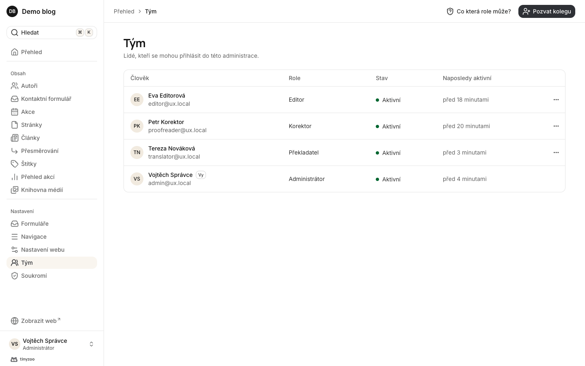

# Role a oprávnění

Co je role, jak zjistit, co která role smí, proč některé pole nejde změnit a co dělat, když vaše role zmizela. Na konci je část pro administrátory: pozvání s rolí a změna role.

## Co je role

Každý, kdo se do správy přihlašuje, má **jednu roli**. Role říká, co smí: které části webu upravuje, které jen čte, jestli smí zveřejňovat a co smí v knihovně médií.

Svou roli vidíte vlevo dole pod svým jménem (na telefonu v menu).

Každý web má tři základní role:

| Role | Co smí |
|---|---|
| **Administrátor** | Všechno, včetně lidí (část **Tým**) a části **Soukromí**. |
| **Editor** | Vytváří, upravuje a zveřejňuje veškerý obsah. |
| **Autor** | Píše koncepty a upravuje vlastní položky. Nemůže zveřejňovat. |

Web může mít i **vlastní role**, třeba **Překladatel** nebo **Korektor**. Ty nastavuje vývojář webu podle toho, co lidé ve vaší firmě dělají. Každá vychází z editora nebo z autora a má něco ubráno (nebo u autora přidáno). Například překladatel může upravovat jen články a stránky a nesmí nic zveřejnit.

**Role jsou dané webem, administrátor vybírá, kdo bude mít kterou.** Novou roli ani její pravidla ve správě nevytvoříte. Když potřebujete roli jinou, požádejte vývojáře.

<!-- clip: roles | Krátké video: přehled „Co která role může?“, pozvání kolegy s rolí a pole se zámkem, které smí měnit jen některé role. -->

## Co která role může?

Administrátor najde přehled všech rolí v části **Tým**, tlačítkem **Co která role může?** vpravo nahoře. Jste-li editor nebo autor, tuhle část nevidíte. Co vaše role smí, vám řekne administrátor.

Jak tabulku číst:

- **Role**: název role, kolik lidí ji má, a jednou větou, k čemu je.
- **Upravuje**: části webu, které role mění. **Veškerý obsah** znamená všechno. Když je pod tím **jen vlastní položky**, mění jen to, co sama vytvořila (tak to má autor).
- **Jen čte**: části webu, které role vidí, ale nemůže je měnit. Části, které v žádném sloupci nejsou, role vůbec nevidí.
- **Zveřejňuje**: **Ano**, nebo **Ne, jen koncepty**. Kdo nezveřejňuje, nemůže měnit ani to, co už je na webu, a ani obsah, který se na web dostane hned po uložení (třeba **Nastavení webu** nebo **Přesměrování**). Takové části má proto ve sloupci **Jen čte**.
- **Soubory**: knihovna médií. **Všechny** (mění každý soubor), **Jen vlastní** (nahrává a mění jen soubory, které sám nahrál; ostatní vidí a může je použít) nebo **Žádné** (knihovna médií je pro roli zavřená).

Stejnou větu o roli uvidíte i v pozvánce a při změně role, viz [níže](#pozvání-kolegy-s-rolí).

## Pole, které nejde změnit

Některá pole může web zamknout tak, že je smí měnit jen určité role. Třeba místo konání akce smí měnit jen editor, ne překladatel.

Takové pole poznáte hned: **má šedé pozadí a zámek** a pod ním je napsáno, kdo ho smí měnit, třeba:

> Upravit to mohou jen Editor, Korektor a Administrátor.

Hodnotu si přečtete, ale nepřepíšete ji. **Potřebujete změnu? Napište někomu z rolí, které jsou ve větě jmenované.** Kdo má kterou roli, ví administrátor.

Pole, které vaše role nesmí ani číst, ve formuláři vůbec není. Nehledejte ho, ani v seznamu, v historii nebo ve vyhledávání ho neuvidíte.

### Celá položka jen ke čtení

Někdy nejde změnit nic v celé položce. Nahoře u názvu je pak **Jen ke čtení** a nad formulářem je rámeček s důvodem, třeba:

- **Zveřejněný záznam už může upravit jen editor.** Vaše role nezveřejňuje, a proto nemůže měnit, co už je na webu.
- **Tento záznam může upravit jen jeho autor nebo editor.** Položku vytvořil někdo jiný.
- **Tohle může měnit jen editor nebo administrátor.** Tuhle část webu vaše role jen čte.

Pod tím je vždy: **Můžete si všechno přečíst, ale nic tu nejde upravit ani uložit. Potřebujete-li změnu, požádejte editora.**

Další podobná místa:

- **Tady nemůžete nic přidávat**: v seznamu, kam vaše role nesmí přidávat nové položky. Seznam si ale prohlédnout můžete.
- **Knihovna médií není pro vaši roli otevřená**: vaše role nemá knihovnu médií. Obrázky, které už u položek jsou, zůstávají a na webu se ukazují dál.
- **Zveřejní ho editor**: místo tlačítka **Zveřejnit…** u role, která nezveřejňuje. Až budete hotovi, dejte editorovi vědět.

## Vaše role už neexistuje

Po přihlášení se může ukázat:

> **Vaše role už neexistuje**
> S účtem je všechno v pořádku, ale role „…“ už pro tento web není definovaná, takže nemáte přístup k obsahu. Požádejte administrátora, aby vám přidělil jinou roli.

Stane se to, když vývojář vaši roli z webu odebral. **Váš účet, heslo i všechno, co jste napsali, zůstává.** Jen teď nemáte žádnou roli, a tak nevidíte žádný obsah. Stránku **Váš účet** otevřete a odhlásit se můžete.

Napište administrátorovi. Jakmile vám přidělí jinou roli, přihlaste se znovu a uvidíte zase vše, co vaše nová role smí.

## Pro administrátory

### Pozvání kolegy s rolí

1. V nabídce vlevo v části **Nastavení** otevřete **Tým**.
2. Klikněte na **Pozvat kolegu**.
3. Napište e-mail, volitelně jméno, a v části **Role** vyberte roli. U každé je jednou větou, co smí. Nejste si jistí? Odkaz **Co která role může?** pod rolemi otevře přehled všech rolí vedle sebe.
4. Klikněte na **Poslat pozvánku**.

Kolegovi přijde e-mail, ve kterém je, kdo ho zve a v jaké roli. Vlastní role se v něm jmenuje tak, jak ji vidíte ve správě (třeba **Překladatel**). Víc o pozvánkách, o tom, co dělat, když e-mail neodejde, a o ostatních volbách v **Týmu** je v kapitole [Přihlášení a váš účet](prihlaseni-a-ucet.md#pozvání-kolegů-jen-administrátor).

### Změna role

1. V **Týmu** klikněte na tři tečky u člověka.
2. Vyberte **Změnit roli** a v nabídce novou roli. U každé role je zase věta o tom, co smí.

Role se změní hned a správa potvrdí **Role změněna**.

> **Pozor:** Po změně role se ten člověk **odhlásí na všech zařízeních**. Při dalším přihlášení už má novou roli. Neuložené změny, které měl zrovna rozepsané, se ztratí, proto mu raději dejte vědět předem.

Svou vlastní roli si změnit nemůžete. A posledního aktivního administrátora nejde přepnout na jinou roli, aby se k webu vždycky někdo dostal.

### Když role zmizí

Když vývojář nějakou roli z webu odebere, lidé s touto rolí v **Týmu** zůstanou. U jejich role je upozornění **Tato role už neexistuje: člověk se přihlásí, ale nic neuvidí. Přidělte mu jinou roli.** Přes **Změnit roli** mu vyberte jinou a je to.

## Viz také

- [Přihlášení a váš účet](prihlaseni-a-ucet.md): pozvánky, zablokování přístupu, odebrání člověka
- [Překlady](preklady.md): co smí ten, kdo nezveřejňuje, s jednotlivými jazyky
- [Obrázky a soubory](obrazky-a-soubory.md)
- [Co dělat, když něco nefunguje](kdyz-neco-nefunguje.md)
