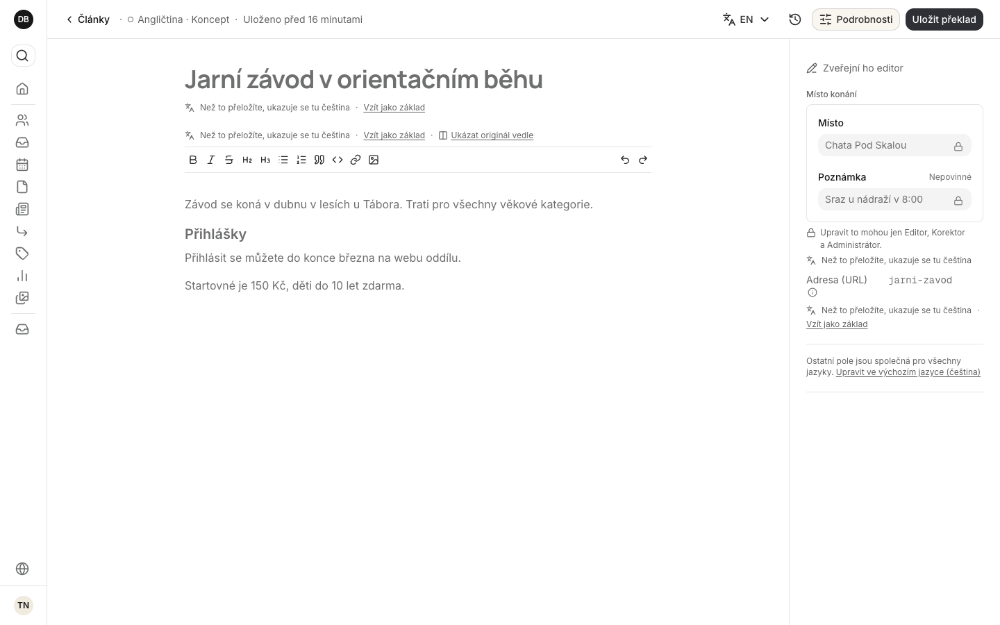
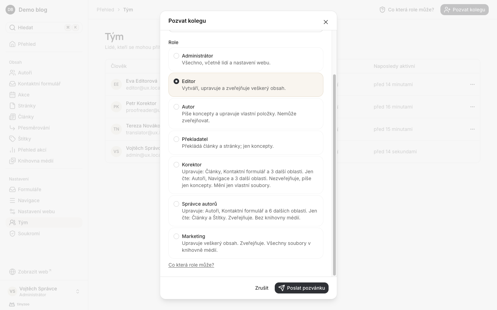
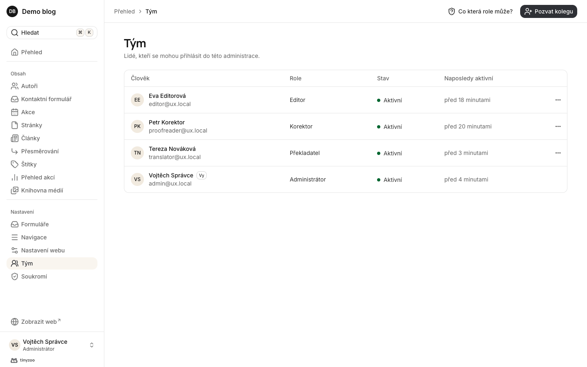

# Rollen und Berechtigungen

Was eine Rolle ist, wie Sie herausfinden, was welche Rolle darf, warum sich manche Felder nicht ändern lassen und was zu tun ist, wenn Ihre Rolle verschwunden ist. Am Ende steht ein Teil für Administratoren: Einladen mit Rolle und Rolle ändern.

## Was ist eine Rolle

Jede Person, die sich in der Verwaltung anmeldet, hat **eine Rolle**. Die Rolle legt fest, was sie darf: welche Bereiche der Website sie bearbeitet, welche sie nur liest, ob sie veröffentlichen darf und was sie in der Medienbibliothek darf.

Ihre Rolle sehen Sie links unten unter Ihrem Namen (auf dem Smartphone im Menü).

Jede Website hat drei Grundrollen:

| Rolle | Was sie darf |
|---|---|
| **Administrator** | Alles, auch die Verwaltung der Personen (Bereich **Team**) und den Bereich **Datenschutz**. |
| **Redakteur** | Erstellt, bearbeitet und veröffentlicht alle Inhalte. |
| **Autor** | Schreibt Entwürfe und bearbeitet eigene Einträge. Kann nicht veröffentlichen. |

Eine Website kann auch **eigene Rollen** haben, etwa **Übersetzer** oder **Korrektor**. Diese legt der Entwickler der Website fest, je nachdem, was die Menschen in Ihrer Firma tun. Jede baut auf dem Redakteur oder dem Autor auf und hat etwas weniger (oder beim Autor etwas mehr). Ein Übersetzer darf zum Beispiel nur Artikel und Seiten bearbeiten und nichts veröffentlichen.

**Die Rollen gehören zur Website, ein Administrator wählt aus, wer welche hat.** Eine neue Rolle oder ihre Regeln können Sie in der Verwaltung nicht anlegen. Brauchen Sie eine andere Rolle, wenden Sie sich an den Entwickler.

<!-- clip: roles | Kurzes Video: die Übersicht „Was darf welche Rolle?“, eine Person mit Rolle einladen und ein Feld mit Schloss, das nur bestimmte Rollen ändern dürfen. -->

## Was darf welche Rolle?

Ein Administrator findet die Übersicht aller Rollen im Bereich **Team**, über die Schaltfläche **Was darf welche Rolle?** rechts oben. Als Redakteur oder Autor sehen Sie diesen Bereich nicht. Was Ihre Rolle darf, sagt Ihnen ein Administrator.

So lesen Sie die Tabelle:

- **Rolle**: der Name der Rolle, wie viele Personen sie haben und in einem Satz, wofür sie da ist.
- **Bearbeitet**: die Bereiche der Website, die die Rolle ändert. **Alle Inhalte** heißt alles. Steht darunter **nur eigene Einträge**, ändert sie nur, was sie selbst erstellt hat (so ist es beim Autor).
- **Liest nur**: die Bereiche, die die Rolle sieht, aber nicht ändern kann. Bereiche, die in keiner Spalte stehen, sieht die Rolle gar nicht.
- **Veröffentlicht**: **Ja** oder **Nein, nur Entwürfe**. Wer nicht veröffentlicht, kann auch nicht ändern, was schon auf der Website ist, und auch keine Inhalte, die gleich beim Speichern auf die Website gehen (etwa **Website-Einstellungen** oder **Weiterleitungen**). Solche Bereiche stehen deshalb in der Spalte **Liest nur**.
- **Dateien**: die Medienbibliothek. **Alle** (ändert jede Datei), **Nur eigene** (lädt hoch und ändert nur selbst hochgeladene Dateien; die anderen sieht die Rolle und kann sie verwenden) oder **Keine** (die Medienbibliothek ist für die Rolle geschlossen).

Denselben Satz zur Rolle sehen Sie auch in der Einladung und beim Ändern der Rolle, siehe [unten](#eine-person-mit-rolle-einladen).

## Felder, die sich nicht ändern lassen

Die Website kann einzelne Felder so sperren, dass nur bestimmte Rollen sie ändern dürfen. Den Ort einer Veranstaltung darf zum Beispiel nur der Redakteur ändern, nicht der Übersetzer.

Ein solches Feld erkennen Sie sofort: **Es hat einen grauen Hintergrund und ein Schloss**, und darunter steht, wer es ändern darf, zum Beispiel:

> Nur Redakteur, Korrektor und Administrator können das ändern.

Den Wert können Sie lesen, aber nicht überschreiben. **Sie brauchen eine Änderung? Schreiben Sie jemandem mit einer der Rollen, die im Satz genannt sind.** Wer welche Rolle hat, weiß ein Administrator.

Ein Feld, das Ihre Rolle nicht einmal lesen darf, fehlt im Formular ganz. Suchen Sie es nicht: Auch in der Liste, im Verlauf und in der Suche sehen Sie es nicht.

### Ein ganzer Eintrag nur zum Lesen

Manchmal lässt sich im ganzen Eintrag nichts ändern. Oben beim Titel steht dann **Nur lesen**, und über dem Formular steht in einem Kasten der Grund, zum Beispiel:

- **Sobald es veröffentlicht ist, kann nur noch die Redaktion es ändern.** Ihre Rolle veröffentlicht nicht und kann deshalb nicht ändern, was schon auf der Website ist.
- **Das kann nur die Autorin oder der Autor oder die Redaktion ändern.** Jemand anderes hat den Eintrag erstellt.
- **Das kann nur die Redaktion oder eine Administratorin bzw. ein Administrator ändern.** Diesen Bereich der Website darf Ihre Rolle nur lesen.

Darunter steht immer: **Sie können alles lesen, aber hier lässt sich nichts bearbeiten oder speichern. Für eine Änderung wenden Sie sich an die Redaktion.**

Ähnliche Stellen:

- **Hier können Sie nichts hinzufügen**: in einer Liste, in der Ihre Rolle keine neuen Einträge anlegen darf. Ansehen können Sie die Liste aber.
- **Die Medienbibliothek steht Ihrer Rolle nicht offen**: Ihre Rolle hat keine Medienbibliothek. Bilder, die schon an Einträgen hängen, bleiben und werden auf der Website weiter angezeigt.
- **Ein Redakteur übernimmt die Veröffentlichung**: statt der Schaltfläche **Veröffentlichen…** bei einer Rolle, die nicht veröffentlicht. Wenn Sie fertig sind, sagen Sie der Redaktion Bescheid.

## Ihre Rolle gibt es nicht mehr

Nach der Anmeldung kann Folgendes erscheinen:

> **Ihre Rolle gibt es nicht mehr**
> Mit Ihrem Konto ist alles in Ordnung, aber die Rolle „…“ ist für diese Website nicht mehr definiert, daher haben Sie keinen Zugriff auf die Inhalte. Bitten Sie eine Administratorin oder einen Administrator, Ihnen eine andere Rolle zu geben.

Das passiert, wenn der Entwickler Ihre Rolle von der Website entfernt hat. **Ihr Konto, Ihr Passwort und alles, was Sie geschrieben haben, bleiben erhalten.** Sie haben nur gerade keine Rolle und sehen deshalb keine Inhalte. Die Seite **Ihr Konto** können Sie öffnen, und abmelden können Sie sich auch.

Schreiben Sie einem Administrator. Sobald er Ihnen eine andere Rolle gegeben hat, melden Sie sich erneut an und sehen wieder alles, was Ihre neue Rolle darf.

## Für Administratoren

### Eine Person mit Rolle einladen

1. Öffnen Sie im Menü links im Bereich **Einstellungen** den Eintrag **Team**.
2. Klicken Sie auf **Person einladen**.
3. Geben Sie die E-Mail-Adresse ein, wenn Sie möchten auch den Namen, und wählen Sie im Bereich **Rolle** eine Rolle aus. Bei jeder steht in einem Satz, was sie darf. Sie sind unsicher? Der Link **Was darf welche Rolle?** unter den Rollen öffnet die Übersicht aller Rollen nebeneinander.
4. Klicken Sie auf **Einladung senden**.

Die eingeladene Person bekommt eine E-Mail, in der steht, wer sie einlädt und mit welcher Rolle. Eine eigene Rolle heißt darin so, wie Sie sie in der Verwaltung sehen (etwa **Übersetzer**). Mehr über Einladungen, darüber, was zu tun ist, wenn die E-Mail nicht rausgeht, und über die anderen Möglichkeiten unter **Team** steht im Kapitel [Anmeldung und Ihr Konto](anmeldung-und-konto.md#kolleginnen-und-kollegen-einladen-nur-administratoren).

### Rolle ändern

1. Klicken Sie unter **Team** auf die drei Punkte bei der Person.
2. Wählen Sie **Rolle ändern** und im Menü die neue Rolle. Bei jeder Rolle steht wieder ein Satz dazu, was sie darf.

Die Rolle ändert sich sofort, und die Verwaltung bestätigt **Rolle geändert**.

> **Achtung:** Nach einer Rollenänderung wird die Person **auf allen Geräten abgemeldet**. Bei der nächsten Anmeldung hat sie schon die neue Rolle. Ungespeicherte Änderungen, an denen sie gerade gearbeitet hat, gehen verloren. Sagen Sie ihr deshalb lieber vorher Bescheid.

Ihre eigene Rolle können Sie nicht ändern. Und den letzten aktiven Administrator können Sie nicht auf eine andere Rolle umstellen, damit immer jemand an die Website herankommt.

### Wenn eine Rolle verschwindet

Entfernt der Entwickler eine Rolle von der Website, bleiben die Personen mit dieser Rolle unter **Team** erhalten. Bei ihrer Rolle steht der Hinweis **Diese Rolle gibt es nicht mehr: die Person kann sich anmelden, sieht aber nichts. Weisen Sie ihr eine andere Rolle zu.** Wählen Sie über **Rolle ändern** eine andere aus, und fertig.

## Siehe auch

- [Anmeldung und Ihr Konto](anmeldung-und-konto.md): Einladungen, Zugang sperren, eine Person entfernen
- [Übersetzungen](uebersetzungen.md): was jemand, der nicht veröffentlicht, mit den einzelnen Sprachen darf
- [Bilder und Dateien](bilder-und-dateien.md)
- [Wenn etwas nicht klappt](wenn-etwas-nicht-klappt.md)
