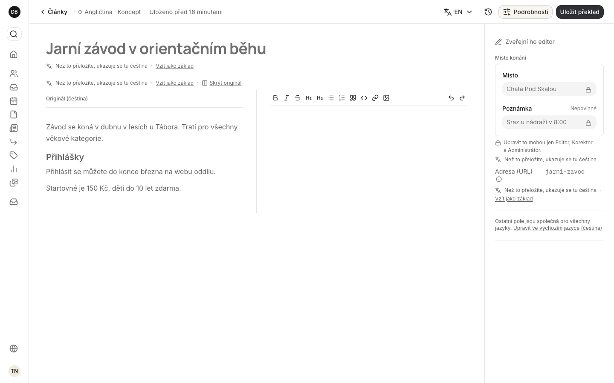
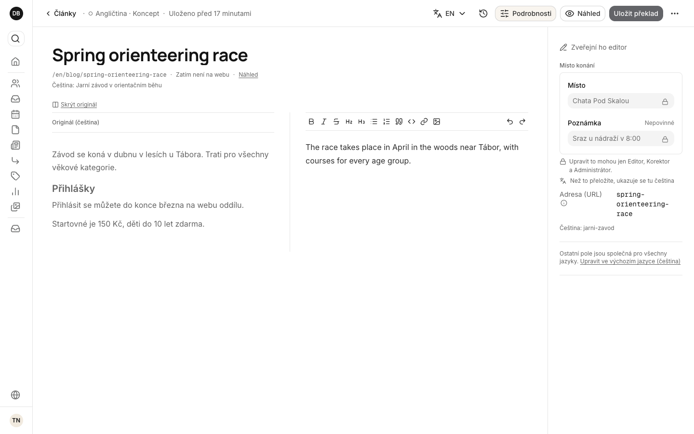
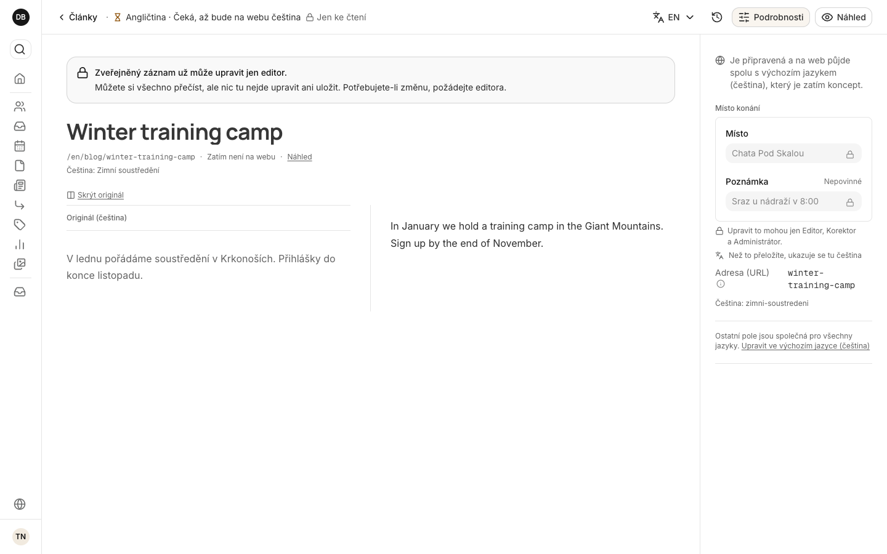
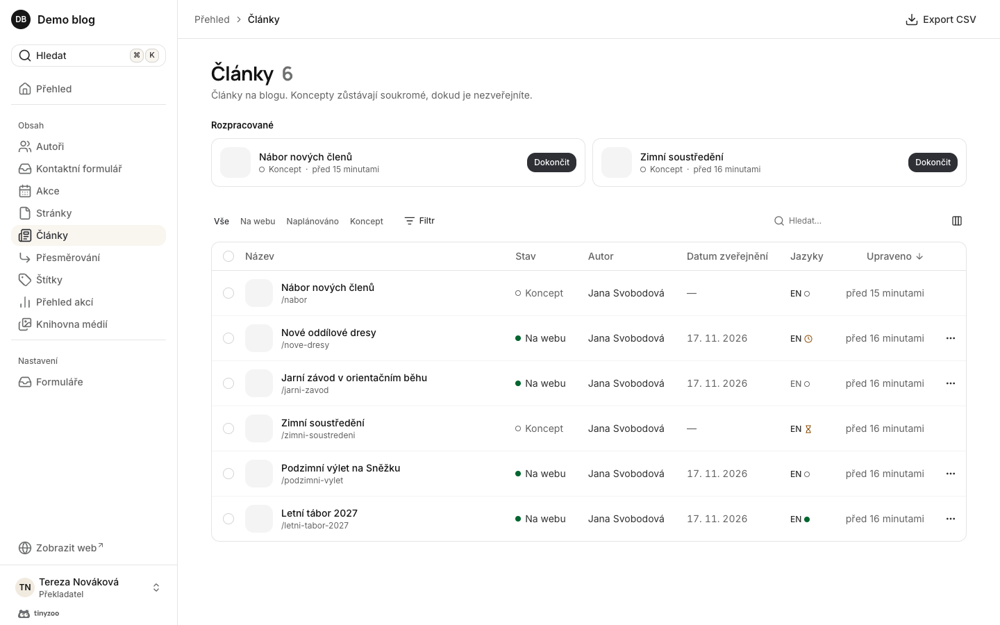
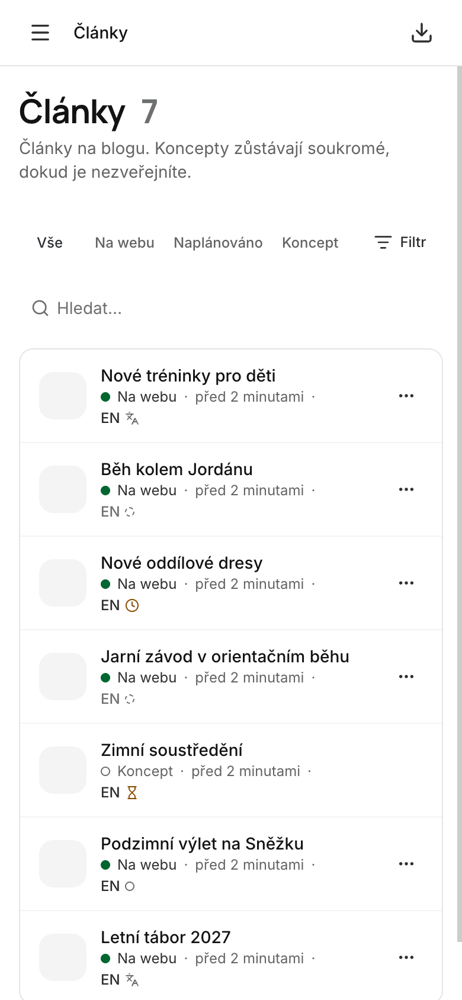
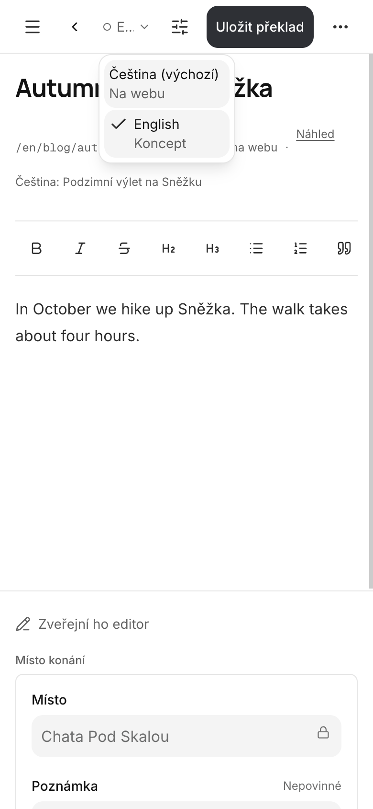

# Übersetzungen

Wie Sie eine englische (oder andere) Fassung einer Seite oder Neuigkeit anlegen, wie Sie mit dem Original vor Augen übersetzen und wann eine Übersetzung auf der Website erscheint.

Eine Website kann mehrere Sprachen haben. Eine davon ist die **Standardsprache**, in unserem Beispiel Tschechisch. In die anderen wird übersetzt. Sie müssen nicht alles übersetzen: Wo eine Übersetzung fehlt, sehen Besucher den Text in der Standardsprache.

## So übersetzen Sie eine Seite oder Neuigkeit

1. Öffnen Sie den Eintrag, den Sie übersetzen möchten. Er muss zuerst **gespeichert** sein: Bei einem ganz neuen Eintrag gibt es die Sprachschaltfläche in der oberen Leiste noch nicht (und bei noch nicht gespeicherten Einstellungen steht im Sprachmenü **Zuerst speichern, dann übersetzen**).
2. Rechts in der oberen Leiste ist eine Schaltfläche mit einem Sprachsymbol und dem Kürzel der Sprache, in der Sie gerade sind (etwa **CS**). Klicken Sie darauf und wählen Sie die Sprache, in die Sie übersetzen. Bei jeder Sprache sehen Sie, wie es um sie steht: **(Standard)**, **Übersetzt**, **Nicht übersetzt** oder ihren Status, etwa **Auf der Website** oder **Entwurf**. Die Sprache können Sie auch im Panel **Details** wechseln, dort steht dieselbe Liste. (Auf dem Smartphone ist es anders, siehe [Auf dem Smartphone](#auf-dem-smartphone).)
3. Oben beim Titel steht jetzt, in welcher Sprache Sie sind und welchen Status sie hat, etwa **Englisch · Entwurf**.
4. Schreiben Sie die Texte in der neuen Sprache (wie Ihnen das Original dabei hilft, steht [gleich unten](#übersetzen-mit-dem-original-vor-augen)).
5. Klicken Sie auf **Übersetzung speichern**.

Zurück zur Standardsprache kommen Sie genauso: mit der Sprachschaltfläche in der oberen Leiste und der Sprache, die mit **(Standard)** gekennzeichnet ist.

## Übersetzen mit dem Original vor Augen

Öffnen Sie eine Sprache, die noch nicht übersetzt ist, sind die Felder nicht leer. **In jedem nicht übersetzten Feld steht grau der tschechische Text.** Genau das würden Besucher in dieser Sprache an dieser Stelle sehen, bis Sie es übersetzen. Über dem Formular steht das in einem Satz: **Leere Felder zeigen den Text auf Tschechisch grau, bis Sie sie übersetzen.**

- **Als Vorlage übernehmen** setzt den tschechischen Text ins Feld. Das ist praktisch, wenn Sie den Text nur leicht anpassen möchten oder wenn Namen und Zahlen darin stehen, die gleich bleiben. Danach überschreiben Sie ihn.
- Sobald Sie ein Feld übersetzt haben, verschwindet der graue Text. Unter dem Feld steht zur Kontrolle weiterhin, wie es auf Tschechisch lautet, etwa **Tschechisch: Jarní závod v orientačním běhu**.
- Bei längerem Text (dem Text eines Artikels oder einer Seite) gibt es zusätzlich **Original daneben zeigen**. Links erscheint **Original (Tschechisch)**, rechts schreiben Sie die Übersetzung. So sehen Sie Absatz für Absatz, was noch fehlt. **Original ausblenden** blendet es wieder aus. Diese Möglichkeit gibt es nur auf einem breiteren Bildschirm, nicht auf dem Smartphone.

<!-- clip: translate | Kurzes Video: einen Artikel ins Englische übersetzen, mit dem tschechischen Original daneben, und die Übersetzung speichern. -->

> **Tipp:** Das Original daneben eignet sich auch, um eine fertige Übersetzung zu prüfen. Sie ändern dabei nichts, Sie sehen nur hin.

## Was Besucher in einem nicht übersetzten Feld sehen

Den tschechischen Text. Es geht nichts kaputt, nur steht in der englischen Fassung der Website an dieser Stelle Tschechisch. Der graue Text im Feld zeigt Ihnen das vorab.

Auch vor dem Veröffentlichen erinnert die Verwaltung daran: Bei einem Feld, das Sie nicht übersetzt haben, sehen Sie etwa **Text ist leer** und darunter **Besucher sehen hier den Text auf Tschechisch, bis Sie ihn übersetzen.** mit der Schaltfläche **Übersetzen**. Das ist nur ein Hinweis. Veröffentlichen können Sie trotzdem.

## Was übersetzt wird und was nicht

Übersetzt werden **Texte**: Titel, Adresse der Seite, Text, Blöcke, Beschreibungen für Suchmaschinen. Bilder, Zahlen, Daten und Schalter sind für alle Sprachen gleich. Im Panel **Details** sehen Sie deshalb **Alles andere ist in allen Sprachen gleich.** und den Link **Standardsprache bearbeiten (Tschechisch)**, der Sie zur Fassung in der Standardsprache bringt, wo Sie diese Felder ändern.

Manche Felder kann die Website für bestimmte Rollen sperren. Sie haben einen grauen Hintergrund und ein Schloss, und darunter steht, wer sie ändern darf, etwa **Nur Redakteur, Korrektor und Administrator können das ändern.** Mehr dazu im Kapitel [Rollen und Berechtigungen](rollen-und-berechtigungen.md).

## Wann eine Übersetzung auf der Website ist

Das hängt davon ab, wie Ihre Website die jeweilige Inhaltsart eingerichtet hat. Sie erkennen es im Panel **Details** bei der Übersetzung.

**Gemeinsames Veröffentlichen für alle Sprachen.** Steht bei der Übersetzung **Die Veröffentlichung gilt für alle Sprachen.**, hat der Eintrag nur einen Status. Wenn Sie ihn veröffentlichen, sind alle seine Sprachfassungen auf einmal auf der Website. Eine gespeicherte Übersetzung eines veröffentlichten Eintrags ist sofort auf der Website.

**Jede Sprache einzeln.** Auf Websites, auf denen der Entwickler das eingeschaltet hat (etwa bei Artikeln), hat jede Sprache ihren eigenen Status: **Wird übersetzt**, **Entwurf**, **Geplant** oder **Auf der Website**. So können Sie eine Übersetzung in Ruhe fertig schreiben und veröffentlichen, wenn sie fertig ist. Die Einzelheiten stehen im nächsten Abschnitt.

## Jede Sprache einzeln

### Der Status einer Sprache

Den Status sehen Sie an vier Stellen: oben beim Titel (**Englisch · Entwurf**), im Sprachmenü, im Panel **Details** und in der Liste der Einträge.

- **Wird übersetzt**: eine Übersetzung, die noch nie auf der Website war. Besucher sehen vorerst Tschechisch, genau wie vorher, und von der angefangenen Übersetzung sehen sie nichts (weder Text noch Adresse). So bleibt es, bis jemand aus der Redaktion sie veröffentlicht. Die angefangene Übersetzung sehen Sie sich in der **Vorschau** an.
- **Entwurf**: Diese Sprache hat jemand aus der Redaktion von der Website genommen. Besucher finden die Seite in dieser Sprache nicht, weder in Listen noch in der Sitemap noch in der Suche. Die Übersetzung sehen Sie sich in der **Vorschau** an.
- **Geplant**: Die Sprache geht an dem Tag und zu der Uhrzeit online, die Sie gewählt haben.
- **Auf der Website**: Besucher sehen sie.
- **Folgt der Standardsprache**: Die Sprache hat noch keinen eigenen Status. Sie geht zusammen mit Tschechisch online und offline. So beginnt jede Sprache, bis jemand sie einzeln veröffentlicht oder von der Website nimmt. Deshalb ändert sich auf der Website nichts, wenn der Entwickler diese Möglichkeit einschaltet.

Öffnen Sie die Sprache und verwenden Sie **Veröffentlichen…**, **Aktualisieren** oder **Planen**. Im Menü **Weitere Aktionen** (drei Punkte) finden Sie **Von der Website nehmen** und **Wieder der Standardsprache folgen**. All das gilt nur für die Sprache, die Sie gerade geöffnet haben. Die anderen Sprachen ändern sich nicht.

### Eine neue Übersetzung für einen Artikel, der schon online ist

Öffnen Sie beim Artikel Englisch, schreiben Sie die Übersetzung und speichern Sie. Englisch hat dann den Status **Wird übersetzt**. Im Panel rechts und in der Sprechblase beim Status steht **Besucher sehen die Standardsprache (Tschechisch), bis jemand aus der Redaktion diese Version veröffentlicht.** Sie können so oft speichern, wie Sie möchten; auf der Website ändert sich nichts. Ist die Übersetzung fertig, veröffentlicht jemand aus der Redaktion sie (**Veröffentlichen…**), und von da an lesen Besucher auf Englisch den englischen Text.

Die Übersetzung eines Artikels, der noch ein Entwurf ist, folgt dem Tschechischen: Sie geht zusammen damit online, wenn jemand aus der Redaktion die tschechische Fassung veröffentlicht.

### Tschechisch entscheidet

**Eine Übersetzung geht nur zusammen mit der tschechischen Fassung online.** Ist Tschechisch ein Entwurf, ist auch eine veröffentlichte Übersetzung nicht auf der Website. Sie ist bereit und wartet. Bei der Sprache steht dann **Wartet auf Tschechisch**, und in der Liste hat sie eine Sanduhr. Sobald Sie Tschechisch veröffentlichen, geht sie von selbst mit online.

Warum? In einer Übersetzung erscheinen die nicht übersetzten Felder auf Tschechisch. Ginge die Übersetzung früher online, sähen Besucher auch den unfertigen tschechischen Text.

- Nehmen Sie Tschechisch von der Website, gehen alle Sprachen mit. Ihr eigener Status wird aber nicht vergessen: Nach dem erneuten Veröffentlichen von Tschechisch sind sie wieder so, wie sie waren.
- Eine einzelne Sprache können Sie getrennt von der Website nehmen oder planen, auch wenn Tschechisch online ist.
- Planen Sie eine Sprache und Tschechisch, geht die Sprache online, wenn beide Termine erreicht sind (es gilt der spätere).

### Eine Übersetzung veröffentlichen

**Veröffentlichen…** bei einer Übersetzung öffnet die Prüfung **Die Version auf Englisch veröffentlichen** mit dem Satz **Die anderen Sprachen bleiben, wie sie sind.** (bei einer Übersetzung mit dem Status „Wird übersetzt“ mit dem Satz **Bisher sehen Besucher hier die Standardsprache (Tschechisch). Die anderen Sprachen bleiben, wie sie sind.**) Wie beim ganzen Eintrag weist sie Sie auf nicht übersetzte Felder hin und zeigt die **Webadresse**. Ist Tschechisch noch ein Entwurf, steht oben **Tschechisch ist noch ein Entwurf**, und bei der Möglichkeit **Sofort** steht **Geht zusammen mit Tschechisch online.** Mehr zum Veröffentlichen steht im Kapitel [Veröffentlichen, Planen, Vorschau](veroeffentlichen-und-vorschau.md#eine-übersetzung-veröffentlichen).

### Wer eine Sprache veröffentlichen darf

Wer nicht veröffentlichen darf (etwa **Autor** oder **Übersetzer**), schreibt und speichert die Übersetzung, veröffentlicht sie aber nicht. Statt der Schaltfläche **Veröffentlichen…** sieht er **Ein Redakteur übernimmt die Veröffentlichung**. Eine solche Person kann außerdem:

- keine Sprache veröffentlichen, von der Website nehmen oder planen;
- keine Sprache ändern, die online ist, und auch keine Übersetzung, die dem Tschechischen folgt, wenn Tschechisch online ist. Eine solche Sprache öffnet sich für sie mit **Nur lesen**;
- keine Übersetzung entfernen, die jemand aus der Redaktion von der Website genommen hat (Besucher sähen dann wieder Tschechisch).

Eine Sprache, die nicht online ist, darf sie schreiben. So läuft es in der Praxis:

- **Ein Artikel, der schon online ist**: Der Übersetzer öffnet Englisch, schreibt und speichert. Englisch hat den Status **Wird übersetzt**, Besucher sehen vorerst Tschechisch. Jemand aus der Redaktion sieht sich die Übersetzung in der **Vorschau** an und veröffentlicht sie. Eine Übersetzung mit dem Status „Wird übersetzt“ darf der Übersetzer auch entfernen; auf der Website ändert sich dadurch nichts.
- **Einen neuen Artikel** können Sie auch übersetzen, bevor er veröffentlicht wird. Tschechisch ist ein Entwurf, Englisch folgt dem Tschechischen, und der Übersetzer kann hineinschreiben. Jemand aus der Redaktion veröffentlicht dann Tschechisch, und Englisch geht mit online.

### Sprachen in der Liste

In der Liste der Einträge gibt es die Spalte **Sprachen**. Wird jede Sprache einzeln veröffentlicht, steht dort bei jeder Sprache außer der Standardsprache ihr Kürzel mit einem Zeichen:

| Zeichen | Was es bedeutet |
|---|---|
| ausgefüllter grüner Kreis | **Auf der Website** |
| leerer Kreis | **Entwurf** |
| Sprachsymbol | **Wird übersetzt**: Besucher sehen vorerst Tschechisch |
| Uhr | **Geplant** |
| Sanduhr | **Wartet auf Tschechisch**: Die Übersetzung ist veröffentlicht, Tschechisch aber noch nicht |

Das Kürzel ist heller, wenn die Sprache noch nicht übersetzt ist (in ihr erscheint Tschechisch). Fahren Sie mit der Maus über das Zeichen, steht es in Worten da, etwa „Englisch: Auf der Website · folgt der Standardsprache“.

Bei Inhalten, die für alle Sprachen gemeinsam veröffentlicht werden, steht in der Spalte **Sprachen** entweder **Alle Sprachen** oder **EN fehlt** (je nachdem, was fehlt). So finden Sie schnell, was noch nicht übersetzt ist.

## Was auf eine Übersetzung wartet

Auf der **Übersicht** (der ersten Seite nach der Anmeldung) gibt es die Liste **Wartet auf Übersetzung**. Darin stehen Einträge, die auf Tschechisch auf der Website (oder geplant) sind, in einer anderen Sprache aber noch nicht:

- **Nicht übersetzt**: In dieser Sprache hat noch niemand etwas geschrieben;
- **Wird übersetzt**: Eine Übersetzung ist begonnen und war noch nie auf der Website;
- **Entwurf**: Eine Redakteurin oder ein Redakteur hat die Übersetzung von der Website genommen.

Bei jedem Eintrag stehen die Sprache und ihr Status, zum Beispiel **Englisch · Nicht übersetzt**, und die Schaltfläche **Übersetzen**, die direkt diese Sprache öffnet. Oben stehen die Einträge, an denen zuletzt gearbeitet wurde. Die Liste zeigt fünf Einträge; **Alle ansehen** öffnet die ganze Liste der Beiträge (oder Seiten, Schlagwörter …) mit dem Filter **Englisch: Wartet auf Übersetzung**. Die Begrüßung oben sagt es auch in Worten, zum Beispiel „3 Texte warten auf Übersetzung.“

In der Liste steht nur, was Sie selbst übersetzen können. Wer übersetzt, sieht dort zum Beispiel keine Schlagwörter, die er nur lesen darf, und keine Seiten, die auf der Website sind (bei Seiten werden alle Sprachen gemeinsam veröffentlicht, und ändern darf sie nur, wer veröffentlicht). Wenn alles übersetzt ist, fehlt die Liste auf der Übersicht.

Wer veröffentlichen darf (**Redakteur**, **Administrator**), sieht in derselben Liste auch Übersetzungen, die jemand begonnen hat. Bei einer solchen Übersetzung steht die Schaltfläche **Prüfen**: Öffnen Sie sie, sehen Sie sie in der **Vorschau** an und veröffentlichen Sie sie (**Veröffentlichen…**).

### Nach Sprache filtern

In einer Liste von Einträgen gibt es unter **Filter** für jede Sprache außer der Standardsprache eine Auswahl (zum Beispiel **Englisch**):

| Auswahl | Was sie zeigt |
|---|---|
| **Wartet auf Übersetzung** | dasselbe wie die Übersicht: auf Tschechisch online oder geplant, in dieser Sprache nicht übersetzt, begonnen oder von der Website genommen, und nur, was Sie übersetzen können |
| **Nicht übersetzt** | in dieser Sprache gibt es noch nichts |
| **Wird übersetzt** | eine begonnene Übersetzung, die noch nie auf der Website war |
| **Entwurf** | die Sprache ist nicht auf der Website: Sie wurde von der Website genommen, oder der ganze Eintrag ist ein Entwurf |
| **Auf der Website** | Besucher lesen den Eintrag in dieser Sprache |

Bei Inhalten, die für alle Sprachen gemeinsam veröffentlicht werden, gibt es **Wartet auf Übersetzung**, **Nicht übersetzt**, **Entwurf** und **Auf der Website**; bei Inhalten ohne Entwürfe (etwa Schlagwörtern) nur **Nicht übersetzt** und **Übersetzt**. Der Filter lässt sich mit den Reitern (**Auf der Website**, **Entwurf** …) und der Suche kombinieren. Ein Feld, das Sie nicht lesen dürfen, zählt nicht dafür, ob ein Eintrag übersetzt ist.

## Auf dem Smartphone

In der Liste auf dem Smartphone stehen die Sprachen bei jedem Eintrag unter seinem Status, mit denselben Zeichen wie am Computer.

In einem geöffneten Eintrag stehen auf dem Smartphone die Sprache und ihr Status links oben, direkt neben dem Zurück-Pfeil, als Statuszeichen und Sprachkürzel (etwa ein grauer Ring und **EN** bei einem Entwurf, ein grüner Punkt bei einer Sprache auf der Website). **Tippen Sie darauf, öffnet sich das Sprachmenü** mit dem Status jeder Sprache in Worten. Dasselbe Menü finden Sie auch unter **Weitere Aktionen** (drei Punkte) bei **Sprache**.

Die Schaltfläche zum Speichern der Übersetzung heißt auf dem Smartphone nur **Speichern**, damit auch die Sprache in die Leiste passt. Solange Sie ungespeicherte Änderungen haben, steht statt der Sprache **Ungespeichert**. Nach dem Speichern ist die Sprache wieder da.

## Die Adresse in einer anderen Sprache

Auch die Adresse einer Seite lässt sich übersetzen. Die Seite **O nás** („Über uns“) kann auf der Website unter `/o-nas` stehen und ihre englische Fassung unter `/en/about`. Füllen Sie die englische Adresse nicht aus, wird die tschechische verwendet.

Unter der Überschrift der Übersetzung steht die Adresse und daneben, ob sie online ist. Ist sie noch nicht online, steht dort **Noch nicht auf der Website** und statt des Links zur Website der Link **Vorschau**.

## Eine Übersetzung entfernen

Eine Übersetzung, die Sie nicht mehr möchten, entfernen Sie mit **Übersetzung entfernen** (im Menü **Weitere Aktionen**, wenn Sie eine Sprache geöffnet haben, die nicht die Standardsprache ist). Die Verwaltung fragt **Übersetzung entfernen: Englisch?**. Besucher sehen in dieser Sprache dann wieder die Standardsprache. **Das lässt sich nicht rückgängig machen.** Bei einer Übersetzung mit dem Status „Wird übersetzt“ ändert sich auf der Website nichts: Besucher sehen das Tschechische ja schon jetzt.

> **Tipp:** Möchten Sie eine Übersetzung nur ausprobieren, speichern Sie sie zuerst und öffnen Sie die **Vorschau**. Sie sehen die Seite dann so, wie Besucher sie in dieser Sprache sehen.

## Siehe auch

- [Seiten und Blöcke](seiten-und-bloecke.md)
- [Veröffentlichen, Planen, Vorschau](veroeffentlichen-und-vorschau.md)
- [Rollen und Berechtigungen](rollen-und-berechtigungen.md): gesperrte Felder und wer veröffentlichen darf
- [Wenn etwas nicht klappt](wenn-etwas-nicht-klappt.md): „Die englische Fassung fehlt“
