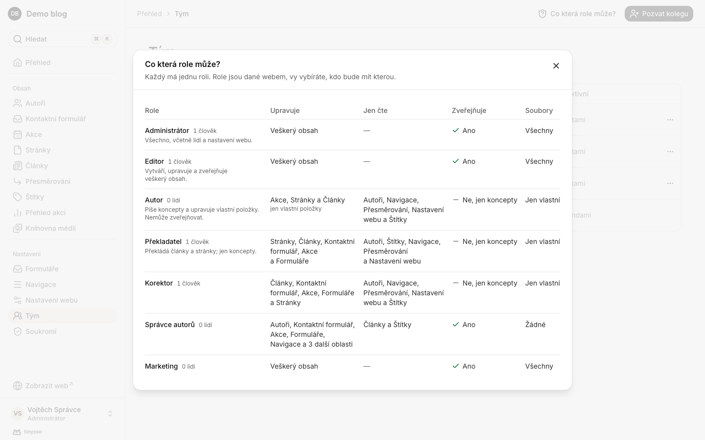
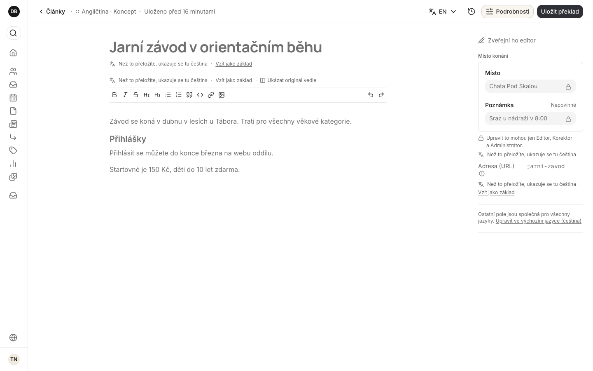
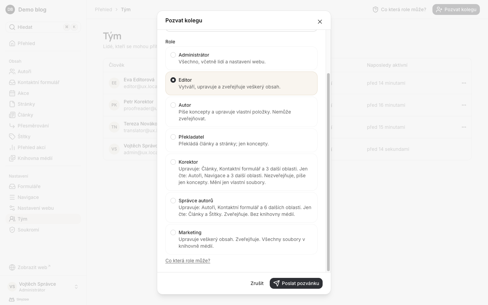
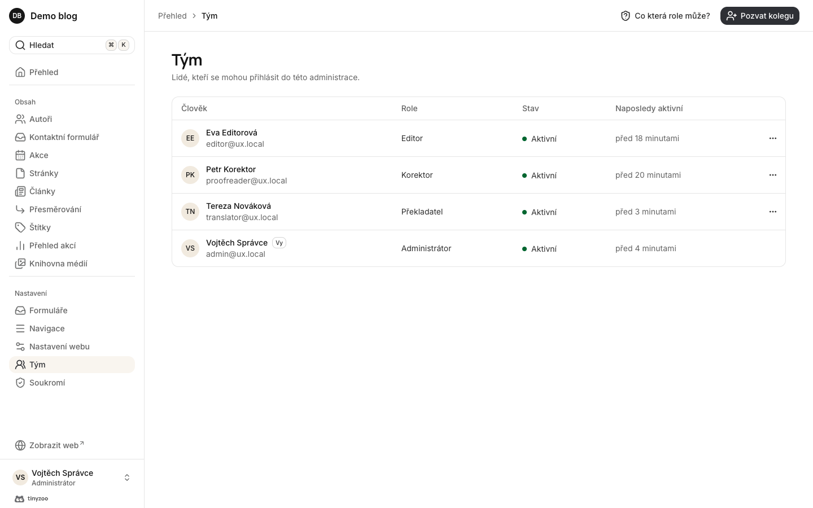

# Roles and permissions

What a role is, how to find out what each role can do, why you can't change some fields, and what to do when your role has gone. At the end there's a part for administrators: inviting someone with a role, and changing a role.

## What a role is

Everyone who signs in to the admin has **one role**. The role says what they can do: which parts of the website they can change, which they can only read, whether they can publish, and what they can do in the media library.

You'll find your role at the bottom left, under your name (in the menu on a phone).

Every website has three basic roles:

| Role | What they can do |
|---|---|
| **Administrator** | Everything, including people (the **Team** section) and the **Privacy** section. |
| **Editor** | Creates, edits and publishes all content. |
| **Author** | Writes drafts and edits their own entries. Cannot publish. |

A website can also have **custom roles**, such as **Translator** or **Proofreader**. The website's developer sets them up to match what people in your organisation actually do. Each one is based on the editor or the author role, with some things taken away (or, for an author, added). A translator, for example, might be able to edit only posts and pages, and not publish anything.

**The roles come with the website; the administrator chooses who has which.** You can't create a new role or change its rules in the admin. If you need a different role, ask your developer.

<!-- clip: roles | Short video: the "What can each role do?" overview, inviting a colleague with a role, and a locked field that only some roles can change. -->

## What can each role do?

Administrators find an overview of all the roles in the **Team** section, with the **What can each role do?** button at the top right. If you're an editor or an author, you don't see this section. Your administrator can tell you what your role can do.

How to read the table:

- **Role**: the role's name, how many people have it, and one sentence on what it's for.
- **Changes**: the parts of the website the role can change. **All content** means everything. If it says **only the entries they created** underneath, the role changes only what it created itself (that's how the author role works).
- **Only reads**: the parts of the website the role can see but not change. Parts that aren't in any column are hidden from the role completely.
- **Publishes**: **Yes**, or **No, drafts only**. A role that doesn't publish also can't change what's already on the website, or content that goes on the website as soon as it's saved (such as **Site settings** or **Redirects**). That's why those parts are in its **Only reads** column.
- **Files**: the media library. **All** (changes every file), **Their own** (uploads and changes only the files they uploaded; they can see and use the others) or **None** (the media library is closed to the role).

You'll see the same sentence about the role in the invitation and when changing someone's role; see [below](#inviting-a-colleague-with-a-role).

## A field you can't change

A website can lock some fields so that only certain roles can change them. For example, only an editor, not a translator, might be allowed to change where an event takes place.

You'll recognise such a field straight away: **it has a grey background and a padlock**, and below it a note says who can change it, for example:

> Only Editor, Proofreader, and Administrator can change this.

You can read the value, but you can't overwrite it. **Need a change? Write to someone with one of the roles named in that sentence.** Your administrator knows who has which role.

A field your role isn't even allowed to read isn't in the form at all. Don't go looking for it: you won't see it in the list, in the history or in search either.

### A whole entry you can only read

Sometimes you can't change anything in a whole entry. Then you'll see **Read only** at the top by the title, and a box above the form explains why, for example:

- **Once it’s live, only an editor can change it.** Your role doesn't publish, so it can't change what's already on the website.
- **Only its author or an editor can change this.** Someone else created the entry.
- **Only an editor or an administrator can change this.** Your role can only read this part of the website.

Below that, it always says: **You can read everything, but nothing here can be edited or saved. If you need a change, ask an editor.**

Other places like this:

- **You can’t add anything here**: in a list where your role isn't allowed to add new entries. You can still look through the list.
- **The media library is not open to your role**: your role has no media library. Pictures already on entries stay, and keep showing on the website.
- **An editor will publish it**: in place of the **Publish…** button, for a role that doesn't publish. When you're done, let an editor know.

## Your role no longer exists

After you sign in, you might see:

> **Your role no longer exists**
> Your account is fine, but the role “…” is no longer defined for this site, so you have no access to the content. Ask an administrator to give you another role.

This happens when the developer has removed your role from the website. **Your account, your password and everything you've written are still there.** You just don't have a role right now, so you can't see any content. You can still open the **Your account** page and sign out.

Write to your administrator. As soon as they give you another role, sign in again and you'll see everything your new role allows.

## For administrators

### Inviting a colleague with a role

1. In the menu on the left, under **Settings**, open **Team**.
2. Click **Invite someone**.
3. Type their email, optionally their name, and choose a role under **Role**. Each role has one sentence saying what it can do. Not sure? The **What can each role do?** link below the roles opens an overview of all of them side by side.
4. Click **Send invitation**.

Your colleague gets an email saying who is inviting them and in which role. A custom role is named the way you see it in the admin (**Translator**, for example). More about invitations, what to do when the email doesn't go out, and the other options in **Team** is in the [Signing in and your account](signing-in-and-your-account.md#inviting-colleagues-administrators-only) chapter.

### Changing a role

1. In **Team**, click the three dots next to the person.
2. Choose **Change role**, then the new role from the menu. Again, each role has a sentence about what it can do.

The role changes straight away and the admin confirms with **Role changed**.

> **Watch out:** After a role change, the person is **signed out on every device**. The next time they sign in, they have the new role. Any unsaved changes they were in the middle of are lost, so it's best to let them know beforehand.

You can't change your own role. And the last active administrator can't be switched to another role, so that someone can always get into the website.

### When a role disappears

When the developer removes a role from the website, the people with that role stay in **Team**. Their role shows the warning **This role no longer exists: the person can sign in but sees nothing. Give them another role.** Pick another one for them with **Change role**, and that's it.

## See also

- [Signing in and your account](signing-in-and-your-account.md): invitations, disabling access, removing someone
- [Translations](translations.md): what someone who doesn't publish can do with each language
- [Images and files](images-and-files.md)
- [Troubleshooting](troubleshooting.md)
