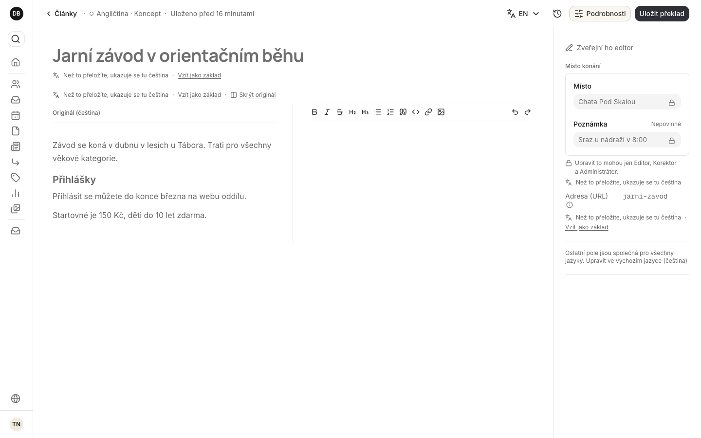
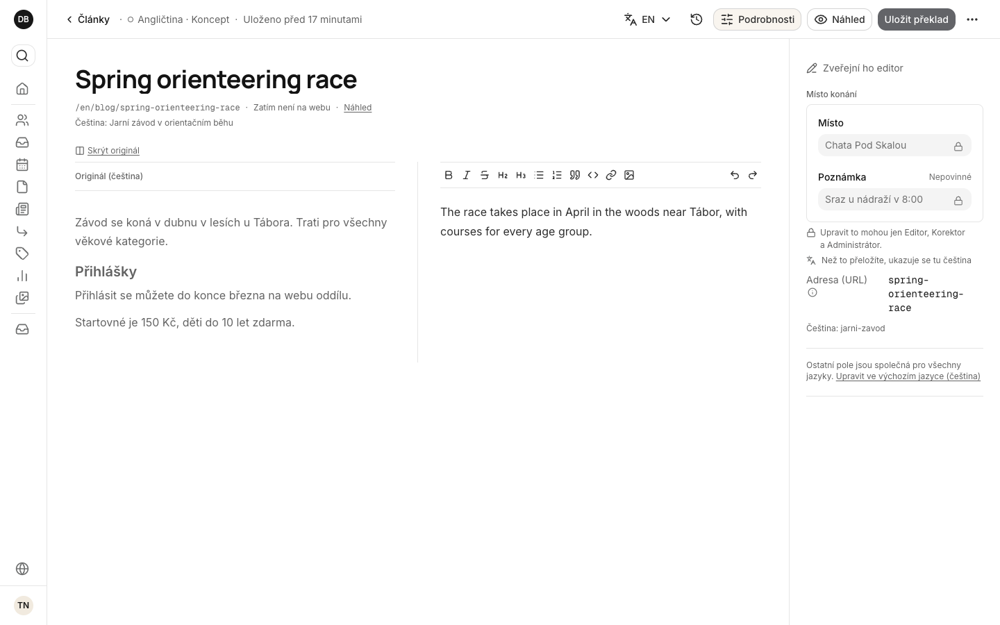
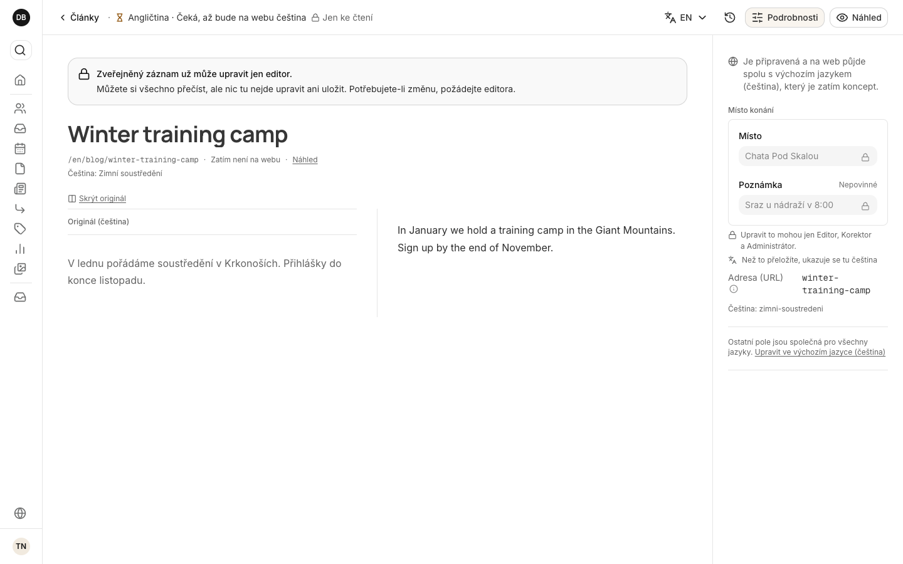
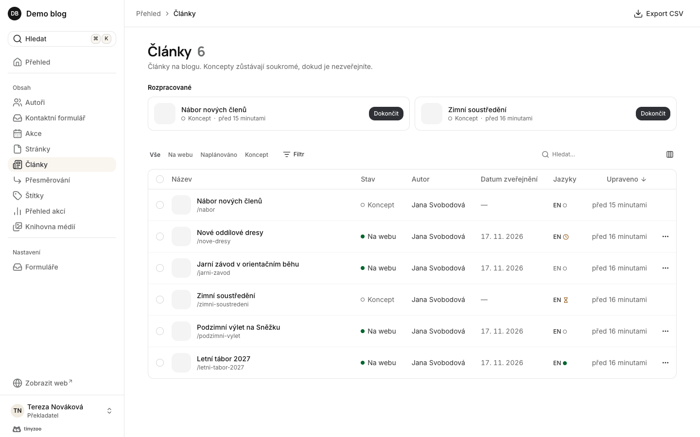
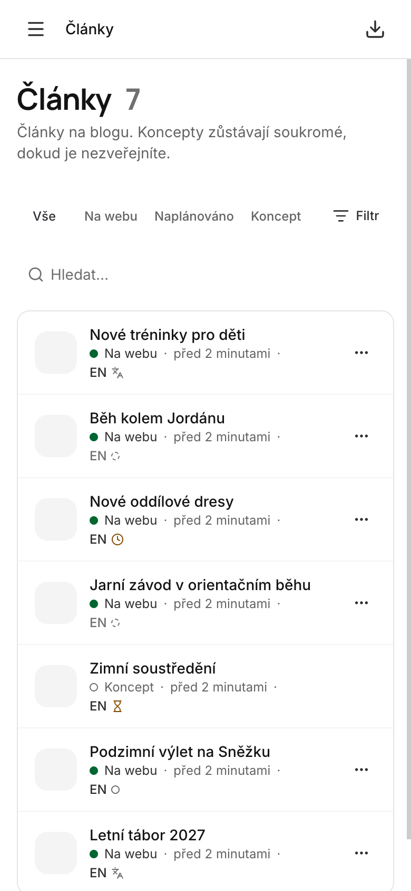
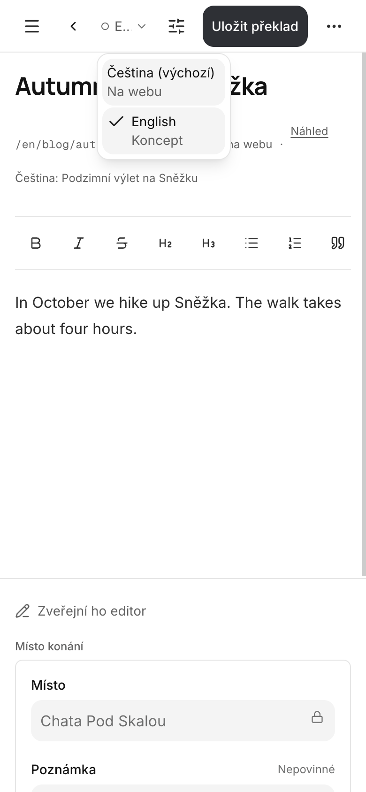

# Translations

How to add an English (or other) version of a page or news item, how to translate with the original in front of you, and when a translation appears on the website.

A website can have several languages. One of them is the **default** (in this guide's examples, Czech). The others are translated from it. You don't have to translate everything: wherever a translation is missing, visitors see the text in the default language.

## How to translate a page or news item

1. Open the entry you want to translate. It must be **saved** first: a brand-new entry has no language button in the top bar yet (and for settings that haven't been saved, the language menu says **Save first, then translate**).
2. At the right of the top bar there's a button with a languages icon and the short code of the language you're in (**CS**, for example). Click it and choose the language you're translating into. Each language shows how it's doing: **(default)**, **Translated**, **Not translated**, or its status, such as **On the website** or **Draft**. You can also switch language in the **Details** panel, which has the same list. (It works differently on a phone; see [On a phone](#on-a-phone).)
3. The top of the screen, by the title, now shows which language you're in and its status, for example **English · Draft**.
4. Rewrite the text in the new language (how the original helps you with that is explained [just below](#translating-with-the-original-in-view)).
5. Click **Save translation**.

You go back to the default language the same way: with the language button in the top bar, choosing the language marked **(default)**.

## Translating with the original in view

When you open a language that hasn't been translated yet, the fields aren't empty. **Every untranslated field shows the Czech text in grey.** That's exactly what a visitor reading in that language would see there until you translate it. One line above the form says so: **Empty fields show the Czech text in grey until you translate them.**

- **Use it as a start** puts the Czech text into the field. Handy when you only want to adjust the text a little, or when it contains names and numbers that stay the same. Then you write over it.
- Once you've translated a field, the grey text disappears. Below the field you can still see how it reads in Czech, for checking, for example **Czech: Jarní závod v orientačním běhu**.
- Longer text (a post's or a page's body) also has **Show the original beside it**. The **Original (Czech)** appears on the left and you write the translation on the right. Paragraph by paragraph, you can see what's still left to do. **Hide the original** puts it away again. This option is only there on a wider screen, not on a phone.

<!-- clip: translate | Short video: translating a post into English, with the Czech original beside it, and saving the translation. -->

> **Tip:** Having the original beside you is also handy for checking a finished translation. You don't change anything; you're only looking.

## What visitors see in an untranslated field

The Czech text. Nothing breaks; the English version of the website just shows Czech in that spot. The grey text in the field shows you this in advance.

The admin reminds you before publishing, too: for a field you haven't translated you'll see, for example, **Text is empty** and below it **Visitors see the Czech text here until you translate it.**, with a **Translate** button. It's only a reminder. You can publish anyway.

## What gets translated and what doesn't

**Text** gets translated: the title, the page address, the body text, blocks, descriptions for search engines. Pictures, numbers, dates and switches are the same in every language. That's why the **Details** panel says **Everything else is the same in all languages.**, with an **Edit the default language (Czech)** link that takes you back to the default version, where those fields are changed.

A website can lock some fields for certain roles only. They have a grey background and a padlock, and below them it says who can change them, for example **Only Editor, Proofreader, and Administrator can change this.** More in the [Roles and permissions](roles-and-permissions.md) chapter.

## When a translation is on the website

That depends on how your website has set up that kind of content. You can tell in the **Details** panel of the translation.

**Publishing shared by all languages.** When the translation says **Publishing applies to all languages.**, the entry has just one status. When you publish it, all its language versions go on the website at once. A saved translation of a published entry is on the website straight away.

**Each language on its own.** On websites where the developer has switched this on (for posts, for example), every language has its own status: **Being translated**, **Draft**, **Scheduled** or **On the website**. That way you can finish a translation in peace and publish it when it's ready. The details are in the next part.

## Each language on its own

### A language's status

You can see the status in four places: at the top by the title (**English · Draft**), in the language menu, in the **Details** panel, and in the list of entries.

- **Being translated**: a translation that has never been on the website. Visitors still see Czech, exactly as before, and see nothing of the unfinished translation (neither its text nor its address). It stays that way until an editor publishes it. You can look at the unfinished translation in **Preview**.
- **Draft**: an editor has taken this language off the website. Visitors won't find the page in it; it won't come up for them in lists, in the site map or in search. You can look at the translation in **Preview**.
- **Scheduled**: the language goes on the website on the day and at the time you chose.
- **On the website**: visitors can see it.
- **Follows the default language**: the language doesn't have its own status yet. It goes on and off the website together with Czech. Every language starts like this until someone publishes or unpublishes it separately. That's why nothing changes on the website when the developer switches this option on.

Open the language and use **Publish…**, **Update** or **Schedule**. In the **More actions** menu (the three dots) you'll find **Unpublish** and **Follow the default language again**. All of this applies only to the language you have open. The other languages don't change.

### A new translation of a post that's already on the website

Open English on the post, write the translation and save. English is then **Being translated**. The panel on the right and the bubble by the status say **Visitors see the Czech version until an editor publishes this one.** You can save as often as you like; nothing changes on the website. When the translation is ready, an editor publishes it (**Publish…**), and from then on visitors reading in English see the English text.

A translation of a post that's still a draft follows Czech: it goes on the website together with Czech, when an editor publishes the Czech version.

### Czech comes first

**A translation goes on the website only together with the Czech version.** While Czech is a draft, not even a published translation is on the website. It's ready and waiting. The language then says **Waiting for Czech**, and in the list it has an hourglass. As soon as you publish Czech, the translation goes on the website too, all by itself.

Why? In a translation, untranslated fields show Czech. If the translation went on the website first, visitors would see the unfinished Czech text too.

- When you take Czech off the website, all the languages go with it. Their own status isn't forgotten, though: once Czech is published again, they're back the way they were.
- You can unpublish or schedule one language separately, even while Czech is on the website.
- If you schedule both a language and Czech, the language goes on the website once both dates have passed (the later one counts).

### Publishing a translation

**Publish…** on a translation opens the **Publish the English version** check, with the sentence **The other languages stay as they are.** (for a translation that's being translated, with the sentence **Until now visitors see the Czech version here. The other languages stay as they are.**). As with a whole entry, it warns you about untranslated fields and shows the **Web address**. When Czech is still a draft, the top says **Czech is still a draft**, and the **Right now** option says **It goes on the website together with Czech.** There's more about publishing in the [Publishing, scheduling, preview](publishing-and-preview.md#publishing-a-translation) chapter.

### Who can publish a language

Someone who isn't allowed to publish (an **Author** or a **Translator**, for example) writes and saves the translation, but doesn't publish it. Instead of the **Publish…** button, they see **An editor will publish it**. Such a person also:

- can't publish, unpublish or schedule any language;
- can't change a language that's on the website, or a translation that follows Czech while Czech is on the website. A language like that opens as **Read only** for them;
- can't remove a translation that an editor has taken off the website (visitors would then see Czech again).

They can write in a language that isn't on the website. This is how it works in practice:

- **A post that's already on the website**: the translator opens English, writes and saves. English is **Being translated**, and visitors still see Czech. An editor looks at the translation in **Preview** and publishes it. The translator may also remove a translation that's being translated; that changes nothing on the website.
- **A new post** can be translated even before it's published. Czech is a draft, English follows Czech, and the translator can write in it. The editor then publishes Czech, and English goes on the website with it.

### Languages in the list

The list of entries has a **Languages** column. When each language is published on its own, every language apart from the default one shows its short code and a mark:

| Mark | What it means |
|---|---|
| filled green circle | **On the website** |
| empty circle | **Draft** |
| languages icon | **Being translated**: visitors still see Czech |
| clock | **Scheduled** |
| hourglass | **Waiting for Czech**: the translation is published, but Czech isn't yet |

The code is paler when the language hasn't been translated yet (it shows Czech). Hover over the mark and it's spelled out in words, for example “English: On the website · follows the default language”.

For content where everything is published together, the **Languages** column shows either **All languages** or **EN missing** (depending on what's missing). It helps you quickly find things that haven't been translated yet.

## On a phone

In the list on a phone, the languages for each entry are below its status, with the same marks as on a computer.

In an open entry on a phone, the language and its status are at the top left, right next to the back arrow, as the status mark and the language code (for example a grey ring and **EN** for a draft, a green dot for a language on the website). **Tap it and the language menu opens**, with the status of each language in words. You'll find the same menu under **More actions** (the three dots), under **Language**.

On a phone, the button for saving a translation is just called **Save**, so that the language fits in the bar too. While you have unsaved changes, it says **Unsaved** instead of the language. Once you save, the language is back.

## An address in another language

A page's address can be translated too. The **O nás** ("About us") page might be at `/o-nas` on the website, and its English version at `/en/about`. If you leave the English address empty, the Czech one is used.

Below the translation's heading is the address and, next to it, whether it's on the website. If it isn't yet, it says **Not on the website yet** and there's a **Preview** link instead of a link to the website.

## Removing a translation

You remove a translation you no longer want with the **Remove translation** button (in the **More actions** menu, when you have a language other than the default one open). The admin asks **Remove the translation: English?**. Visitors reading in that language then see the default language again. **This can’t be undone.** For a translation that's being translated, nothing changes on the website: visitors already see Czech.

> **Tip:** If you just want to try a translation out, save it first and open **Preview**. You'll see the page the way a visitor reading in that language will see it.

## See also

- [Pages and blocks](pages-and-blocks.md)
- [Publishing, scheduling, preview](publishing-and-preview.md)
- [Roles and permissions](roles-and-permissions.md): locked fields and who can publish
- [Troubleshooting](troubleshooting.md): "The English version is missing"
