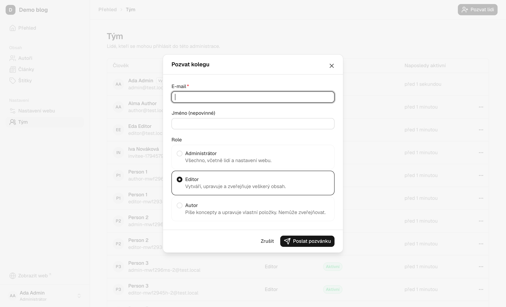

# The admin: accounts, look and extension points

What editors work in (`/admin`), how people sign in, how it is branded, and how to change how a field is drawn.

## Accounts, roles & sign-in

The CMS owns its users (`cms_users`). A fresh install shows **first-run setup** at
`/admin`, which creates the first administrator; everyone else is **invited** from
Settings → Team (email with a one-time link, plus a copyable link if the email gets
lost). People reset forgotten passwords themselves; links expire (invites 7 days,
resets 1 hour) and only a hash of each is stored. In production setup always asks for
a **setup code** — your `NUXT_CMS_AUTH_SETUP_TOKEN`, or one the server prints in its
log (`Setup code: XXXX-XXXX-XXXX-XXXX`) when none is set — so a fresh deploy cannot be
claimed by whoever opens the page first.

| Role | Can |
|---|---|
| Administrator | everything, plus people (invite, change role, disable, remove) |
| Editor | create, edit, publish and delete all content; edit site settings |
| Author | create drafts; edit and delete only what they created; never publish, never touch settings |

An entity's own `access` rules still apply on top (AND-ed). Every request re-reads
the account, so disabling someone, changing their role or changing a password takes
effect immediately, not when a cookie expires. Sign-in is rate-limited, failures look
identical whether or not the address exists, and writes, sign-ins and people changes go
to an audit log (`cms_audit`). Every content row records `createdBy` / `updatedBy`.

Configuration (all overridable by env):

```ts
cms: {
  publicUrl: 'https://cms.example.com',   // NUXT_CMS_PUBLIC_URL — required in production: links in emails use it, never the Host header
  mail: {
    transport: 'smtp',                    // NUXT_CMS_MAIL_TRANSPORT: log (default) | file | smtp (Node only)
    from: 'Pekárna Novák <web@pekarna-novak.cz>',
    smtp: { host: 'smtp.example.com', port: 587, user: '…', pass: '…' }, // NUXT_CMS_MAIL_SMTP_*
  },
  auth: {
    mode: 'builtin',                      // 'external': your app signs people in and sets event.context.cmsUser
    trustedProxies: 1,                    // proxies appending to X-Forwarded-For (rate limits read the client IP behind them)
    ipHeader: '',                         // or a trusted edge header, e.g. 'cf-connecting-ip'
  },
}
```

Sessions last 14 days from sign-in (`runtimeConfig.session.maxAge`). State-changing
requests to `/api/cms/**` must send JSON (multipart only for media uploads) and, when
the browser reports it, come from the same origin — so a form on another page of the
site or a sibling subdomain cannot act as a signed-in editor (CSRF). Rate limits are
in memory per instance today; a shared store for several replicas is planned (Phase 5).

Locally, `docker compose --profile mail up -d` starts Mailpit; set
`NUXT_CMS_MAIL_TRANSPORT=smtp NUXT_CMS_MAIL_SMTP_HOST=localhost NUXT_CMS_MAIL_SMTP_PORT=1025`
and read the emails at http://localhost:8025. Without it, emails are printed to the
server log.



## Admin look & language

The admin has its own design system, scoped so it never touches the host website's
theme: tinyzoo's look — a white workspace, charcoal actions, cream for the brand's
moments (with one of the animals), Manrope titles and Inter text, and a "charcoal
night" dark mode. It works on phones. It speaks Czech and English (cookie → browser
language → default). Brand it per client in `app.config.ts`:

```ts
cms: { admin: {
  name: { cs: 'Pekárna Novák', en: 'Novák Bakery' },
  siteUrl: 'https://pekarna-novak.cz',
  accent: 'mono',              // mono (default) | indigo | blue | violet | emerald
  locales: ['cs', 'en'], defaultLocale: 'cs',
  timeZone: 'Europe/Prague',   // dates are shown and edited in this zone
} }
```

Labels in `cms.config.ts` take one string or one per admin language
(`label: { en: 'Posts', cs: 'Články' }`), and entities can set `icon`,
`labelSingular` and `description`.

Each editor and list is arranged for its content, without configuration: news (a
rich-text body with a page) opens as a calm **writing** column, events and settings as
a **form**, pages built from blocks beside their **live preview**; lists are tables
(with drafts "in progress" on top), picture grids (albums, logos) or **Upcoming / Past**
(events). Override where the guess is wrong:

```ts
defineEntity('event', { /* … */ admin: { editor: 'form', list: { columns: ['title', 'startsAt'], layout: 'table' } } })
defineSingleton('home', { /* … */ admin: { preview: '/' } }) // edit the home page beside the live page
```

The preview beside the form follows the typing: the editor's unsaved values go to the
server, and the preview page refetches its content, with those values laid over the
entry for that editor's own `?preview` requests only (never cached, never public, gone
when they close the editor). A site that loads its content through the content API with
`?preview` (as the starter does) needs no code for it. A site rendering from somewhere
else can listen for `{ type: 'cms:preview', entity, id, locale, data }` messages.

Forms read as a few titled sections. Name them as plain questions, and give fields
the icons and options that make them quick to fill in. Empty optional fields wait
behind "+ Add …"; long forms get a section menu beside them:

```ts
defineEntity('event', {
  /* … */
  admin: { sections: [
    { label: { cs: 'Kdy?', en: 'When?' }, icon: 'i-lucide-calendar', fields: ['startsAt', 'endsAt'] },
    { label: { cs: 'Kde?', en: 'Where?' }, icon: 'i-lucide-map-pin', fields: ['place'] },
    { label: { cs: 'Kontakty', en: 'Contacts' }, fields: ['email', 'phone'], columns: 2 },
  ] },
  fields: {
    kind: f.select({ options: ['race', 'club'] as const, icons: { race: 'i-lucide-trophy', club: 'i-lucide-users' } }),
    startsAt: f.datetime({ allDay: true }),          // an "All day" switch; stored at 0:00
    place: f.text().optional().icon('i-lucide-map-pin'),
    organised: f.boolean().label('We organise it').help('It gets a label in the calendar.'), // the help is the switch's sentence
    /* … */
  },
})
```

Without `admin.sections`, a form of six fields or more is grouped by kind (dates,
pictures, links, related entries); `admin.tabs` read as sections in the form and
preview editors.

Tokens, rules and building blocks:
[`../ui-foundation.md`](../ui-foundation.md); live tour at `/admin/styleguide`.

## Theming (host-owned)

The CMS components use semantic Nuxt UI classes (`bg-primary`, `text-muted`, …), so the
host re-skins the whole admin from its own `app.config.ts` + `main.css` — no package edits.
The playground ships a monochrome theme: `primary` is a custom `ink` ramp anchored at `#555`
(defined via `@theme` in `main.css`), `neutral` is a true-neutral gray.

## Extensibility — the field & view registry

Every field renders through a tiny dispatcher (`CmsField` for the edit form,
`CmsCell` for list cells) that resolves a component **by name** with this precedence:

```
app.config  cms.fields[type].edit   (host override, by field type)
  → a plugin's `fields[type].edit`  (see [Plugins](../plugins.md))
    → field.ui.edit                 (built-in default, from the descriptor)
      → CmsFieldText                 (fallback)
```

So a host adds or replaces a renderer **without touching the package** — ship a
component and register its name:

```ts
// app.config.ts
export default defineAppConfig({
  cms: { fields: { select: { edit: 'MySegmentedSelect' }, color: { edit: 'ColorPicker', cell: 'ColorSwatch' } } },
})
```

```vue
<!-- components/global/MySegmentedSelect.vue  (props: { field }, v-model) -->
```

> Custom renderers must be **globally registered** (put them in `components/global/`
> or use the `.global.vue` suffix) — the registry resolves them at runtime, and
> `resolveComponent` only sees globals. The playground does exactly this in
> `app/components/global/PgStatusSelect.vue`, rendering the post status as a
> segmented control instead of the default dropdown.


Built-in renderers live in `packages/cms/app/components` (`CmsField*` / `CmsCell*`),
one small component per type — each independently overridable.

## Authoring experience

The admin is built for non-technical clients, not just developers:

- **Rich text** — the TipTap editor does **links** and **inline images** (pick from
  the media library or upload inline). Stored content is sanitized on write *and* at
  render (CmsContent), so a `javascript:`/`data:` href or src can never reach a visitor.
- **Media library** — browse, search and **reuse** existing uploads instead of
  re-uploading; set **alt text** per image (accessibility + SEO). Blobs are
  reference-counted across media fields **and images embedded in rich text**, so an
  asset is GC'd only when truly orphaned (and never while still referenced).
- **Slugs auto-generate** from their source field (`f.slug({ from: 'title' })`) until
  you edit them, and never clobber an existing slug.
- **Friendly fields** — labels are humanized from the key, overridable with
  `.label('Publish date')`, with help text via `.help('…')`.
- **Safety rails** — destructive deletes ask for confirmation, and leaving a form with
  unsaved changes warns you (in-app navigation and tab close).

```ts
publishedAt: f.datetime().optional().label('Publish date'),
slug: f.slug({ from: 'title', unique: true }).help('Auto-generated — edit to override.'),
```
