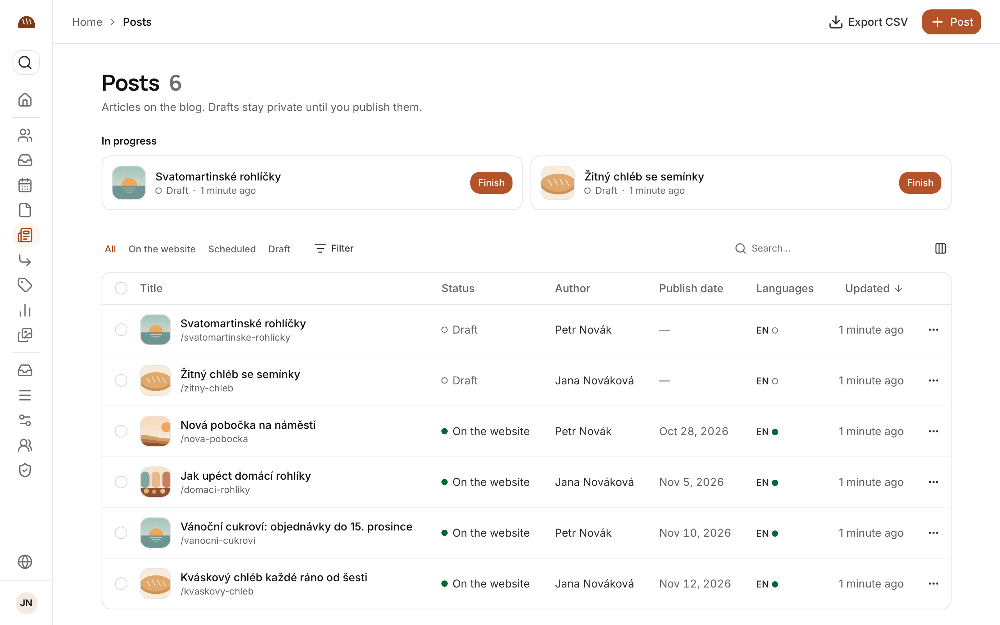
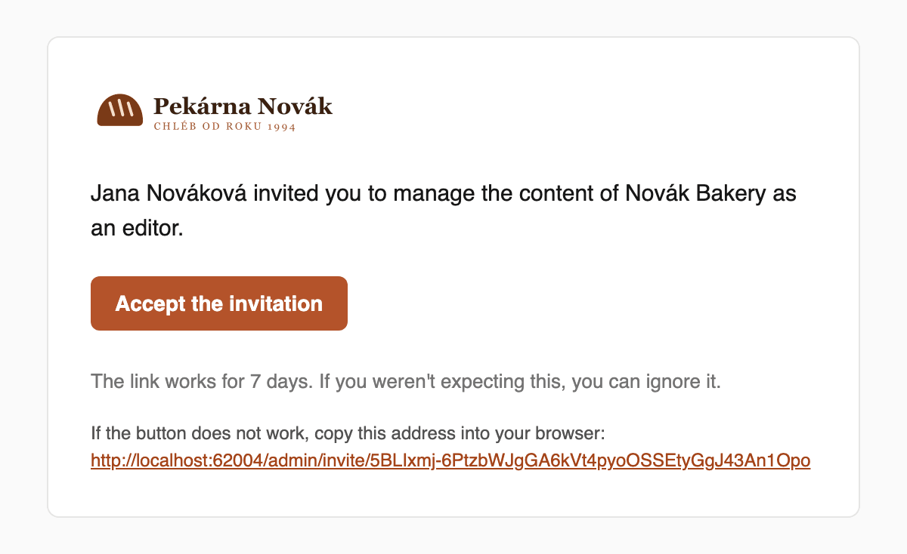
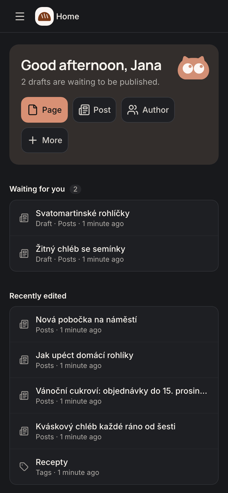
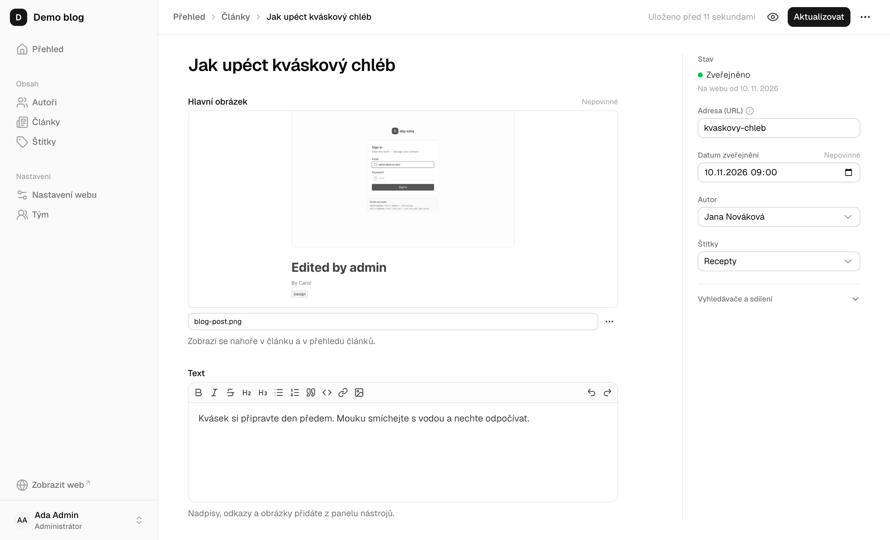

# The admin: accounts, look and extension points

The admin (`/admin`) is where editors work. This page covers how people sign in, how you brand the admin, and how to change the way a field is drawn.

## Accounts, roles & sign-in

The CMS owns its users (`cms_users`). People get in like this:

1. A fresh install shows **first-run setup** at `/admin`. It creates the first administrator.
2. Everyone else is **invited** from Settings → Team. The invitation is an email with a one-time link, plus a copyable link in case the email gets lost.
3. People reset forgotten passwords themselves.

Invite links expire after 7 days and reset links after 1 hour. Only a hash of each link is stored.

In production, setup always asks for a **setup code**. It is your `NUXT_CMS_AUTH_SETUP_TOKEN`. When none is set, the server prints one in its log (`Setup code: XXXX-XXXX-XXXX-XXXX`). So a fresh deploy cannot be claimed by whoever opens the page first.

There are three built-in roles:

| Role | Can |
|---|---|
| Administrator | everything, plus people (invite, change role, disable, remove) |
| Editor | create, edit, publish and delete all content; edit site settings |
| Author | create drafts; edit and delete only what they created; never publish, never touch settings |

A site can define roles of its own on top of these three, such as a translator that edits only posts, or an editor with no media library. It can also say per field who reads and who edits it. See [Roles and permissions](roles.md).

An entity's own `access` rules still apply on top (AND-ed).

### Configuration

All of these options can be overridden by env:

```ts
cms: {
  publicUrl: 'https://cms.example.com',   // NUXT_CMS_PUBLIC_URL — required in production: links and the logo in emails use it, never the Host header
  mail: {
    transport: 'smtp',                    // NUXT_CMS_MAIL_TRANSPORT: log (default) | file | smtp (Node only)
    from: 'Pekárna Novák <web@pekarna-novak.cz>',
    smtp: { host: 'smtp.example.com', port: 587, user: '…', pass: '…' }, // NUXT_CMS_MAIL_SMTP_*
  },
  auth: {
    mode: 'builtin',                      // 'external': your app signs people in and sets event.context.cmsUser
    trustedProxies: 1,                    // proxies appending to X-Forwarded-For (rate limits read the client IP behind them)
    ipHeader: '',                         // or a trusted edge header, e.g. 'cf-connecting-ip'
  },
}
```

### Security details

- Every request re-reads the account. Disabling someone, changing their role or changing a password takes effect immediately, not when a cookie expires.
- Sign-in is rate-limited. Failures look identical whether or not the address exists.
- Writes, sign-ins and people changes go to an audit log (`cms_audit`).
- Every content row records `createdBy` / `updatedBy`.
- Sessions last 14 days from sign-in (`runtimeConfig.session.maxAge`).
- State-changing requests to `/api/cms/**` must send JSON (multipart only for media uploads). When the browser reports it, they must also come from the same origin. So a form on another page of the site, or on a sibling subdomain, cannot act as a signed-in editor (CSRF).
- Rate limits are in memory per instance today. A shared store for several replicas is planned (Phase 5).

### Email while developing

Locally, `docker compose --profile mail up -d` starts Mailpit. Set `NUXT_CMS_MAIL_TRANSPORT=smtp NUXT_CMS_MAIL_SMTP_HOST=localhost NUXT_CMS_MAIL_SMTP_PORT=1025`, and read the emails at http://localhost:8025.

Without Mailpit, emails are printed to the server log.


## Admin look & language

The admin has its own design system, scoped so it never touches the host website's theme. It has:

- a white workspace, charcoal actions, and cream for the brand's **moments**: the sign-in pages, the welcome card, the current page in the sidebar; most of them with one of tinyzoo's animals
- Manrope titles and Inter text
- a "charcoal night" dark mode
- a layout that works on phones

All of it can carry the client's brand instead of tinyzoo's: a name, a colour and a logo set.

### What you can brand

Everything is in `cms.admin`, in the site's `app.config.ts`, and every key is optional. Without `name`, `accent` and `logo`, the admin is tinyzoo's own.

```ts
export default defineAppConfig({
  cms: { admin: {
    name: { cs: 'Pekárna Novák', en: 'Novák Bakery' }, // the sidebar, the tab title, the emails; the logo's text for screen readers
    siteUrl: 'https://pekarna-novak.cz',                 // "View website"
    accent: '#B4532A',           // the client's brand colour, or mono (default) | indigo | blue | violet | emerald
    logo: { full: '/brand/logo.svg', mark: '/brand/mark.svg' }, // files in public/brand/; fullDark and markDark too
    signature: true,             // tinyzoo's quiet signature; false hides it
    animals: true,               // tinyzoo's animals at the moments; false hides them all
    locales: ['cs', 'en'], defaultLocale: 'cs', // the admin's languages (below)
    timeZone: 'Europe/Prague',   // dates are shown and edited in this zone
  } },
})
```

The server reads `cms.admin` when it runs and gives the admin and the emails one resolved theme (`GET /api/cms/_theme`). Name, colour and logos come from there, so changing `cms.admin` in the browser at run time (`updateAppConfig`) does not change them.


### The brand colour

`accent` takes one of the built-in accents (`mono`, tinyzoo's charcoal, is the default; `indigo`, `blue`, `violet`, `emerald`) or the client's brand colour as a hex: `'#B4532A'` or `'#b53'`. Names are read in any case, and spaces around a value are ignored.

The colour goes where the accent goes:

- main buttons, and a button under the pointer (a shade of its own, one step away from its text)
- the current page in the menu
- links
- focus rings: a solid 2 px ring in the link colour, never in a light button colour
- checked boxes and switches, selected options

**With a brand colour, the whole look follows it.** The moments, which are cream in tinyzoo's own look (the sign-in, setup, reset and invitation pages, the welcome card on the home page, the current page in the sidebar and in a form's section menu, the icon tiles of form sections), become a faint tint of the brand in light mode and charcoal leaning toward it in dark mode: calm paper with a hint of the brand, never a coloured background. A near-grey brand gives near-grey moments. The animals take one muted shade of the brand with a near-white face, in light and dark mode.

The white workspace, the greys and the status colours (green "On the website", red errors) stay as they are. With a built-in accent (`mono` and the four colours) the moments stay cream and the animals keep their own colours.

tinyzoo works out the rest: the shades, a lighter version for dark mode, a button's colour under the pointer, the text colour on a button, the moments' tints and the animals' shade.


**The text on a button is white or ink, whichever reads better.** Dark colours get white text, light ones ink. Mid tones often get ink too: on `#3B82F6` ink reads at 5.0:1 and white at only 3.7:1, so its buttons carry ink text. That is on purpose; there is no option to force white. The built-in colour accents (`indigo`, `blue`, `violet`, `emerald`) have white text in light mode and ink in dark mode.

**The contrast guard.** Every colour has to stay readable, in light and dark mode:

- 4.5:1 for the text on a button, at rest and under the pointer;
- 4.5:1 for links and other accent text on the page, and for every text on the brand's moments;
- 3:1 for focus rings.

When the brand colour falls short, tinyzoo moves it to the nearest colour that passes. Only the lightness changes; the hue stays. A light colour keeps its buttons: a yellow brand gets yellow buttons with ink text, while its links use a darker yellow. Links are checked on white, the brand's own moments, the hover grey and the colour's own light tint (the soft buttons, a hovered day in the calendar). So a colour that reads on white can still get a slightly darker shade for its links: `#B4532A` is 4.9:1 on white but 3.7:1 on its own tint, and its links use `#A44419`.

In development, the server log and the browser console say what changed and why:

```
[tinyzoo] cms.admin: accent #FFD500: links and other accent text would be 1.3:1 on the hover grey; they use #766100 (4.5:1); buttons keep #FFD500 with ink text (13.0:1).
```

The server log says it at every start, the browser console once per browser session (and again when the colour changes). To silence the message, pick a colour that passes, or accept the adjustment: nothing breaks either way. Production adjusts quietly.

An accent tinyzoo cannot read (`'red'`, `'#12345'`) falls back to `mono`, with the same kind of message in development.

You can try colours at `/design-system` on the tinyzoo website: it runs the same guard and shows the moments and animals a colour gives.


### The client's logo

Give the admin the client's logo set in `cms.admin.logo`. Each value is a file in the site's `public/` folder (`/brand/logo.svg`) or an `https://` URL:

```ts
logo: {
  full: '/brand/logo.svg',          // the wide logo with the name
  mark: '/brand/mark.svg',          // the square mark
  fullDark: '/brand/logo-dark.svg', // optional: for dark mode
  markDark: '/brand/mark-dark.svg', // optional
},
```

| Logo | Where it shows | Best as |
|---|---|---|
| `full` | the open sidebar (28 px high), the phone's menu, the sign-in, reset and invitation pages (40 px high), the emails | SVG, or a PNG at least 320 px wide (640 px is better), on a transparent background |
| `mark` | the folded sidebar, the phone's top bar, the browser tab, the phone's home screen | a square SVG, or a square PNG of 512 × 512 |
| `fullDark`, `markDark` | the same places in dark mode | light versions of the two above |

The full logo carries the name, so the admin uses `name` as its text for screen readers. Set `name` too.

What the admin shows when a logo is missing:

- no `full`: the mark with the client's name beside it;
- no `mark`: a tile with the name's initials (the tab keeps tinyzoo's icon);
- no logo and no `name`: tinyzoo's own mascot, as before.

**Dark mode.** Without `fullDark` or `markDark`, the light logo sits on a small light tile in dark mode, so a dark logo never disappears on charcoal. The tile is tinyzoo's cream, or with a brand colour the brand's own light tint. A dark version without its light one is not used.

**A logo that does not load** (a wrong address, a file that is gone) gives way: a full logo to the mark with the name, a mark to the initials, in light and dark mode. A dark version that does not load leaves its light one in place, on the light tile, as if no dark version had been given. An SVG needs no `width` or `height`: one with only a `viewBox`, as design tools export it, works.

**Tab and home-screen icons.** With a mark, the browser tab shows it, and tinyzoo makes PNG copies of it for browsers that need them (see [Emails and the phone's home screen](#emails-and-the-phones-home-screen)). Without a mark, or with one the server cannot read, the tab keeps tinyzoo's icon. This happens on the admin's pages only; the website keeps its own.

**Checks in development.** When the dev server starts, tinyzoo looks at each logo and warns in the log about:

- an address it cannot use (it must start with `/` or `https://`; an `http://` logo is kept with a warning, but an https admin blocks it and the server never downloads it);
- a file that is missing;
- a mark that is not square;
- a PNG that is too small to stay sharp;
- an SVG with text in it (`<text>`): the PNG copies are drawn on the server with whatever fonts it has, often none, so convert the text to outlines in your design tool.

A logo never stops the start, and production does not check.



### Emails and the phone's home screen

The emails the admin sends (invitations, password resets, the emails about a changed sign-in address) carry the client's brand:

- the full logo at the top, 160 px wide. Without `logo.full`, the site's name in bold;
- the site's name from `cms.admin.name`, in the recipient's language;
- the main button in the accent colour, with its text colour;
- the written-out link under it, a real link in the accent's link colour.

Emails never carry tinyzoo's signature. The text version stays plain: the message and the link. The email that a form sends to the site's staff is not branded.



Gmail and Outlook do not show SVG, so tinyzoo makes PNG versions of the logo on the server:

| File | Made from | What for |
|---|---|---|
| `/api/cms/_brand/full-email.png` | `logo.full` | the emails: 320 px wide, at most 120 px tall, transparent |
| `/api/cms/_brand/mark-32.png` | `logo.mark` | the PNG tab icon |
| `/api/cms/_brand/mark-180.png` | `logo.mark` | the phone's home-screen icon (apple-touch-icon): on white, with a little padding |
| `/api/cms/_brand/mark-192.png`, `mark-512.png` | `logo.mark` | the web manifest |

Without a mark, the icons show tinyzoo's own. Without a full logo, `full-email.png` is a 404 and the emails show the name. A logo that cannot be read is left out, with one line in the server log: the emails show the name, and the mark files and the tab show tinyzoo's mark.

What tinyzoo reads to make them:

- **A file of the site** (`/brand/logo.svg`): a picture in `public/` ending in `.svg`, `.png`, `.webp`, `.jpg`, `.jpeg` or `.avif`, not under `/api/`. In production it is read from the built site; in development from the `public/` folder on disk.
- **An `https://` URL**: downloaded with a 5 second limit, at most 2 MB, following at most two redirects, each to `https://` again. Only from hosts on the public internet: an address that resolves to the server's own network (localhost, private ranges, link-local, cloud metadata) is refused. A logo on an intranet server belongs in `public/` instead. An `http://` logo is never downloaded.

**Caching.** The addresses carry `?v=`, a hash of the logo file and of how tinyzoo draws it. With it, browsers and mail apps may keep a file for a year; replace the logo, even under the same name, and the address changes. In production tinyzoo reads each logo again every 15 minutes, so a new file (a redeploy, a changed `https://` logo) reaches the icons and new emails within that time. Emails already sent keep the picture they had. Development never lets the browser keep the files.

`/api/cms/_brand/admin.webmanifest` lets people add the admin to a phone's home screen. It opens `/admin/` as an app, with the site's name in the admin's default language and the mark as its icon. Without a mark there is no manifest.

**The public address.** The logo in emails needs the site's public address, `NUXT_CMS_PUBLIC_URL`. Production needs it anyway for the links. Mail clients load the logo from there, so it must be reachable from the internet. `GET /api/cms/_theme` and `/api/cms/_brand/*` need no sign-in (the sign-in page and mail clients read them), so a proxy or an access rule in front of `/api/cms` must let them through.



### Signature and animals

**`signature: false`** hides tinyzoo's quiet signature under the sidebar and at the foot of the sign-in pages ("Content administration" stays). The emails never carry it.

**`animals: false`** hides tinyzoo's animals everywhere, for any accent: the sign-in pages, the welcome card, empty places (they show a plain icon instead), the review before publishing, the card after publishing and the family on the first-run setup page. Each place closes up around it.

Together with your logo, your colour and `signature: false`, the admin carries nothing of tinyzoo's own look.

### The admin's language

The admin speaks Czech, English and German. It picks the language from a cookie (the person's own choice in the account menu), then the browser's language, then `defaultLocale`. `locales` limits which of them a site offers.

Labels in `cms.config.ts` take one string or one per admin language (`label: { en: 'Posts', cs: 'Články' }`). Entities can also set `icon`, `labelSingular` and `description`.

Nuxt UI draws a few words itself ("Close", "Previous month", "Show password"). They follow the admin language when the site's `app/app.vue` hands it over, and the starter does. Add `const uiLocale = useCmsUiLocale()` and `<UApp :locale="uiLocale">`. On the website's own pages it is empty, so the site keeps its own.

### How editors and lists are arranged

Each editor and list is arranged for its content, without configuration:

- News (a rich-text body with a page) opens as a calm **writing** column.
- Events and settings open as a **form**.
- Pages built from blocks open beside their **live preview**.
- Lists are tables (with drafts "in progress" on top), picture grids (albums, logos) or **Upcoming / Past** (events).

Override it where the guess is wrong:

```ts
defineEntity('event', { /* … */ admin: { editor: 'form', list: { columns: ['title', 'startsAt'], layout: 'table' } } })
defineSingleton('home', { /* … */ admin: { preview: '/' } }) // edit the home page beside the live page
```

### The live preview

The preview beside the form follows the typing. The editor's unsaved values go to the server, and the preview page refetches its content. Those values are laid over the entry for that editor's own `?preview` requests only. They are never cached, never public, and gone when the editor closes.

A site that loads its content through the content API with `?preview` (as the starter does) needs no code for this. A site rendering from somewhere else can listen for `{ type: 'cms:preview', entity, id, locale, data }` messages.

### Form sections

Forms read as a few titled sections. Name them as plain questions, and give fields the icons and options that make them quick to fill in. Empty optional fields wait behind "+ Add …". Long forms get a section menu beside them.

```ts
defineEntity('event', {
  /* … */
  admin: { sections: [
    { label: { cs: 'Kdy?', en: 'When?' }, icon: 'i-lucide-calendar', fields: ['startsAt', 'endsAt'] },
    { label: { cs: 'Kde?', en: 'Where?' }, icon: 'i-lucide-map-pin', fields: ['place'] },
    { label: { cs: 'Kontakty', en: 'Contacts' }, fields: ['email', 'phone'], columns: 2 },
  ] },
  fields: {
    kind: f.select({ options: ['race', 'club'] as const, icons: { race: 'i-lucide-trophy', club: 'i-lucide-users' } }),
    startsAt: f.datetime({ allDay: true }),          // an "All day" switch; stored at 0:00
    place: f.text().optional().icon('i-lucide-map-pin'),
    organised: f.boolean().label('We organise it').help('It gets a label in the calendar.'), // the help is the switch's sentence
    /* … */
  },
})
```

Without `admin.sections`, a form of six fields or more is grouped by kind (dates, pictures, links, related entries). `admin.tabs` read as sections in the form and preview editors.

Tokens, rules and building blocks are in [`../ui-foundation.md`](../ui-foundation.md). There is a live tour at `/design-system` on the tinyzoo website.

## Theming (host-owned)

The website's theme stays the website's. The CMS components use semantic Nuxt UI classes (`bg-primary`, `text-muted`, …), but the admin sets the variables behind them itself, under `html[data-cms-admin]`, at a higher specificity than Nuxt UI's `:root`. So the site's `ui.colors` in `app.config.ts` and its `main.css` theme its own pages and do not reach the admin.

To colour the admin, set `cms.admin.accent` ([above](#the-brand-colour)): a built-in accent or a brand hex, checked by the contrast guard.

A host can still override the admin's tokens in its own CSS under `html[data-cms-admin]`, for example a radius. Two limits:

- Nothing checks the contrast of what a host sets.
- With a hex accent, the admin writes the brand's colours in a `<style>` under `html[data-cms-admin][data-cms-accent='brand']`. It wins over a host rule on `html[data-cms-admin]` that sets the accent (`--ui-primary`, `--ui-color-primary-*`) or the moments' variables. `data-cms-accent` is `mono`, `indigo`, `blue`, `violet`, `emerald` or `brand`, nothing else.

The playground's own pages use a monochrome Nuxt UI theme: `primary` is a custom `ink` ramp anchored at `#555` (defined via `@theme` in `main.css`), and `neutral` is a true-neutral gray. The admin does not take it.

## Extensibility — the field & view registry

Every field renders through a tiny dispatcher: `CmsField` for the edit form and `CmsCell` for list cells. It resolves a component **by name** with this precedence:

```
app.config  cms.fields[type].edit   (host override, by field type)
  → a plugin's `fields[type].edit`  (see [Plugins](../plugins.md))
    → field.ui.edit                 (built-in default, from the descriptor)
      → CmsFieldText                 (fallback)
```

So a host adds or replaces a renderer **without touching the package**. Ship a component and register its name:

```ts
// app.config.ts
export default defineAppConfig({
  cms: { fields: { select: { edit: 'MySegmentedSelect' }, color: { edit: 'ColorPicker', cell: 'ColorSwatch' } } },
})
```

```vue
<!-- components/global/MySegmentedSelect.vue -->
<script setup lang="ts">
import type { CmsFieldEditProps } from 'tinyzoo'

const props = defineProps<CmsFieldEditProps>()   // field, entity, id, readOnly
const model = defineModel<string | null>()
</script>

<template>
  <div class="flex gap-1.5">
    <button
      v-for="option in props.field.meta.options as string[]" :key="option" type="button"
      :disabled="props.readOnly" :aria-pressed="model === option" @click="model = option"
    >
      {{ option }}
    </button>
  </div>
</template>
```

### What a renderer receives

A renderer gets these props (`CmsFieldEditProps`):

- `field`: what the admin knows about it, such as its type, `meta`, `required` and `readOnly`
- `entity`
- `id`: the DOM id the control should take, so the label finds it
- the value, through `v-model`

### `readOnly`

`readOnly` is `true` when the person cannot change the field. That happens in two cases:

- Their role may read the field but not edit it (`.access({ edit: [...] })`, [Roles and permissions](roles.md), also `field.readOnly`).
- The whole entry is read-only for them, because their role cannot update it.

The admin disables the native controls inside such a field. A renderer made of anything else has to stop editing itself when `readOnly` is set. That means buttons that are not disabled, a drag handle, a canvas or a color wheel.

`readOnly` is passed to every renderer the registry resolves, the built-in ones too. The server refuses a write to a locked field in any case. `readOnly` only keeps the screen honest.

> Custom renderers must be **globally registered** (put them in `components/global/`
> or use the `.global.vue` suffix) — the registry resolves them at runtime, and
> `resolveComponent` only sees globals. The playground does exactly this in
> `app/components/global/PgStatusSelect.vue`, rendering the post status as a
> segmented control instead of the default dropdown.



Built-in renderers live in `packages/cms/app/components` (`CmsField*` / `CmsCell*`). Each is one small component per type, and each is independently overridable.

## Authoring experience

The admin is built for non-technical clients, not just developers:

- **Rich text.** The TipTap editor does **links** and **inline images** (pick from the media library or upload inline). Stored content is sanitized on write *and* at render (CmsContent). So a `javascript:`/`data:` href or src can never reach a visitor.
- **Media library.** Browse, search and **reuse** existing uploads instead of re-uploading. Set **alt text** per image (accessibility and SEO). Blobs are reference-counted across media fields **and images embedded in rich text**. So an asset is GC'd only when truly orphaned, and never while still referenced.
- **Slugs auto-generate** from their source field (`f.slug({ from: 'title' })`) until you edit them. They never clobber an existing slug.
- **Friendly fields.** Labels are humanized from the key, and you can override them with `.label('Publish date')`. Add help text with `.help('…')`.
- **Safety rails.** Destructive deletes ask for confirmation. Leaving a form with unsaved changes warns you, on in-app navigation and on tab close.

```ts
publishedAt: f.datetime().optional().label('Publish date'),
slug: f.slug({ from: 'title', unique: true }).help('Auto-generated — edit to override.'),
```
