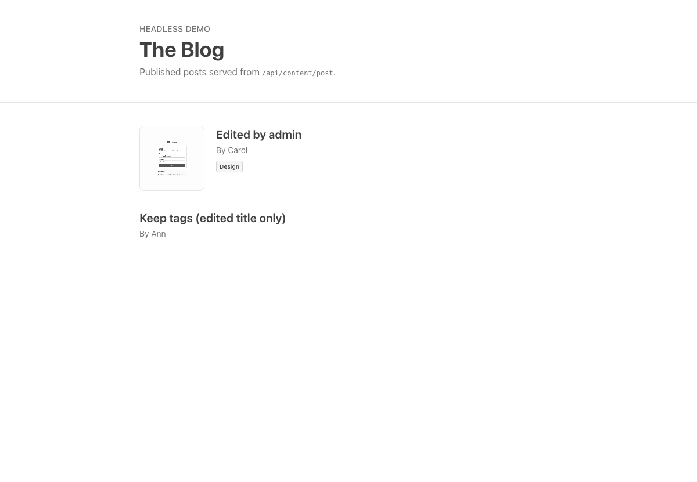
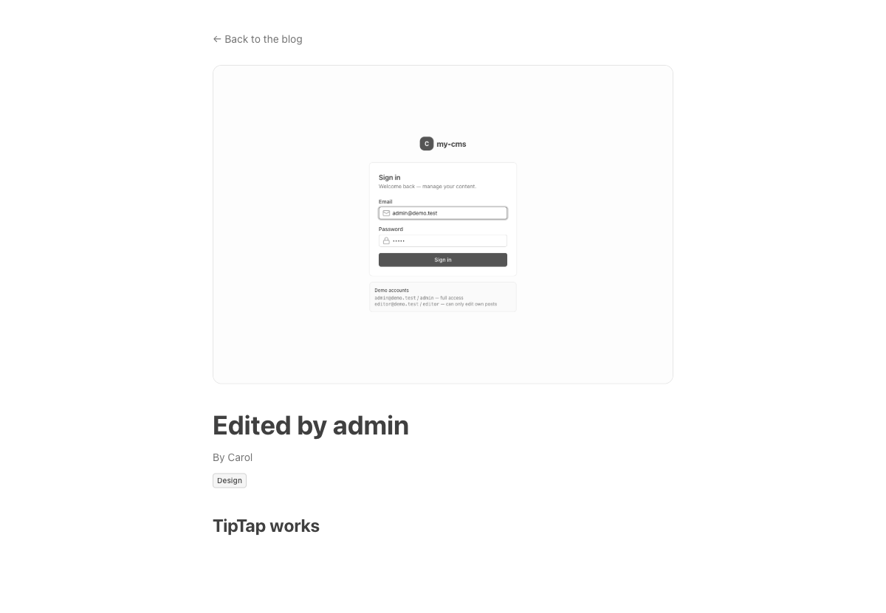
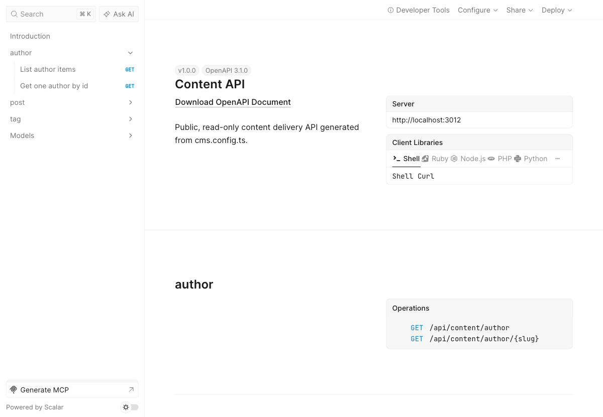

# The content API, the typed client and the frontend kit

What the website reads. The content API is public and read-only; the admin API (`/api/cms/**`) is a separate, signed-in one and is not described here.

## Headless content API

A separate, **public, read-only** delivery API for your frontends — distinct from the
auth-gated admin API. Entities opt in from `cms.config.ts`:

```ts
export const Post = defineEntity('post', {
  /* …fields… */
  content: {
    public: true,
    published: (t) => eq(t.status, 'published'), // only these are served
    slug: 'slug',                                //  → GET /api/content/post/:slug
    populate: ['hero', 'author', 'tags'],        // resolved into the response
  },
})
export const Author = defineEntity('author', {
  /* … */ content: { public: true, hidden: ['email'] }, // never expose email
})
```

```
GET /api/content/:entity         # published list — ?page= ?limit= ?sort= ?dir= ?q= ?<field>=
GET /api/content/:entity/:slug   # single published item by slug (or id); in a page tree by its whole address (o-nas%2Ftym)
GET /api/content/_tree/:entity   # a page tree's published pages, nested, for navigation
GET /api/content/_search?q=      # the website search — ?locale= ?limit= ?entity=page,news
```

**Search.** `/api/content/_search` searches every public collection with a `path`:
published entries only, in the requested language (entries translated into it), never
`hidden` fields. It reads what a visitor reads — titles, text, rich text and the text
inside blocks and lists, not addresses, choices or block types — ignores accents and
case, needs every word and **forgives typos**: one in a word of 4–7 letters, two from
8, swapped letters counting as one, the first letter kept ("bazne" and "baezn" find
"bazénu", "sousterdeni" finds "soustředění"); other endings of a word match too
("zima" finds "zimní"). Title matches rank first; each result has its address, a
snippet and the [start, end) ranges of the words found. Leave a collection out with
`content: { search: false }`, or narrow it with `search: { fields: ['title', 'body'] }`.
The admin has its own search (⌘K) over everything the signed-in person may read,
drafts, hidden fields and every language included.

How it works: Postgres only, with the **pg_trgm** extension (in every standard
Postgres image, CloudNativePG's included; the migration enables it, which the
database owner may do). The `cms_search` table holds each entry's text per language,
updated on every save and rebuilt on start whenever the search configuration changes
(or by hand: `cms:search-reindex` task). Trigram indexes find the candidates; the
server then checks each word by edit distance, ranks and cuts the snippet. Upgrading
an existing site: `pnpm db:generate` writes the migration for the table (starting with
`CREATE EXTENSION IF NOT EXISTS pg_trgm`), then `pnpm db:migrate`; the index fills
itself on the next start.

Links to other pages (`cms:…` references, see [Links that follow their page](content-model.md#links-that-follow-their-page)) are replaced
by the page's current address in the requested language — or `null` / an unlinked text when
it is gone or not published.

Responses resolve relations + media into nested objects, drop raw FK ids, and omit
`hidden` fields — on the item **and** on populated relations (a non-public relation target
collapses to `{ id, title }`). Drafts are never served (list excludes them; single → 404).
Responses are CDN-cacheable (`Cache-Control: public, max-age=0, must-revalidate, s-maxage=300`:
a CDN may keep them 5 minutes; browsers check back every time and get a quick `304` via
`ETag` while nothing changed, so a published change shows at once; [Caching](../deploying.md#caching)), or lock the whole API behind a token with
`cms.content.token` / `NUXT_CMS_CONTENT_TOKEN` (the website's own server-side requests are let
through, a browser's are not: [Content API token](../deploying.md#content-api-token)).
`?locale=` takes the closest language the site has: `en-US` and `EN` both give `en`; a
language the site does not have is a `400`.

Render stored rich text on the frontend with the shipped `<CmsContent :doc="post.body" />`
(safe — builds VNodes from the structured doc, no `v-html`). The playground's `/blog` and
`/blog/[slug]` pages are a complete consumer demo.




## Typed clients & OpenAPI

Two ways for a **separate** frontend (any framework, its own repo — no shared monorepo)
to consume the content API with full types. Both are generated from `cms.config.ts` via a
single IR (`content-shape.ts`) that mirrors the runtime projection exactly, so the types
**cannot drift** from what the API actually returns. Hidden fields (e.g. `author.email`)
never appear; nullability, enums and populated-relation shapes are all precise.

**OpenAPI 3.1 — any language.** A spec with a concrete path per public collection:

```
GET /api/openapi.json    # the document
GET /api/openapi         # interactive reference (Scalar) — development, or cms.content.docs: true
```
```bash
npx openapi-typescript https://cms.example.com/api/openapi.json -o cms.d.ts
```

**Typed TS SDK — `@tinyzoo/client`.** A ~2 kB, dependency-free, strictly-typed client.
Generate the bindings, install the runtime, go:

```bash
pnpm cms:client                                              # writes app/lib/cms-content.ts
# …or from anywhere with API access:
curl https://cms.example.com/api/content-types.ts -o src/cms-content.ts
npm i @tinyzoo/client
```
```ts
import { createClient } from './cms-content'
const cms = createClient({ baseUrl: 'https://cms.example.com', token: process.env.CMS_TOKEN })

const { items } = await cms.post.list({ filter: { status: 'published' }, sort: 'publishedAt', dir: 'desc' })
//      ^? Post[] — items[0].author.name, .hero?.url, .tags[0].slug are all typed
const post = await cms.post.get('hello-world') // Post, or throws CmsError on 404
const settings = await cms.global('siteSettings', { locale: 'en' }) // SiteSettings | null
```

Filters match text, choice and relation fields exactly, yes/no fields with `true`/`false`,
and date fields by range — `'publishedAt.from'` / `'publishedAt.to'` (an ISO date or time;
a bare date is a whole day in UTC, a time without an offset is UTC), e.g. upcoming events:
`cms.event.list({ filter: { 'startsAt.from': new Date() }, sort: 'startsAt', dir: 'asc' })`.

Per-collection sort keys, filters and enum values are type-checked; an invalid sort key or
filter value is a compile error. The spec's `servers` URL is `cms.content.publicUrl` when
that is set, otherwise `cms.publicUrl` (`NUXT_CMS_PUBLIC_URL`, the address the emails and the
sitemap use), and stays relative (`/`) when neither is: the request Host is never reflected. The
playground's `/blog/typed` page is a working consumer.

**`createClient` or `createCmsClient`?** They are the same client; one is typed for your site and
the other is not.

| | From | Typed | Use it |
|---|---|---|---|
| `createClient(options)` | your generated `cms-content.ts` (`tinyzoo client`, or `GET /api/content-types.ts`) | **Yes**: every collection, field, sort key, filter and global of *your* config | Always, in a site |
| `createCmsClient<Schema>(options)` | `@tinyzoo/client` | Only as far as the schema you hand it | Rarely: in tooling that has no generated file, or to build your own wrapper. `createClient` is `createCmsClient<ContentSchema, GlobalSchema>` and nothing else |

Both take the same `options` (`baseUrl`, `token`, `headers`, `fetch`) and return the same `CmsClient`. There is no
other name for either: the package keeps its `Cms` prefix, the generated file is the site's own.



## The sitemap

Collections with `content.path` (e.g. `'/blog/:slug'`) appear in **`/sitemap.xml`**
(published only, with `hreflang` alternates and `x-default` for the default language;
`defineLocales({ prefix })` controls `/en/…` prefixes) and in `GET /api/content/_sitemap`.

`/sitemap.xml` is served by [`@nuxtjs/sitemap`](https://nuxtseo.com/docs/sitemap), which
comes with tinyzoo (a site does not install it). tinyzoo hands it the entries; the module
adds what it does for any Nuxt site:

- the site's own static pages (`pages/kontakt.vue`) are listed too;
- a page that robots rules keep from search engines (a `robots: false` route rule, a
  `Disallow` of [`@nuxtjs/robots`](https://nuxtseo.com/docs/robots)) is left out, and so is the admin;
- a large sitemap can be split (`sitemap: { sitemaps: true, defaultSitemapsChunkSize: … }`), and
  opening it in a browser shows a readable table.

It is cached for an hour, on the server and in browsers; a content change clears the server's
copy at once, so a new page is listed straight away. Its addresses start with the site's
address: `NUXT_SITE_URL` (or `site.url` in `nuxt.config.ts`) when set, otherwise
`NUXT_CMS_PUBLIC_URL`; in production without either, `/sitemap.xml` is a `404` (never the
address a request names: a forged one would end up in a cached sitemap). Change the module's
options with `sitemap: { … }` in `nuxt.config.ts`, e.g. `sitemap: { exclude: ['/hledat'] }`;
`sitemap: { enabled: false }` turns `/sitemap.xml` off (`/api/content/_sitemap` stays). A site
whose content API is behind a token (`NUXT_CMS_CONTENT_TOKEN`) keeps its entries out of it.

**Pages that are not entries.** For addresses the website draws from data rather than from
its own `pages/` (`/aktuality` drawn by a catch-all page, a shop's sale page) there are two ways, both
feeding `/sitemap.xml` and `/api/content/_sitemap`:

```ts
// nuxt.config.ts — fixed pages: a full address (language prefix included), or one object per page with
// its address in each language, which makes them hreflang alternates of each other
cms: { sitemap: { paths: ['/kontakt', { cs: '/aktuality', en: '/en/news' }] } },
```

```ts
// server/plugins/sitemap.ts — addresses that come from data: the `cms:sitemap` Nitro hook gets the
// entries and may push more (it runs when the sitemap is built, at most once a minute per instance)
export default defineNitroPlugin((nitro) => {
  nitro.hooks.hook('cms:sitemap', async (entries) => {
    entries.push({ loc: '/shop/sale', locale: null, lastmod: null, alternates: [] })
  })
})
```

The option is for what never changes and is validated at build time; the hook is for what is
computed. An address in both, or already an entry's, is listed once. `lastmod` may be `null`
(the tag is then left out).

## The frontend kit

These components and composables are what a website draws its content with. They are **frozen
from 1.0** like the config API ([the public API](../api-surface.md#the-frontend-kit)): their props, slots,
events and return values change only in a major release. Other `Cms*` components belong to the admin and
can change in any minor.

| | |
|---|---|
| `<CmsBlocks :blocks="page.sections" />` | each block drawn by the site's `Block<Type>` component (`prefix="Section"` for `<SectionHero>`), which receives `block` and `index` |
| `<CmsImage :media="post.hero" />` | alt text, real size, lazy loading, the editor's focal point (`eager`, `sizes`, `alt`) |
| `<CmsContent :doc="post.body" />` | rich text, sanitised |
| `<CmsNav :links="nav.main" />` | a menu with dropdowns, as nested lists |
| `<CmsForm name="contactForm" />` | a website form (needs `formsPlugin()`); `locale`, event `sent`, slot `success` |
| `useCmsSeo(() => item, { siteName, defaultLocale })` | title, description, sharing image from the `seo()` fields, and the page's `canonical`, `hreflang` alternates (+ `x-default`), `og:url` and `og:locale` from the item's `paths` (absolute: they need `NUXT_CMS_PUBLIC_URL`; `path` option rewrites addresses such as the home page's `/home` → `/`). Returns `{ title, description, image, canonical }` |
| `useCmsSearch(() => route.query.q, { locale })` | the website search: results with address and snippet. Returns `{ items, total, searched, pending, error }` |
| `<CmsHighlight :text="r.excerpt" :ranges="r.highlights" />` | text with the searched words in `<mark>` |
| `useCmsUiLocale()` | Nuxt UI's own words in the admin's language on `/admin` pages: `<UApp :locale="uiLocale">` |

Every prop, slot, event and return value is listed in [the public API](../api-surface.md#the-frontend-kit), and the
prop types (`CmsImageProps`, `CmsBlocksProps`, `CmsBlockProps` for your own block components, …) are exported from `tinyzoo`.
